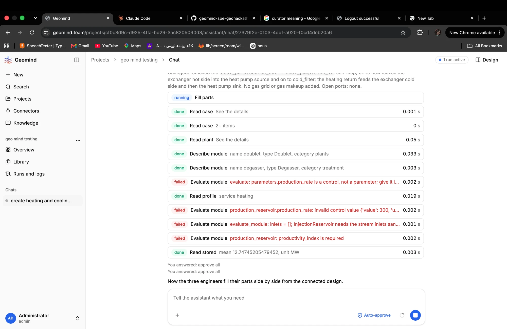

# Improvements

Things that work but should be faster, cheaper or make fewer mistakes. A bug (something wrong)
goes in [BUGS.md](BUGS.md); an idea to make the app better goes here. One section per idea,
`IMP-<nnn>`; take the next id and add your section at once. Statuses: idea, agreed, doing, done,
dropped. A change to the agents' behaviour, or to gemini, needs Sahand's OK before work starts.

## Where the time goes: run a61cfb19 (2026-11-04)

Chat "design heating and cooling based on files" (challenge PDF and two daily demand CSVs);
[run JSON](evidence/QA-007/run-a61cfb19bfb04ae99e92060fc5bd2e40.json.gz), downloaded while the run was
still active, 58 steps.

- About 26 minutes, and the design had not started: all of it went to setting the case.
- LLM calls: about 1,575 s. Tools: about 90 s, of which 73 s is the nested geoscientist (LLM
  again); gemini's own tool time is under 20 s. The LLM is about 99 % of the time.
- 2.47 M input tokens, 90 k output tokens, 0.06 USD. The case lead's calls carry 40 k to 78 k
  input tokens each.
- The slowest calls are the ones that write long JSON by hand: 209 s, 149 s, 122 s (cut at the
  output limit), 106 s, 87 s.
- Lost work: a 504 that stopped the case lead (about 10 min, QA-011), three empty answers
  (QA-012), one call cut at the output limit (QA-013), three asks of the same question (QA-009).

## Summary

| Id | Status | Area | Idea | Gain |
|---|---|---|---|---|
| IMP-001 | idea | geomind | ask_economics fills the catalogue's recommended rows itself; the agent sends only exceptions | 3-4 min per run, no output-limit cuts |
| IMP-002 | idea | geomind | ask_economics checks everything and lists every problem in one refusal | fewer retries (QA-007) |
| IMP-003 | idea | geomind | ask_user answers go into the problem state and every later agent's brief | no repeated questions (QA-009) |
| IMP-004 | idea | geomind, backend | Retry 5xx and timeouts with a back-off; stream the LLM calls | no lost nested runs (QA-011) |
| IMP-005 | idea | geomind | read_rag on a time-series CSV returns a summary, not all rows | smaller contexts, fewer empty answers |
| IMP-006 | idea | geomind | A defined path for "use reasonable assumptions": find sourced candidates and ask to approve | the design can go on (QA-010) |
| IMP-007 | idea | data, geomind | Catch what gemini refuses before the agent sends it | fewer refused calls |
| IMP-008 | idea | geomind | Keep the case lead's context small: drop file texts and old tool outputs once used | faster calls, lower cost |
| IMP-009 | idea | geomind | read_case returns an unset section as empty with a note, not an error | fewer red errors (QA-001, QA-014) |
| IMP-010 | idea | geomind | Ask only for the values gemini reports missing for the chosen plant | one question instead of six (QA-009, QA-010, QA-015) |
| IMP-011 | idea | geomind | The design lead gives each engineer a case summary in its brief | fewer repeated reads, smaller contexts |
| IMP-012 | done (geomind 0.4.81 (evaluate_module, set_case)) | geomind | Tools fix pure format slips in code and say so (names, {value}, setpoint, over/when, unit aliases) | about half of the first-try refusals |
| IMP-013 | done (geomind 0.4.81 (design/result/time; inlets [] taken as none)) | geomind | evaluate_module takes its inlets from the design, and its schema requires them | 77 % of 430 calls fail today |
| IMP-014 | done (geomind 0.4.82) | geomind | Each engineer is told and shown only its own paths | 170 patch_plant not_allowed |
| IMP-015 | done (geomind 0.4.82) | geomind | Stop repeating the same failing call: after two identical errors the agent must change the call or hand back | 89 identical evaluate_module errors in a row |
| IMP-016 | done (geomind 0.4.79 (prompt), 0.4.83 (loop stops after 3 rounds)) | geomind | A round budget per failing requirement: hand back to the project lead instead of hours of attempts | QA-090: 2h40, 17.7M tokens |
| IMP-017 | done (geomind 0.4.83 (part 1: optimise a passed design once)) | geomind | Make the design reach optimisation: optimize once all requirements pass; a targeted test of optimize and evolve_structure | 0 of 45 runs reached optimize; evolve_structure never called |
| IMP-018 | done (geomind 0.4.82) | geomind | Check build_plant and patch_plant before the approval, as set_case does | no approval of a refused write |
| IMP-019 | idea | geomind, gemini | A choice gemini allows only one value for (dispatch least_cost) is filled by the tool with a note | 14 refused simulates; Sahand decides |
| IMP-020 | idea | geomind | read_stored shows the outline of a result (keys two levels deep) when the path is wrong | 127 unknown_name |
| IMP-021 | idea | geomind | Examples in the skills generated from gemini's own schema; evals from the real refusals | prompts that do not drift from gemini |
| IMP-022 | idea | QA | Two measures after every deploy: first-try error rate per tool; runs that reach simulate, check and optimize | shows whether a fix helps |
| IMP-023 | rejected | geomind, frontend | Start from gemini's six hackathon plant files (125 values each) and a complete case; size then optimize; no hand-built plants | the only path that has reached a passing result |

## IMP-001: ask_economics fills the recommended rows itself

Now the case lead writes every economics key (about 55) with its row, its `others` and a long note.
These calls take 87 to 209 s and 6,000 to 13,000 output tokens; one hit the 16,000-token limit
(QA-013). The catalogue already marks the recommended row per key. Proposal: ask_economics takes
only the exceptions (a key with a different row, a key left open, a note per key), and the tool
fills the rest from the catalogue. The question the user sees stays the same.

## IMP-002: one refusal lists every problem

ask_economics refuses on the first problem it finds; the agent fixes it and the next call fails on
another one (QA-007). set_case already lists every problem in one answer ("fix every one in the
next call"). ask_economics should do the same, and drop a key that is not an economics key with a
note instead of refusing the whole question.

## IMP-003: user answers are kept for the whole run

An ask_user answer stays inside the nested run that asked. A new case lead run does not know it,
and the project lead asks for the same values again. Proposal: every answer is written to the
problem state (question, answer, time) and is part of every later brief; the project lead reads it
before it sends a task that asks the user.

## IMP-004: retry and stream LLM calls

One OpenRouter 504 ("Upstream idle timeout exceeded") stopped the nested case lead and lost about
10 minutes. Proposal: retry 5xx, 429 and timeouts with a back-off (for example 3 tries); stream the
LLM calls so a long generation does not hit an idle timeout.

## IMP-005: summaries for time-series files

read_rag returns the full text of each 365-row demand CSV, and the case lead reads the files again
in every run. set_case takes the file itself, so the agent needs only the shape: columns, number of
rows, time span and step, minimum, maximum, peak date, annual sum. That keeps the context smaller;
the empty answers (QA-012) came on contexts of 74 k to 78 k tokens.

## IMP-006: a path for a delegated answer

When the user says "use reasonable, documented engineering assumptions", the agent now sets
nothing (QA-010). Proposal, within the no-default-values rule: the agent searches RAG and the
connectors (for example a weather source for site air, a technology data sheet for network return
temperatures), puts the sourced candidates to the user as one question with approve all / change
some, and sets what is approved. If nothing has a source, the run ends with one clear message: the
values the user must type, with units, and that the design waits for them. Needs Sahand's decision.

## IMP-007: catch gemini's refusals earlier

Refusals seen in one run: a catalogue unit the key does not take (`kg CO2e/kg CH4` on a
dimensionless key, QA-004), an efficiency as 70 % instead of 0.7 (QA-002), a case key in the
economics (QA-007). Proposal: fix the catalogue rows so every unit is one the key accepts (a check
in the catalogue's tests); say in the case lead's prompt that an efficiency is a fraction 0-1 with
no unit and no `over`/`when`.

## IMP-008: a smaller context for the case lead

The case lead's input grows to 78 k tokens per call (the PDF, both CSVs, catalogue rows, earlier
tool outputs). Every call pays for it in time. Proposal: once a file's values are in the case,
replace its text in the context with a short line; keep only the last output of a repeated tool;
let the case lead read the catalogue by key, not by whole groups.

## IMP-009: unset sections are not errors

read_case on a project with no case, or on a section that is not set yet, returns a red error
(QA-001, QA-014). Three agents in this run start with that error. Proposal: return the empty
section with a note ("not set yet; set_case sets it"), and give the list of sections that exist.

## IMP-010: ask only what gemini says is missing

In run a61cfb19 the case lead asked for six values it called necessary (network return
temperatures, site air temperature, humidity and pressure, electricity import limit), three times.
Once the plant was built, gemini flagged only site.air.pressure. Proposal: before design, ask only
what the case check requires; after build_plant, read the plant's missing list and ask the user for
exactly those values, once, before any sizing (QA-015).

## IMP-011: a case summary in every engineer's brief

In fill_parts each engineer reads the case itself: read_case on site, demand, requirements,
utilities and economics, read_profile, read_plant, and up to 16 describe_module calls (energy
systems engineer, steps[94]). Each starts at 20 k to 50 k input tokens, and a restart (QA-016) reads
it all again. Proposal: the design lead (or fill_parts) puts a short case and plant summary in each
brief, and the engineers read only what their part needs.

## Measured on production, 2026-11-05 10:15 UTC (tool calls since 2026-11-04 18:00 UTC)

Read-only from `run_events` by Fatemeh's QA session. 45 runs; 6 reached a successful `simulate`; 0
called `optimize`; `evolve_structure` was never called by an agent (one `optimize` ever, 2026-11-02).

| Tool | Calls | Refused | Main refusals |
|---|---|---|---|
| calculate | 67 | 82 % | units gemini lacked (m/s2, kg/m2: QA-074) |
| evaluate_module | 430 | 77 % | `inlets = []` (about 140), `temperature_setpoint` as a parameter, not a control (52), module names `heat_pump` / `compression_chiller` (20), wrong inlet names |
| simulate | 175 | 67 % | missing plant values, `params.control.dispatch` missing (14: 'least_cost' is the only value) |
| patch_plant | 502 | 61 % | `not_allowed`: another engineer's path (170), internal error (18, QA-083), missing values |
| build_plant | 102 | 60 % | type with other modules, bare strings for choices (QA-018, QA-052) |
| set_case | 171 | 49 % | value forms, `over`/`when` where the quantity takes none, files without a time zone |
| read_stored | 1088 | 12 % | guessed paths (`steps.0`, `summary.summary`, a module id) (127) |

The same error came back in a row from the same agent: evaluate_module 89 times, read_plant 19,
patch_plant 19. By agent, the most refusals: design lead 454 of 3622 calls, energy systems engineer
375 of 1453, case lead 191 of 1686.

## IMP-012: tools fix pure format slips in code

A slip of form, not of value, is fixed by the tool itself, with a note in the answer saying what it
changed, so the agent learns it and the user can see it: a module name in another case or in snake
case (`heat_pump` -> `HeatPump`), a bare choice (`"none"` -> `{"value": "none"}`), a control given as
a parameter (`temperature_setpoint` moved to `controls`), `over`/`when` on a quantity that takes
none (dropped), a known unit spelling (`m/s^2`, `m/s²` -> `m/s2`). No value is invented, so the
no-default rule holds. The cheapest and largest gain.

Seen again 2026-11-05 ~10:25 UTC (chat 27379f2e, fill_parts), four evaluate_module refusals in a row:
`parameters.production_rate is a control, not a parameter`; then the control given as
`{'value': 300, 'unit': ...}` is "invalid control value" (controls take another form than parameters,
so the agent cannot carry the `{value, unit}` habit over); `inlets = []` on InjectionReservoir (IMP-013);
`productivity_index is required`. One form for parameters and controls (or the tool converting a
`{value, unit}` control) removes the second one. 

## IMP-013: evaluate_module gets its inlets from the design

Agents call evaluate_module with no inlets about 140 times; the tool cannot work without them. When
the call names a design (or a simulated result), the tool takes the module's inlets from it; the
input schema makes `inlets` required with at least one item and names the module's inlet names, so
a call without them is not even sent. If agents still cannot use it, take it from the agents that
do not need it (the energy systems engineer has the most refusals).

## IMP-014: each engineer sees only its own paths

170 patch_plant refusals are one engineer writing another's path. fill_parts (and every brief to an
engineer) lists the paths it owns from `design.owners`; read_plant called by an engineer shows its
own missing values first and marks the others as "owned by X, hand back". patch_plant's precheck
refuses another's path before any approval, with the owner's name.

## IMP-015: no identical failing call twice

The loop's guard stops a run after three identical calls; slightly different calls with the same
error go on (89 identical evaluate_module errors in a row). After the same error code on the same
path twice, the loop tells the agent: "this failed twice the same way: change the call (see the
message) or hand back with the message". Saves steps and tokens at once.

## IMP-016: a round budget per failing requirement

QA-090: 2h40, 17.7M input tokens, 18 plant variants on one failing rule (QA-091). After two design
rounds that end with the same requirement failing, the design lead hands back to the project lead
with that requirement, what it tried and gemini's messages; the project lead reports to the user
(or the team) instead of a third round.

## IMP-017: reach optimisation

The brief asks to "improve the design iteratively"; no run since yesterday reached `optimize`, and
gemini's genetic search (`evolve_structure`) has never run through the agents. Once a design passes
every requirement, the design lead runs `optimize` on it (objective from the brief, a small number
of evaluations first) and simulates the best; and a QA session runs one targeted test: a feasible
sized design, then `optimize`, then `evolve_structure` on a superstructure, before the deadline.

## IMP-018: precheck before approval for plant writes

set_case checks before it asks for approval (QA-037). build_plant and patch_plant ask first, then
gemini refuses (60 % and 61 %). Run gemini's check first; ask for approval only for a write that
passes.

## IMP-019: a choice with one allowed value

`params.control.dispatch` has one valid value ('least_cost'); simulate refused 14 times for its
absence. The tool fills a choice that gemini allows only one value for, with a note. It is no
physical value, but it touches the no-default rule: Sahand decides.

## IMP-020: read_stored shows the outline

127 refusals from guessed paths. On a wrong path, read_stored returns the result's outline (keys two
levels deep, list lengths) beside the message, so the next call is right.

## IMP-021: examples from gemini's schema, evals from real refusals

Hand-written prompt rules drift from gemini (today: the new unmet_share rule written with over/when,
QA-091). The skills carry one example per requirement quantity and per module call, generated from
gemini's schema at release time. Each refusal above becomes an offline eval case (no LLM tokens), so
a prompt or tool change is checked against them.

## IMP-022: two measures after every deploy

The table above, per deploy: first-try refusal rate per tool, and how many runs reach simulate,
check_results feasible, and optimize. A fix that does not move them did not help.

## IMP-023: the short path that works

Measured 2026-11-05 12:20 UTC. The only result in the system that passes every check is the
user-run study "Optimise LCTS" in project "SPE GeoHackathon 2026" (2026-11-02): 10 of 10 checks,
the full heat (111,668 MWh) and cold (23,743 MWh) demand met, lcts 40.34 EUR/MWh, CO2 12.9 kt. It
used gemini's `examples/hackathon_2026`: the plant file `plants/HeatingHeatPumpCoolingPlant.json`
with 125 design values already set and a doublets range 1 to 3, a complete case, then `size` and
`minimize` on lcts (20 evaluations, seed 0).

The agents take another path: an empty plant class (the app's template is an 86-character
skeleton), five engineers filling about 125 values by hand. Since 2026-11-04 18:00 UTC: 529
patch_plant, 40 fill_parts, 15 size_plant, 0 optimize; 45 runs, none feasible.

Proposal: (a) gemini's six hackathon plant files become real templates, in Start from template and
for the agents; (b) the design lead picks a template, sizes, simulates, checks and optimizes; the
engineers fill only what gemini reports missing; (c) the case starts complete: the sample's values
offered to the user in one approval question, with gemini's README as their source (Sahand decides
whether that counts as a source under the no-default rule).

Decision (user, 2026-11-05 14:20 UTC, via Coordinator-IV): (a) to (c) REJECTED. No gemini sample
plant as a template: the product is general. The failing design path is solved with
`handbook-plant-design.md` in the global Knowledge (read by section; chapter 10 sizing and
optimisation, chapter 11 designing in gemini), which the design lead's and engineers' prompts and
skills point to. A free plant must take a doublet range: gemini 0.6.15 accepts `size.doublets`
on a plant without a class on one doublet `d0` and the optimiser searches the count (QA-129).
Rule: `.claude/memory/feedback-design-from-handbook-not-templates.md`.

## IMP-024: "Run again" on a study

Status: done in frontend 1.1.104 (0f058b4, hotfix-front-III, deploy 14:30 UTC). From Coordinator-III (2026-11-05, engine check for functional-qa-study-I): a study
record (Study tab, and a study's result) has no action to run it again with the same kind, name
and settings, on the current plant version or a chosen one. To repeat project 46d15d6b's
"Optimise LCTS" (minimize lcts, prepare size, 20 evaluations, seed 0) the user must read its
settings and type them again, and a QA session could not check gemini on that project because its
current plant (v3) has no doublet. Proposal: "Run again" on each study row opens New study filled
with the study's kind, settings and plant version (editable), and the backend needs nothing new
(`POST /design/study` takes them). Frontend.
