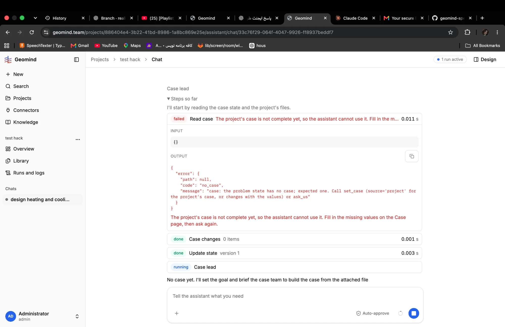

# QA-001: read_case on a project with no case shows a red failed with a wrong instruction

| Field | Value |
|---|---|
| Status | fixing |
| Severity | minor |
| Area | frontend, geomind |
| Reporter | Fatemeh (screenshots), Claude (write-up) |
| Found | 2026-11-04 ~19:00 UTC |
| Versions | frontend 1.1.33, backend 1.1.14 (geomind 0.4.25) |
| Where | https://geomind.team/projects/886404e4-3b22-41bd-8986-1a8bc869e25e/assistant/chat/33c76f29-064f-4047-9926-ff8937beddf7; project test hack; chat design heating and cooling; case lead step 1 |
| Fixer | hotfix-front |

## Steps

1. Make a new project, attach the challenge PDF and the two demand CSVs.
2. Ask in chat to design heating and cooling.
3. Open the case lead's first step.

## Expected

No case yet is a normal answer here: the case lead goes on and builds the case, so the step reads as information, not a failure, and asks the user for nothing.

## Actual

`read_case` with `{}` returns `no_case`; the chat shows `failed` in red and "The project's case is not complete yet, so the assistant cannot use it. Fill in the missing values on the Case page, then ask again."

## Evidence

- 
- Seen again in run [`run-a61cfb19bfb04ae99e92060fc5bd2e40.json.gz`](../evidence/QA-007/run-a61cfb19bfb04ae99e92060fc5bd2e40.json.gz) (`steps[i]`: 0-based index in `steps`): the first call of three agents is read_case and each gets `no_case`
  (steps[1] project lead, steps[3] case lead, steps[6] geoscientist).

## Cause

Guess: frontend `src/shared/sse/pretty.ts:133` maps every `no_case` to that text. The case lead prompt (geomind `prompts/case/lead.md`, step 1) always calls `read_case`, even when the problem state shows no case.

## Fix

## Retest
