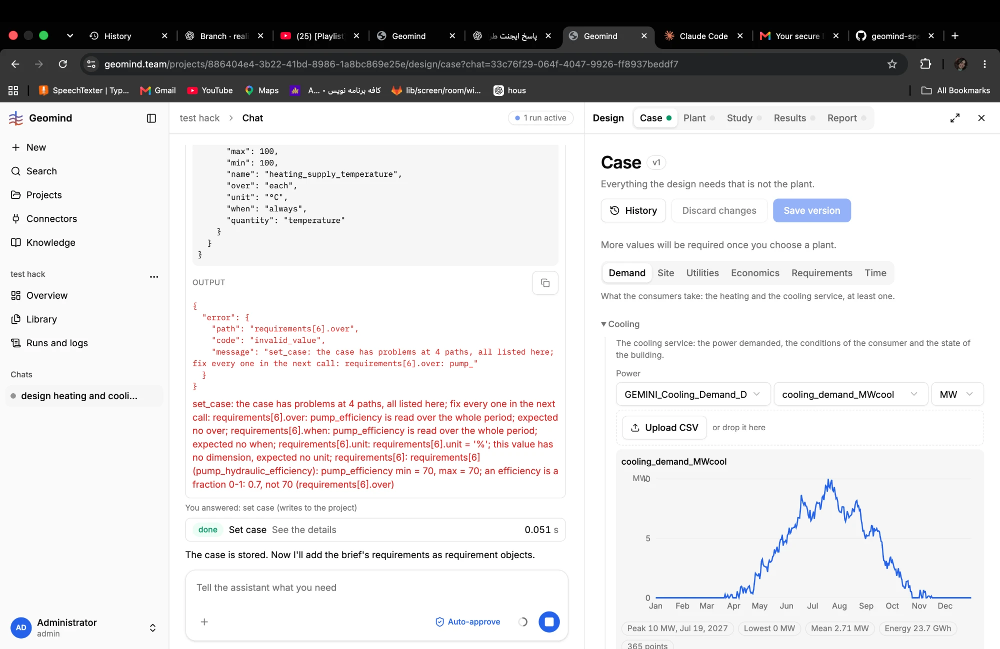

# QA-002: Case lead writes the pump efficiency requirement wrong; set_case refuses it

| Field | Value |
|---|---|
| Status | fixed |
| Severity | minor |
| Area | geomind |
| Reporter | Fatemeh (screenshots), Claude (write-up) |
| Found | 2026-11-04 ~19:00 UTC |
| Versions | frontend 1.1.33, backend 1.1.14 (geomind 0.4.25) |
| Where | https://geomind.team/projects/886404e4-3b22-41bd-8986-1a8bc869e25e/assistant/chat/33c76f29-064f-4047-9926-ff8937beddf7; case lead, adding the brief's requirements |
| Fixer | hotfix-python |

## Steps

1. Same run as QA-001.
2. The case lead adds the brief's requirements with set_case.

## Expected

`pump_hydraulic_efficiency` as a fraction 0.7, no unit, no `over` / `when`.

## Actual

Sent as min = max = 70, unit `%`, with `over` and `when`; set_case refuses 4 paths. The message is clear, so the model can fix it in the next call: a bug if it repeats or costs many steps.

## Evidence

- 
- Seen again in run [`run-a61cfb19bfb04ae99e92060fc5bd2e40.json.gz`](../evidence/QA-007/run-a61cfb19bfb04ae99e92060fc5bd2e40.json.gz) (`steps[i]`: 0-based index in `steps`), steps[13]: set_case refused requirements[6] (pump_hydraulic_efficiency)
  at 4 paths: `over` and `when` given, unit '%', value 70 not 0.7. The case lead fixed it in the
  next call (steps[14]).

## Cause

Guess: nothing tells the case lead that efficiencies are fractions; the brief says 70 %. Possible fix: say so in the prompt or in describe_case, or let set_case convert a `%` value of a dimensionless quantity.

## Fix

- 2026-11-04 20:31 UTC: fixed in geomind 0.4.33 (commit 02a8364), backend 1.1.28 (5789747), waiting for deploy
- 2026-11-04 21:05 UTC: shipped in backend 1.1.40 with geomind 0.4.42 (deployed 21:02 UTC); the fix is in the prod worker (checked: code/prompt present, QA-023 gives 'Design a plant' for a ready case). Live retest by the bug's steps still to do.
## Retest
