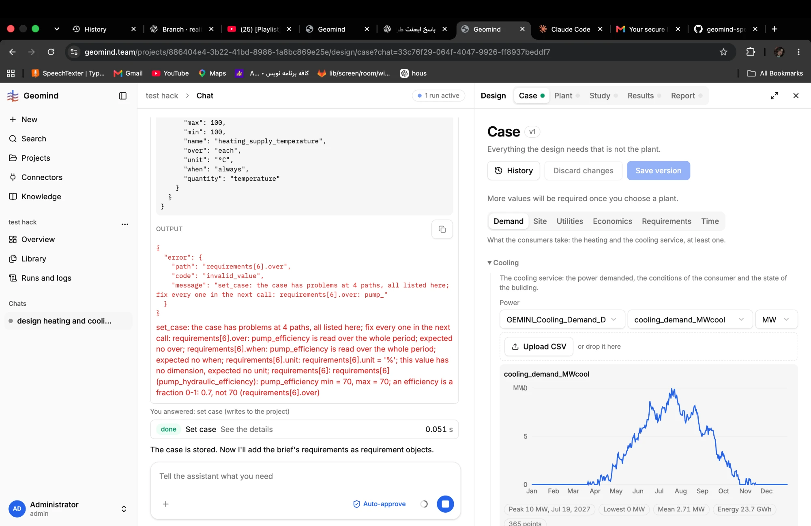

# QA-003: Case page chart: the y-axis unit overlaps the top tick (reads MW0)

| Field | Value |
|---|---|
| Status | verified |
| Severity | cosmetic |
| Area | frontend |
| Reporter | Fatemeh (screenshots), Claude (write-up) |
| Found | 2026-11-04 ~19:00 UTC |
| Versions | frontend 1.1.33, backend 1.1.14 (geomind 0.4.25) |
| Where | https://geomind.team/projects/886404e4-3b22-41bd-8986-1a8bc869e25e/design/case; Demand > Cooling chart |
| Fixer | hotfix-front |

## Steps

1. Open Design > Case > Demand > Cooling with a demand series.

## Expected

The unit `MW` and the top tick `10` are both readable.

## Actual

`MW` is drawn on top of `10`, so it reads `MW0`.

## Evidence

- 

## Cause

Not looked at yet.

## Fix

- 2026-11-04 20:03 UTC: fixed in frontend 1.1.37 (132bd2a), waiting for deploy
- 2026-11-04 21:05 UTC: frontend 1.1.37, commit 132bd2a, deployed (1.1.46, bundle index-DAOiLoAA.js, 20:30 UTC)
## Retest

- 2026-11-04 21:11 UTC: geomind.team 1.1.50, Playwright 21:15 UTC: Case page chart: MW sits above the 10 tick, no overlap
