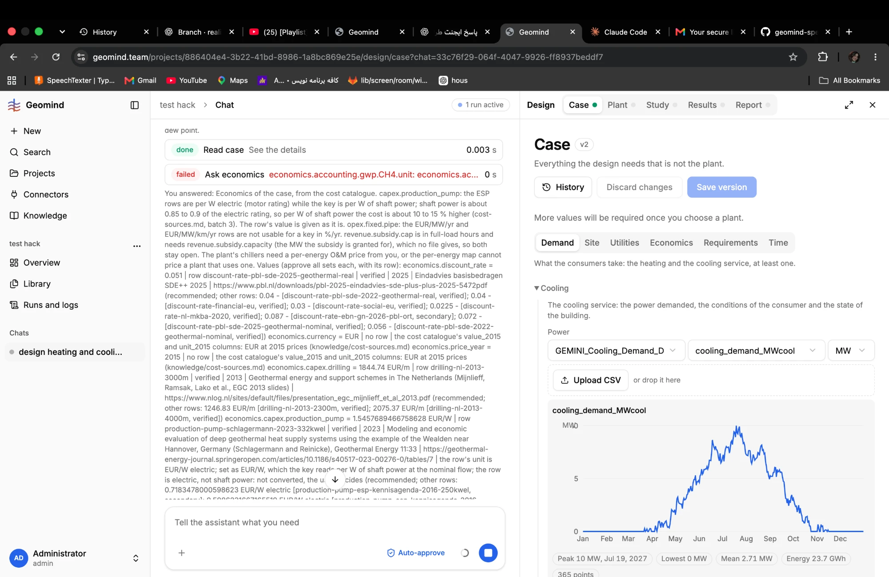
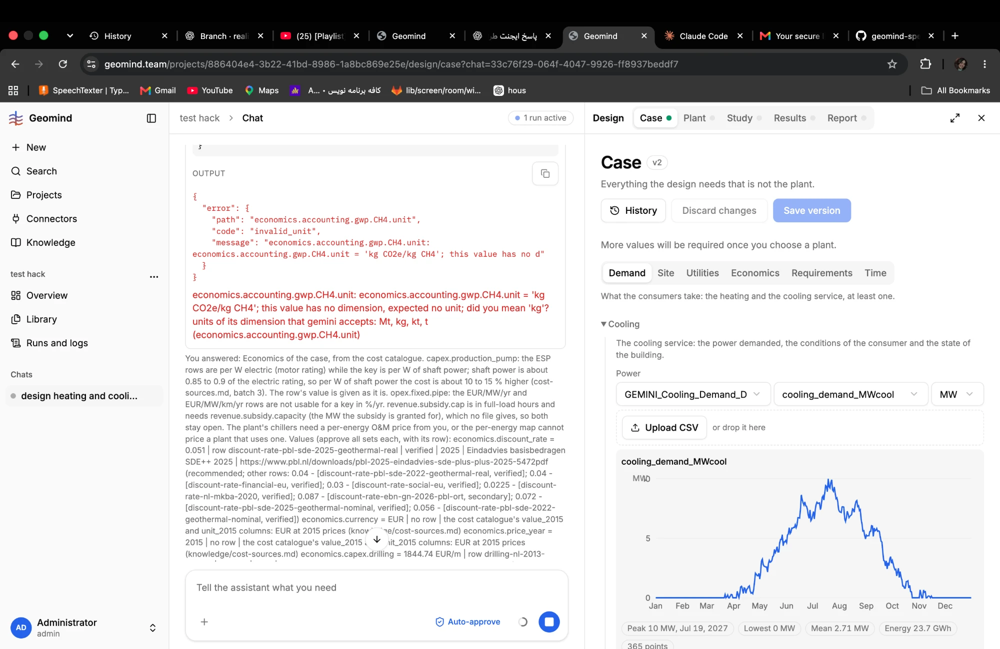

# QA-004: ask_economics: a unit the key refuses is found only after the user's approve all

| Field | Value |
|---|---|
| Status | fixing |
| Severity | major |
| Area | geomind, data |
| Reporter | Fatemeh (screenshots), Claude (write-up) |
| Found | 2026-11-04 ~19:00 UTC |
| Versions | frontend 1.1.33, backend 1.1.14 (geomind 0.4.25) |
| Where | https://geomind.team/projects/886404e4-3b22-41bd-8986-1a8bc869e25e/assistant/chat/33c76f29-064f-4047-9926-ff8937beddf7; economics question, case v2 |
| Fixer | hotfix-python |

## Steps

1. Same run; the case lead asks the economics question.
2. Answer approve all.

## Expected

Every unit is checked before the user is asked; approve all sets the economics.

## Actual

Ask economics `failed` after the answer: `economics.accounting.gwp.CH4.unit = 'kg CO2e/kg CH4'; this value has no dimension, expected no unit; did you mean 'kg'?` (invalid_unit). Nothing of the economics is set; the approval is lost. The question itself was built from row ids (0.4.25 works).

## Evidence

- 
- 
- Seen again in run [`run-a61cfb19bfb04ae99e92060fc5bd2e40.json.gz`](../evidence/QA-007/run-a61cfb19bfb04ae99e92060fc5bd2e40.json.gz) (`steps[i]`: 0-based index in `steps`), steps[21]: ask_economics refused `economics.accounting.gwp.CH4.unit =
  'kg CO2e/kg CH4'` ("this value has no dimension, expected no unit"). The unit comes from the
  catalogue row, so the data also needs fixing.

## Cause

Guess: since geomind 0.4.25 the tool takes the unit from the catalogue row, so the model cannot drop it; the tool should drop the unit of a dimensionless key (or the catalogue row be fixed), and the check before asking (`fitted_units`) misses what gemini refuses. gemini's hint "did you mean 'kg'" is wrong for a GWP factor.

## Fix

- 2026-11-04 20:04 UTC: geomind 0.4.28 (tag v0.4.28, commit 64ac883) and backend 1.1.18 (main 44b7ee5, wheel in backend/.tmp/hotfix-wheels) pushed; NOT deployed: hotfix-python's run of scripts/hotfix_deploy.sh was denied by its permission check. Needs a person (or a session allowed to deploy) to run backend/scripts/hotfix_deploy.sh.
- 2026-11-04 20:05 UTC: fixed in geomind 0.4.28 (commit 64ac883), backend 1.1.18 (44b7ee5), waiting for deploy
## Retest
