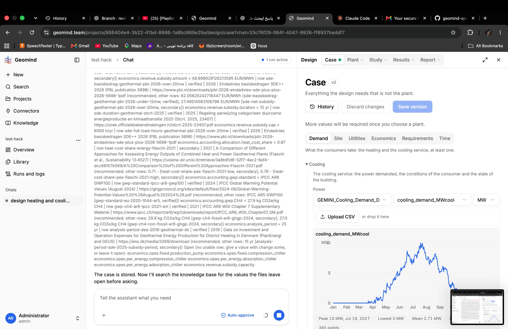
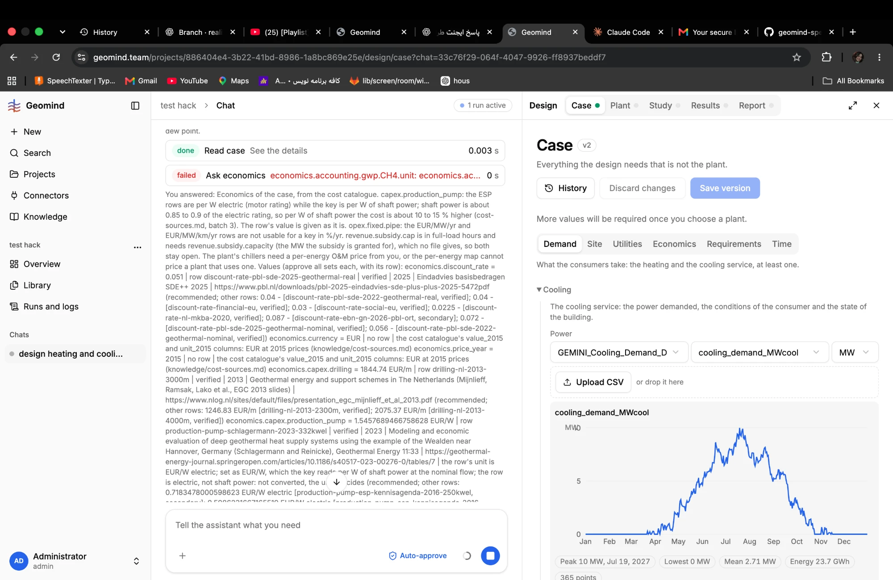

# QA-005: Chat: the economics question is one unreadable wall of text, labelled "You answered"

| Field | Value |
|---|---|
| Status | fixing |
| Severity | minor |
| Area | frontend |
| Reporter | Fatemeh (screenshots), Claude (write-up) |
| Found | 2026-11-04 ~19:00 UTC |
| Versions | frontend 1.1.33, backend 1.1.14 (geomind 0.4.25) |
| Where | https://geomind.team/projects/886404e4-3b22-41bd-8986-1a8bc869e25e/assistant/chat/33c76f29-064f-4047-9926-ff8937beddf7; economics question |
| Fixer | hotfix-front |

## Steps

1. Same run; look at the economics question in the chat.

## Expected

The question is shown as the agent's question, one value per line, numbers rounded.

## Actual

The whole question (every key, row, source, URL, other rows) is one paragraph with the line breaks lost, under "You answered: Economics of the case, ...". Values show unrounded: 48.699029126213595 EUR/MWh, 1.5457689466758628 EUR/W, 62.05825242718447 EUR/MWh.

## Evidence

- 
- 

## Cause

Not looked at yet.

## Fix

## Retest
