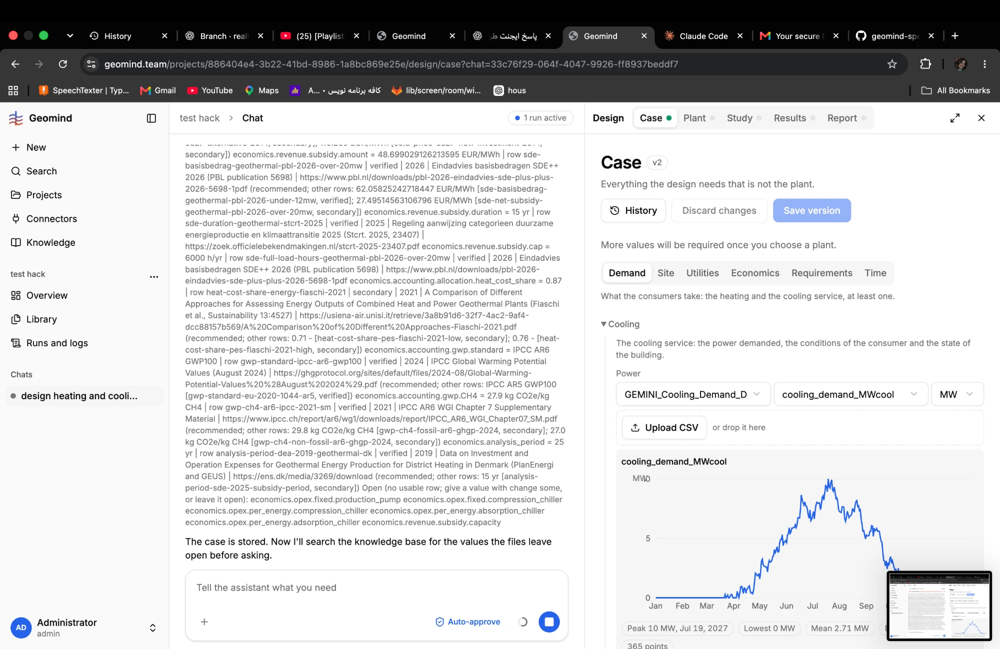

# QA-006: Many economics keys stay open: no catalogue row

| Field | Value |
|---|---|
| Status | verified |
| Severity | minor |
| Area | data |
| Reporter | Fatemeh (screenshots), Claude (write-up) |
| Found | 2026-11-04 ~19:00 UTC |
| Versions | frontend 1.1.33, backend 1.1.14 (geomind 0.4.25) |
| Where | https://geomind.team/projects/886404e4-3b22-41bd-8986-1a8bc869e25e/assistant/chat/33c76f29-064f-4047-9926-ff8937beddf7; the question's Open list |
| Fixer | hotfix-back |

## Steps

1. Same run; read the Open list of the economics question.

## Expected

Every key the design needs has a cited row, or the user is asked once for it.

## Actual

Open: opex.fixed.production_pump, opex.fixed.compression_chiller, opex.per_energy.compression_chiller / absorption_chiller / adsorption_chiller, revenue.subsidy.capacity. The design cannot price chillers without them.

## Evidence

- 

## Cause

A catalogue gap (partly a known issue of geomind 0.4.24), not a code bug.

## Fix

- 2026-11-04 20:08 UTC: hotfix-back: no code bug. Closing it needs new cost-catalogue rows (knowledge cost-sources.csv) for opex.fixed.production_pump, opex.fixed.compression_chiller, opex.per_energy.{compression,absorption,adsorption}_chiller, revenue.subsidy.capacity, each with a cited source a person approves (no-defaults rule), then a Knowledge re-seed. Today the question's Open list already asks the user once for them (the bug's own fallback). Needs Sahand/Fatemeh: who researches the sources, and whether a data round is wanted now.
- 2026-11-04 21:37 UTC: Sahand 2026-11-04 21:40 UTC chose option A: find cited sources (publisher, year, currency year, URL) for the missing rows, propose them as new cost-sources.csv rows in a file for Sahand to approve; only after his OK are they added and Knowledge re-seeded. Until then the economics question asks the user once.
- 2026-11-04 21:40 UTC: proposed rows ready for Sahand's approval: evidence/QA-006/proposed-rows.md (.csv). Not in the catalogue or Knowledge.
- 2026-11-04 23:23 UTC: geomind 0.4.52 (d1e4d7b, tag v0.4.52): catalogue holds only sourced rows (19 placeholders and the 3 unconvertible QA-045 rows removed, 4 QA-006 rows added; 153 rows). Knowledge NOT re-seeded yet (refused to this session); a person runs: cd ~/geomind-spe-hackathon-2026/geomind/data/knowledge && sg docker -c 'docker cp cost-sources.csv geomind-fastapi:/tmp/ && docker cp cost-sources.md geomind-fastapi:/tmp/' && for f in cost-sources.csv cost-sources.md; do sg docker -c "docker exec -w /app/backend geomind-fastapi sh -c 'python -m scripts.knowledge add /tmp/$f --by \"\$FIRST_ADMIN_EMAIL\"'"; done
- 2026-11-04 23:26 UTC: Knowledge re-seeded by Sahand with geomind 0.4.52's cost-sources.csv and .md (153 sourced rows incl. the 4 QA-006 rows). Not covered (no citable source): opex.per_energy of the chillers, opex.fixed.adsorption_chiller; revenue.subsidy.capacity is a project value.
## Retest

- 2026-11-04 23:26 UTC: hotfix-back: production Knowledge holds cost-sources.csv (109929 bytes) and cost-sources.md (10825 bytes), both searchable=ready, created 23:25 UTC; sizes equal geomind 0.4.52's files.
