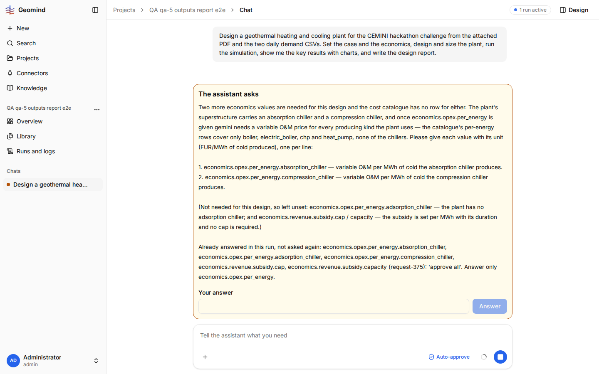

# QA-009: The same ask_user question is asked three times in one run

| Field | Value |
|---|---|
| Status | fixing |
| Severity | major |
| Area | geomind |
| Reporter | Fatemeh (run), Claude (write-up) |
| Found | 2026-11-04 ~20:40 UTC (run started 18:51 UTC, still running) |
| Versions | frontend 1.1.33; backend as at 18:51 UTC (1.1.14, geomind 0.4.25, per QA-007) |
| Where | https://geomind.team/projects/886404e4-3b22-41bd-8986-1a8bc869e25e/assistant/chat/33c76f29-064f-4047-9926-ff8937beddf7; run a61cfb19bfb04ae99e92060fc5bd2e40; steps[19], steps[35], steps[48] |
| Fixer | hotfix-python |

## Steps

1. Chat: "design heating and cooling based on files", with the challenge PDF and the two daily demand CSVs.
2. The case lead asks the user for the values the files leave open.
3. The user answers. The case lead's nested run ends; the project lead starts a new case lead.

## Expected

An answer the user gave is kept in the problem state and reaches every later agent. Nobody asks the
same question again; the project lead acts on the answer it already has.

## Actual

The user is asked three times for the same values (network return temperatures, site air
temperature, humidity and pressure, electricity import limit):
- steps[19], case lead run 1: answer "Use reasonable, documented engineering assumptions for all unspecified values".
- steps[35], case lead run 2: the same question, the same answer.
- steps[48], case lead run 3 (task from the project lead at steps[44]: "close the case values ... by asking the user yourself"): the same question, the same answer.
Each new case lead run starts without the earlier answer, and the project lead sends the same ask again.

## Evidence

- Run JSON: [`../evidence/QA-007/run-a61cfb19bfb04ae99e92060fc5bd2e40.json.gz`](../evidence/QA-007/run-a61cfb19bfb04ae99e92060fc5bd2e40.json.gz)
  (gzip; one run for QA-007 and QA-009 to QA-014). `steps[i]` below is the 0-based index in its
  `steps` list.
- The three ask_user tool calls and their `output`.

## Cause

Guess: ask_user answers live only in the nested run's messages, not in the problem state
(`/assumptions` gets one only at steps[50], after the third ask). The project lead's task text does
not carry the answer either.

- Seen again after the fix (2026-11-04 21:31 UTC, backend 1.1.40), chat 33c76f29, run f78c671a: the
  case lead asks again "The design team is blocked on six case values that neither the project
  files nor the knowledge base give. Please give each one" (run waiting on this question), although
  the problem state records the user's answer (A2) and the design lead said so ("The state shows
  the user already answered A2").

## Seen again (qa-5, 2026-11-04 21:46 UTC, backend 1.1.45)

Project "QA qa-5 outputs report e2e", chat f0388b3b, run 6c5b17e1. The economics question (approved with
"approve all" at 20:41) listed economics.opex.per_energy.absorption_chiller / compression_chiller as
having no row. After the design lead's check, the case lead asks for the same two keys again, and the
same question says: "Already answered in this run, not asked again: economics.opex.per_energy.absorption_chiller, ...
(request-375): 'approve all'. Answer only economics.opex.per_energy." The text contradicts itself: it
says the keys are not asked again while it asks them. Asking once more is right here (the first answer
gave no value), but the "already answered" line is wrong and confusing.

## Fix

- 2026-11-04 20:08 UTC: fixed in geomind 0.4.29 (commit 0622c67), backend 1.1.20 (80eb493), waiting for deploy
- 2026-11-04 20:21 UTC: shipped in backend 1.1.21/1.1.22 with geomind 0.4.29; prod worker has ask_user.on_answer (user_answered). Live retest by the bug's steps still to do.
- 2026-11-04 21:32 UTC: seen again on 1.1.40: run f78c671a asks the six values a fourth time
## Retest
