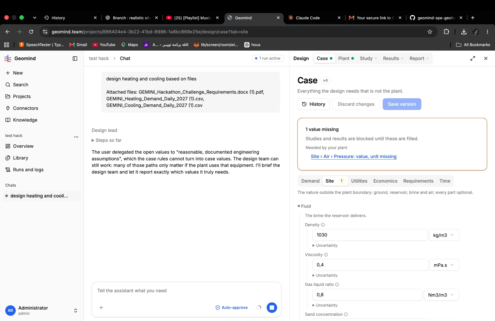
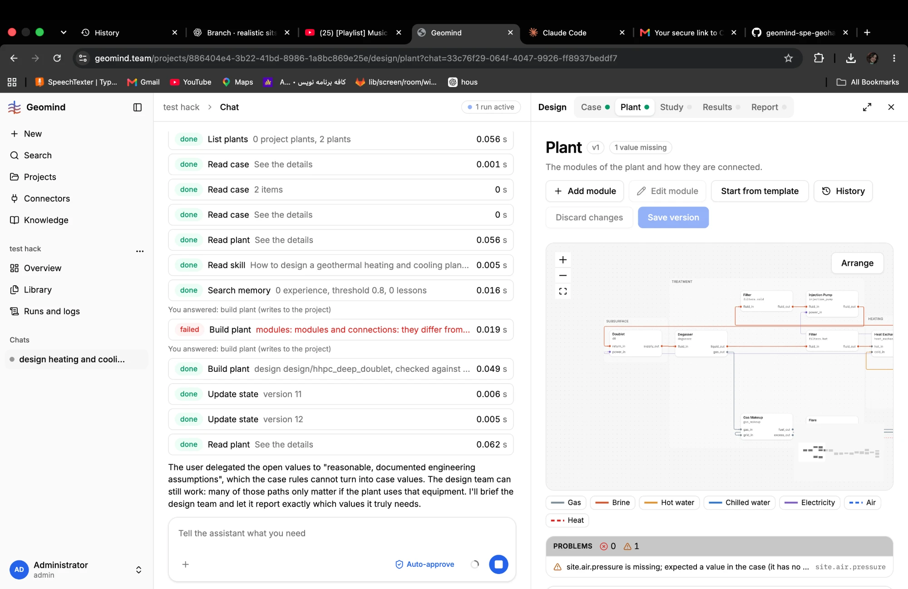

# QA-015: Design goes on while gemini reports a case value the plant needs as missing

| Field | Value |
|---|---|
| Status | fixing |
| Severity | major |
| Area | geomind |
| Reporter | Fatemeh (run), Claude (write-up) |
| Found | 2026-11-04 20:03 UTC |
| Versions | frontend 1.1.33; the run spans backend 1.1.14 to 1.1.16 (geomind 0.4.25/0.4.26), agents on deepseek-v4.1-flash |
| Where | https://geomind.team/projects/886404e4-3b22-41bd-8986-1a8bc869e25e/assistant/chat/33c76f29-064f-4047-9926-ff8937beddf7; project test hack; chat 33c76f29-064f-4047-9926-ff8937beddf7; run a61cfb19bfb04ae99e92060fc5bd2e40; steps[58] to steps[100] |
| Fixer | hotfix-python |

## Steps

1. Run QA-009's chat. The case lacks site.air.pressure (the user gave no value, QA-010).
2. The project lead sends the design team on (steps[58]: "The design team can still work ... let it report exactly which values it truly needs").
3. The plant is built (design/hhpc_deep_doublet, HeatingHeatPumpCoolingPlant).

## Expected

As soon as gemini's check of the built plant names a missing case value, the run asks the user for
that one value (here site.air.pressure, or the site's elevation), once, before more design work.

## Actual

The Case page shows "1 value missing: Site > Air > Pressure: value, unit missing; studies and
results are blocked until these are filled", and the Plant page's Problems list the same as a warning
(0 errors, 1 warning). The design team goes on regardless: connections, then fill_parts with three
engineers (about 15 more minutes of LLM calls) toward a sizing that gemini will refuse.

## Evidence

- 
- 
- [`run-...-step101.json.gz`](../evidence/QA-016/run-a61cfb19bfb04ae99e92060fc5bd2e40-step101.json.gz) (run JSON at 101 steps; `steps[i]` is the 0-based index)

## Cause

Guess: the agents do not read the plant's missing list after build_plant, and the project lead's
brief asks the team to "report" needed values instead of asking for them. Note: of the six values the
case lead had called necessary, gemini flags only this one for this plant (see IMPROVEMENTS.md, IMP-010).

## Fix

## Retest
