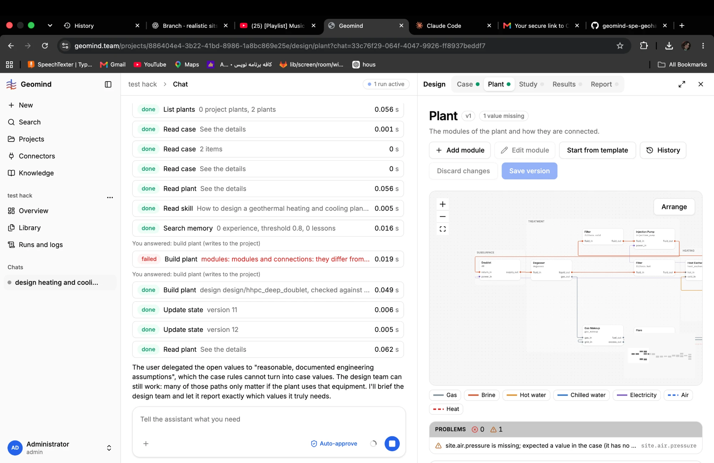

# QA-018: Process engineer's first build_plant sends a type with modules that differ from it; refused

| Field | Value |
|---|---|
| Status | fixing |
| Severity | minor |
| Area | geomind |
| Reporter | Fatemeh (run), Claude (write-up) |
| Found | 2026-11-04 20:04 UTC |
| Versions | frontend 1.1.33; the run spans backend 1.1.14 to 1.1.16 (geomind 0.4.25/0.4.26), agents on deepseek-v4.1-flash |
| Where | https://geomind.team/projects/886404e4-3b22-41bd-8986-1a8bc869e25e/assistant/chat/33c76f29-064f-4047-9926-ff8937beddf7; project test hack; chat 33c76f29-064f-4047-9926-ff8937beddf7; run a61cfb19bfb04ae99e92060fc5bd2e40; steps[70], steps[71] |
| Fixer | hotfix-python |

## Steps

1. Run QA-009's chat. The process engineer builds the plant from the class HeatingHeatPumpCoolingPlant.

## Expected

The first build_plant call is accepted.

## Actual

steps[70]: build_plant with `type: HeatingHeatPumpCoolingPlant` and a hand-written `modules`
list is refused: "modules and connections: they differ from those of HeatingHeatPumpCoolingPlant;
give the type or the structure, or make them agree" (74.6 s, 3,580 output tokens). steps[71]: the same
call with the type only is accepted. The chat shows the first one as a red "failed".

## Evidence

- 
- [`run-...-step101.json.gz`](../evidence/QA-016/run-a61cfb19bfb04ae99e92060fc5bd2e40-step101.json.gz) (run JSON at 101 steps; `steps[i]` is the 0-based index)

## Cause

Guess: the prompt or the skill does not say that a plant class brings its own modules and
connections, so the agent writes them out. The tool could also accept a structure equal to the
class's own.

## Fix

## Retest
