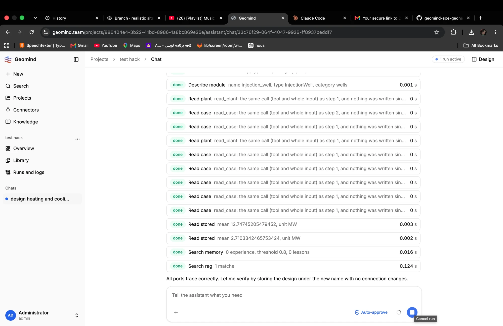

# QA-020: Engineers repeat the same read_case and read_plant calls many times in a row

| Field | Value |
|---|---|
| Status | open |
| Severity | minor |
| Area | geomind |
| Reporter | Fatemeh (screenshot), Claude (write-up) |
| Found | 2026-11-04 20:10 UTC |
| Versions | frontend 1.1.33; the run spans backend 1.1.14 to 1.1.16 (geomind 0.4.25/0.4.26), agents on deepseek-v4.1-flash |
| Where | https://geomind.team/projects/886404e4-3b22-41bd-8986-1a8bc869e25e/assistant/chat/33c76f29-064f-4047-9926-ff8937beddf7; run a61cfb19bfb04ae99e92060fc5bd2e40; fill_parts round 2 (steps[89] on) |
| Fixer | |

## Steps

1. Run QA-009's chat to the design phase. The design lead calls fill_parts (reservoir, well and energy systems engineers).

## Expected

An agent reads each case section and the plant once, and reads again only after something was written.

## Actual

The chat shows a long column of `Read case` and `Read plant` rows, each answered "read_case: the same
call (tool and whole input) as step 1, and nothing was written since ...". In the run JSON the
energy systems engineer reads site, demand, requirements, utilities and economics in its step 1 and
again in its step 3, plus read_plant twice; the reservoir engineer reads site, requirements and the
plant again in its step 4. Each repeat costs a round of a 20 k to 50 k token context.

## Evidence

- 
- Run JSON: [`../evidence/QA-016/run-a61cfb19bfb04ae99e92060fc5bd2e40-step101.json.gz`](../evidence/QA-016/run-a61cfb19bfb04ae99e92060fc5bd2e40-step101.json.gz), steps[91], [97], [98].

## Cause

Guess: the agents do not trust or keep what they read (long contexts); the loop answers a repeat
with a note but still spends the step. See IMPROVEMENTS.md, IMP-011 (a case summary in each brief).

## Fix

## Retest
