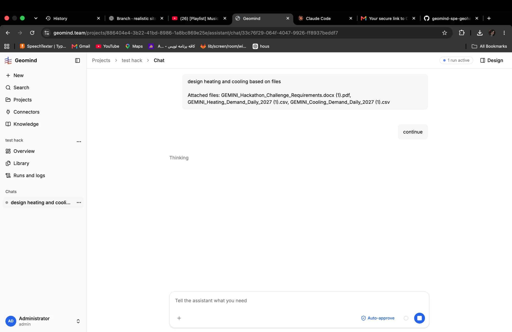

# QA-021: Every LLM call gets 429 Too Many Requests on the free nemotron model; the chat shows Thinking with no message

| Field | Value |
|---|---|
| Status | fixed |
| Severity | blocker |
| Area | backend,infra |
| Reporter | Fatemeh (screenshot), Claude (write-up) |
| Found | 2026-11-04 20:11 UTC |
| Versions | frontend 1.1.33, backend 1.1.17 (geomind 0.4.27 local wheel); agents on `nvidia/nemotron-3.5-super-vl:free` via OpenRouter (STATUS.md) |
| Where | https://geomind.team/projects/886404e4-3b22-41bd-8986-1a8bc869e25e/assistant/chat/33c76f29-064f-4047-9926-ff8937beddf7; run f3ed1acd-3d21-4087-b0f6-73576f6a5dc7 (first call) |
| Fixer | hotfix-back |

## Steps

1. In the chat of QA-009 (after its run was cancelled), send "continue" (2026-11-04 20:09:00 UTC).

## Expected

The coordinator answers within seconds. If the provider refuses (rate limit), the chat says so
("the model provider is busy / the daily limit is reached; try again at ...") and the run ends or waits visibly.

## Actual

- The chat shows "Thinking" and "1 run active", nothing else, for minutes.
- The worker log: from the very first call every POST to openrouter.ai/api/v1/chat/completions
  returns `HTTP/1.1 429 Too Many Requests`; the client retries with back-off (2, 4, 8, 16, 32 s) and
  starts again: 11 refusals from 20:09:00 to 20:10:35 UTC and still going.
- The run row: status running, loop tool, 0 input tokens.

## Evidence

- 
- Worker log lines: [`../evidence/QA-021/celery-429.log`](../evidence/QA-021/celery-429.log)

## Cause

Fact: the agents moved to the free tier `nvidia/nemotron-3.5-super-vl:free` at 19:56 UTC (STATUS.md:
about 20 requests a minute and 1000 a day). Guess: the free model's limit is spent (the QA round's
parallel tests share the one key), or the free model is congested upstream; the 429 body is not
logged, so which one is not known. Second issue: the user gets no message about the 429.

## Fix

hotfix-back (2026-11-04): the 429s came from the free nemotron tier; production left it at 20:16
UTC (backend 1.1.22, deepseek-v4.1-flash on morph/fp8), so the refusals themselves are gone. Still
true on any model: geomind's `retry` event is internal, so the chat shows only Thinking while the
provider refuses. Backend 1.1.23 (7dd34f6) streams it as a live `retry` event
`{attempt, model, delay, status}` (contract: live event table). The frontend still has to show it
("the model provider is busy (429); trying again in 8 s") - for hotfix-front once deployed.
- 2026-11-04 20:22 UTC: backend 1.1.23 (7dd34f6) pushed, NOT deployed yet: 2 runs running at 20:2x UTC; batched into the next deploy (at most 15 min).
- 2026-11-04 20:24 UTC: backend 1.1.23 (7dd34f6), deployed in 1.1.24 at 20:24 UTC: live retry event streamed. The 429s themselves are gone with the move off the free nemotron tier (1.1.22). Frontend must still show the retry event: for hotfix-front.
## Retest
