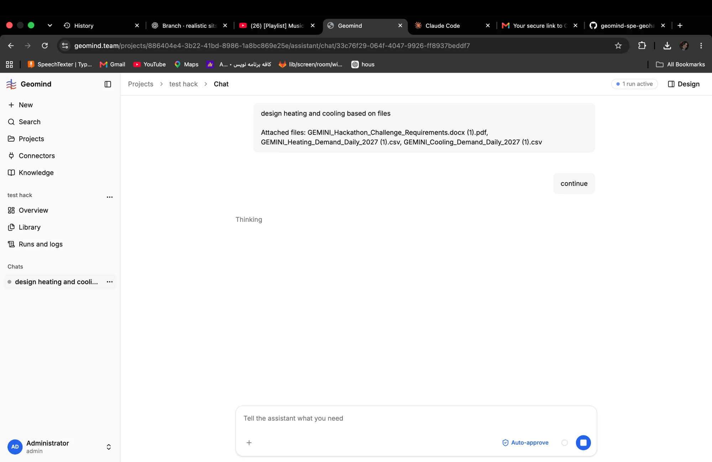
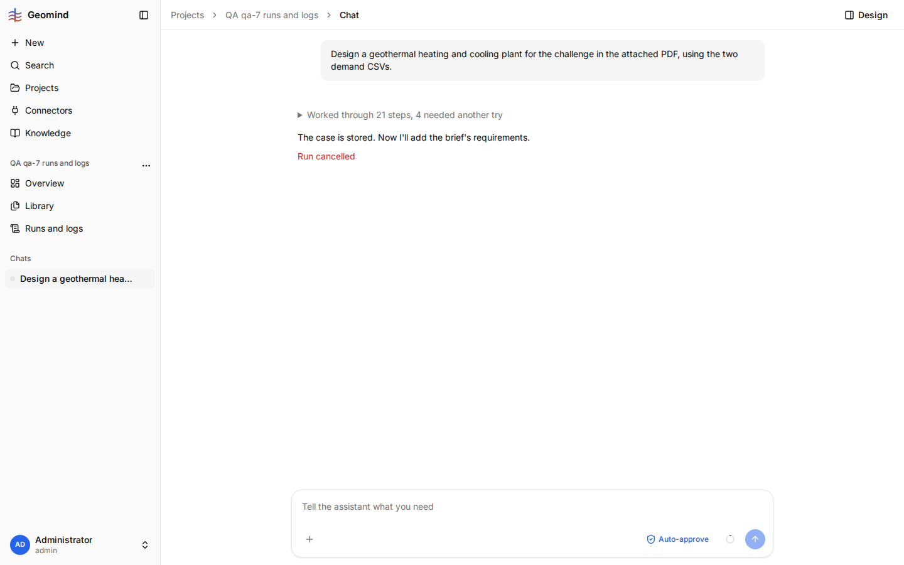
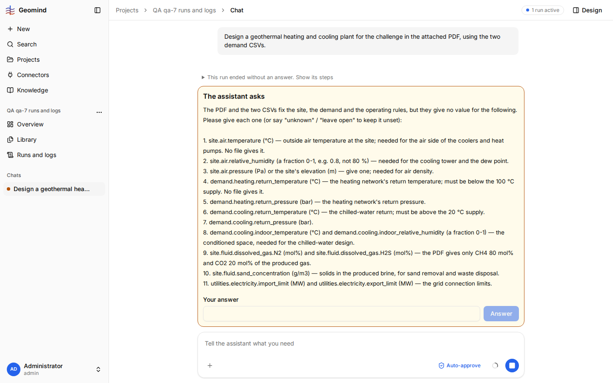

# QA-022: Chat: a cancelled run's messages and steps disappear from the chat

| Field | Value |
|---|---|
| Status | fixed |
| Severity | major |
| Area | frontend,backend |
| Reporter | Fatemeh (screenshots), Claude (write-up) |
| Found | 2026-11-04 20:14 UTC |
| Versions | frontend 1.1.33, backend 1.1.17 |
| Where | https://geomind.team/projects/886404e4-3b22-41bd-8986-1a8bc869e25e/assistant/chat/33c76f29-064f-4047-9926-ff8937beddf7; run a61cfb19bfb04ae99e92060fc5bd2e40 (cancelled 20:08:37 UTC) |
| Fixer | hotfix-front |

## Steps

1. A long run (a61cfb19, 101 steps, 77 minutes) shows its steps and the agents' messages in the chat.
2. Press Cancel run (it ends `cancelled` at 20:08:37 UTC, QA-017).
3. Send "continue" in the same chat, or reload the chat.

## Expected

The cancelled run's messages and steps stay in the chat, marked as cancelled; the user still sees
what the agents did and said.

## Actual

The chat shows only the user's two messages ("design heating and cooling based on files" and
"continue") and "Thinking". Every step and message of the cancelled run is gone from the chat,
including the design lead's text and the tool rows that were there before.

## Evidence

- Before the cancel: 
- After: 
- The run itself still exists (runs row a61cfb19, status cancelled, 4,011,565 input tokens); not
  checked whether Runs and logs still shows its steps.

- qa-7 (2026-11-04, frontend bundle index-DnxCbfcj.js, backend 1.1.21 to 1.1.27): project "QA qa-7 runs and logs",
  chat 51a987be. Run 668fb412 cancelled at 20:27:43 UTC; right after, the chat showed "Worked through 21 steps,
  4 needed another try", the case lead's last text and a red "Run cancelled" (screenshot 1). After a reload it read
  "21 steps, 2 needed another try" (the count changed). After "continue" (run d5765e1e) the cancelled run shows only
  "This run ended without an answer. Show its steps": its text and the "Run cancelled" mark are gone (screenshot 2).
  Runs and logs still has all 10 steps of 668fb412.
  
  

## Cause

Guess: the chat builds the agents' messages only from runs that ended `done` or `failed` (or from
live events), and a `cancelled` run's events are not loaded back; or the cancel's stand-in answer
(QA-017) ends the run without writing its messages to the chat.

## Fix

- 2026-11-04 20:22 UTC: fixed in frontend 1.1.38 (8f4829e), waiting for deploy: an unanswered earlier run shows 'Show its steps' (event replay) and a Runs and logs link
- 2026-11-04 21:05 UTC: frontend 1.1.38, commit 8f4829e, deployed (1.1.46, bundle index-DAOiLoAA.js, 20:30 UTC)
## Retest
