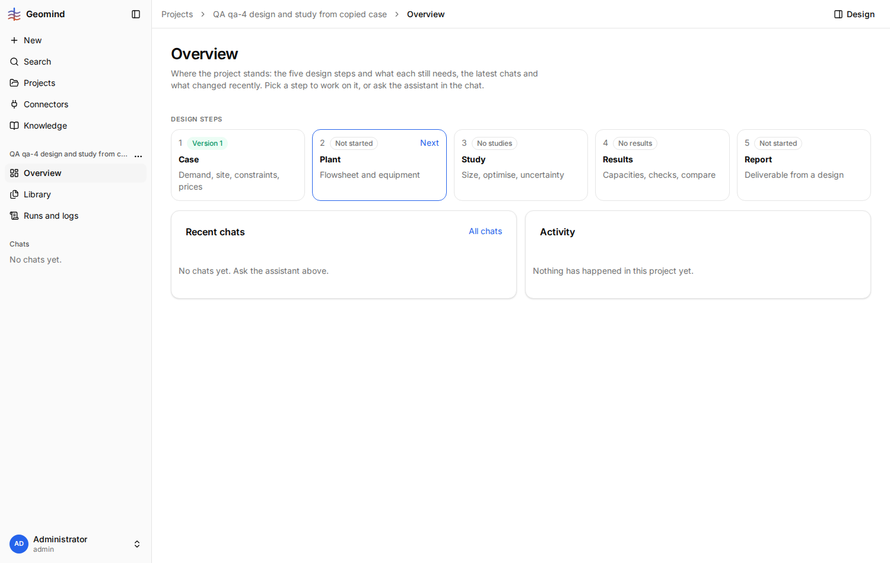

# QA-023: New chat on a project with a copied case offers only case-building chips (Build the case by questions, Which files do you need?)

| Field | Value |
|---|---|
| Status | open |
| Severity | minor |
| Area | geomind |
| Reporter | qa-4 |
| Found | 2026-11-04 20:15 UTC |
| Versions | frontend 1.1.33 (per STATUS.md), backend 1.1.19 (geomind 0.4.28) |
| Where | https://geomind.team/projects/d113b998-4b59-452e-a69c-128faca2a595/assistant/chat; project "QA qa-4 design and study from copied case"; no chat yet; no run |
| Fixer | |

## Steps

1. Projects, New project, Start from "Copy a case", project to copy "SPE GeoHackathon 2026"
   (case version 7), shared memory Off, a goal text, Create.
2. The app opens the new project's chat page.
3. Open Overview: Case shows "Version 1", Plant "Not started" (the case was copied).

## Expected

The next-step chips of the new chat follow the project state: the case is set and the plant is
not, so the chips offer the plant (for example "Design the plant"), not building the case.

## Actual

The new chat shows "Build the case by questions" and "Which files do you need?", the chips for a
project with no case.

## Evidence

- 
- 

## Cause

Guess: `GET /assistant/chat/suggestions` without a chat passes an empty chat state to geomind's
`suggestions_for`, which picks the stage from the chat state (no case) rather than from the
project progress it also gets (case set). Not checked.

## Fix

(Hotfix session: cause, commit, version, deployed at.)

## Retest

(Who, when, result.)
