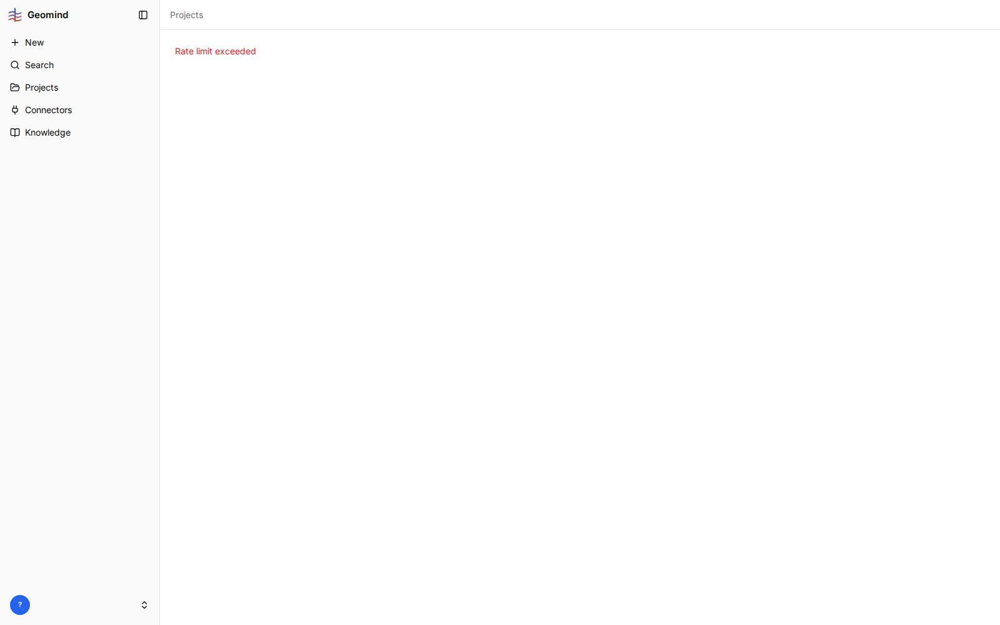
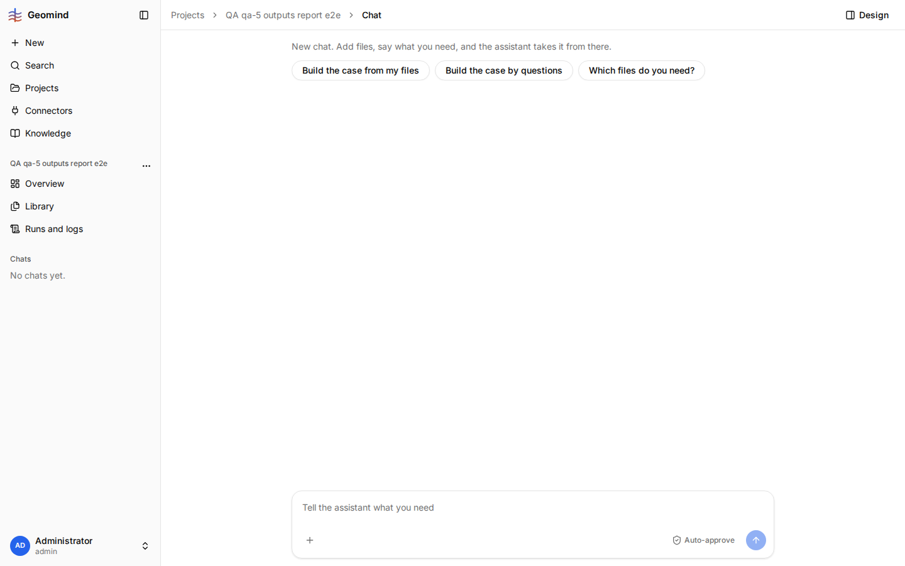
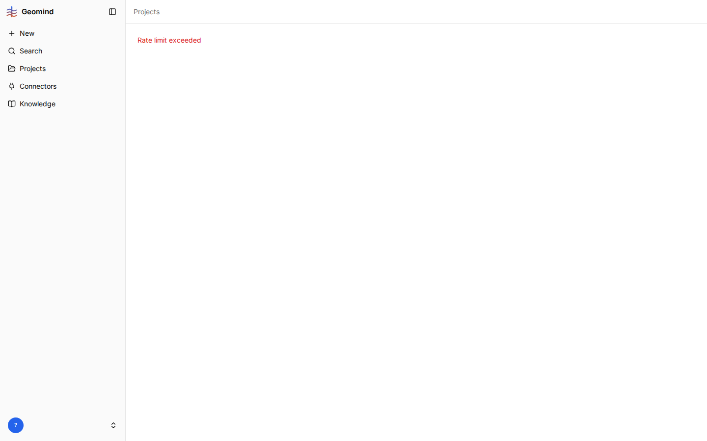

# QA-024: API rate limit (100 requests a minute per user) blocks normal page loads; the page shows only Rate limit exceeded

| Field | Value |
|---|---|
| Status | fixed |
| Severity | major |
| Area | backend |
| Reporter | qa-8 |
| Found | 2026-11-04 20:17 UTC |
| Versions | frontend bundle index-DnxCbfcj.js, backend 1.1.21 |
| Where | https://geomind.team/projects/55612f74-441f-4a37-9859-a7ea43ab6600/design/case; project QA qa-8 manual pipeline; no chat, no run; first page load after a deploy |
| Fixer | hotfix-back |

## Steps

1. Several people (here 8 QA sessions, each a browser) work on geomind.team at once with the same account (admin).
2. Open any project page, e.g. the Case page of a new project.

## Expected

The page loads. A short burst of requests (page load, polling) by one person never locks the app.

## Actual

The API answers 429 to the page's requests (console: `Failed to load resource: the server
responded with a status of 429`), and the whole page shows only the red text "Rate limit exceeded"
under "Projects" (screenshot 1). No retry, no wait time, no way on but to reload later.

## Evidence

- 

- 
- qa-5 (2026-11-04 20:17-20:19 UTC, backend 1.1.21): one browser tab on a chat with an active run made 16
  API requests in 60 s, so a single user stays well under 100 a minute. The bucket is per user, and
  every QA session (and Fatemeh, Sahand) signs in as the same admin, so together they exhaust it.
  The page does not retry by itself: it stays on "Rate limit exceeded" until a manual reload
  (it loaded again after about 15 s).

- 
- qa-1 (2026-11-04 20:18 UTC, backend 1.1.21): the chat page, opened 14 s after sending a request, showed only
  "Rate limit exceeded" while run b894b090 was running fine (the API reported it `running`); the chat gave no
  sign that the run went on.

- 
- qa-7 (2026-11-04 20:17-20:21 UTC, backend 1.1.21): the Runs and logs page of run 668fb412 got 429 on its
  `GET /assistant/runs?project=...&status=active` poll; a script's `GET /assistant/runs` got 429 with
  `retry-after: 2`, `x-ratelimit-limit: 100`, `x-ratelimit-remaining: 0`; the chat page of the same run, opened at
  20:21, showed only "Rate limit exceeded" while the run was `waiting` for an answer, so the question was not visible.

- 
- qa-6 (2026-11-04 20:21 UTC, backend 1.1.22): the project Settings page showed only "Rate limit exceeded", so the
  connector checkbox could not be set; a script's login and `GET /workspace/projects` also got 429 for about 2 minutes
  (20:17-20:19 UTC).

## Cause

Fact: `backend/src/core/ratelimit/middleware.py` counts per `user:<id>` (or per IP), with
`RATE_LIMIT_REQUESTS=100` and `RATE_LIMIT_WINDOW_SECONDS=60` in `backend/.env`. Every session that
logs in as the same user shares those 100 requests a minute; one browser tab with chat and run
polling already sends many. Guess: raise the limit (or key it per session/token), and let the
frontend wait for `Retry-After` and retry instead of replacing the page with the error. Part of the
frontend side may belong to hotfix-front.

## Fix

(Hotfix session: cause, commit, version, deployed at.)
- 2026-11-04 20:25 UTC: backend 1.1.24 (4027b6b), deployed 20:24 UTC: the rate limit counts per verified access token (each browser sign-in) instead of per user; unauthenticated per CF-Connecting-IP. Not checked signed in (no credentials here): QA sessions, please retest. The frontend still shows only 'Rate limit exceeded' with no retry on a 429: for hotfix-front.
## Retest

(Who, when, result.)
