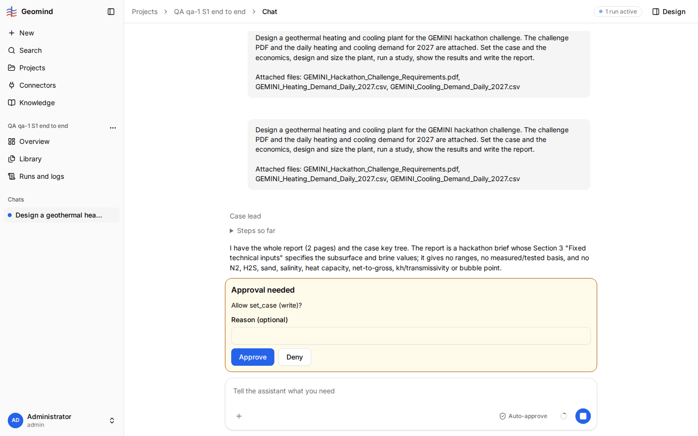

# QA-026: Approval card for set_case shows only 'Allow set_case (write)?': the user cannot see which values, units or sources they approve

| Field | Value |
|---|---|
| Status | open |
| Severity | major |
| Area | geomind,frontend |
| Reporter | qa-1 |
| Found | 2026-11-04 20:21 UTC |
| Versions | frontend bundle assets/index-DnxCbfcj.js, backend 1.1.22; model deepseek/deepseek-v4.1-flash-1017 |
| Where | https://geomind.team/projects/541aa78f-8181-45f4-ac36-e47305e33f37/assistant/chat/062b25d8-1e4a-4b38-aed3-2209baba430a; project "QA qa-1 S1 end to end"; run b894b090-ad7e-4ef6-8c92-412d63bdb989; case lead's first set_case (request-146), 20:20 UTC |
| Fixer | |

## Steps

1. New project, Auto-approve off; attach the challenge PDF and the two demand CSVs; send "Design a
   geothermal heating and cooling plant ... set the case and the economics, design ..., report".
2. The case lead reads the files, asks the geoscientist, then calls set_case.
3. Look at the approval card in the chat.

## Expected

The approval shows what will be written: each key, value, unit and source (file, page), so the user
can check it before approving (project rule: data the user approves comes with its source). At
least a "show details" with the call's arguments.

## Actual

The card reads only "Approval needed / Allow set_case (write)? / Reason (optional) / Approve / Deny"
(screenshot 1). The run's request (`GET /assistant/runs/{id}`) holds only kind, agent, call_id and
the message "Allow set_case (write)?"; no arguments. The steps panel ("Steps so far") does not show
the pending call either, and the run log has no entry for it until the step ends. The user approves
blind. In S1 every case write goes through this card.

## Evidence

- 
- Run while waiting: [run-b894b090-waiting.json](../evidence/QA-026/run-b894b090-waiting.json)

## Cause

Fact: `frontend/src/domains/assistant/chat/request-card.tsx` (`Approval`) renders only the
message, a reason field and the two buttons. Guess: geomind's approval request carries no
arguments, so the frontend has nothing to show; both sides need a change (geomind: put the
arguments, or a summary of keys/values/sources, into the request; frontend: show them).

## Fix

(Hotfix session: cause, commit, version, deployed at.)

## Retest

(Who, when, result.)
