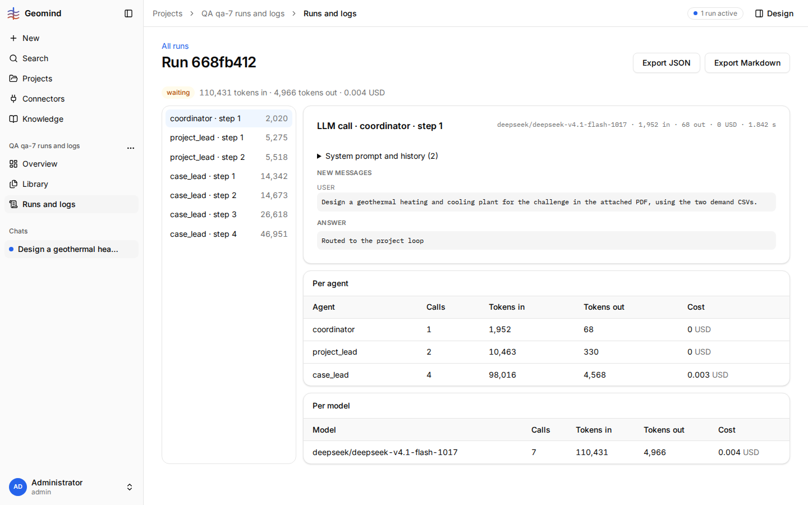

# QA-027: Run log page does not update during a run: status, steps and tokens stay as at page load until a reload

| Field | Value |
|---|---|
| Status | fixed |
| Severity | major |
| Area | frontend |
| Reporter | qa-7 |
| Found | 2026-11-04 20:23 UTC |
| Versions | frontend bundle index-DnxCbfcj.js, backend 1.1.21 |
| Where | https://geomind.team/projects/b3245cdd-63d3-49d3-91e9-e3ec459cb7c1/assistant/runs/668fb412-f060-4bc5-92bf-5836ce5420d1; project "QA qa-7 runs and logs"; chat 51a987be-da15-4d1b-9756-62185507435b; run 668fb412 |
| Fixer | hotfix-front |

## Steps

1. In a chat, send a request that starts an agent run (here: "Design a geothermal heating and cooling plant for the challenge in the attached PDF, using the two demand CSVs." with the challenge PDF and the two demand CSVs).
2. While the run is active, open Runs and logs, then the run.
3. Leave the page open; compare it every 30 s with `GET /api/v1/assistant/runs/{run_id}/log`.

## Expected

The run log shows the steps as they come: new steps in the step list, the status chip and the
token and cost line change while the run goes on (as the chat's "Steps so far" does).

## Actual

- 20:17:28 UTC: page opened; API 6 steps, `running`; page: `running`, "66,112 tokens in · 2,334 tokens out" (screenshot 1).
- 20:17:58 to 20:19:29 UTC: API 7 steps, status `waiting` (approval of set_case); the page still shows
  6 steps, `running`, 66,112 tokens (screenshot 2, taken 20:19:29).
- 20:20 UTC: after a manual reload the page shows 7 steps, `waiting`, "110,431 tokens in · 4,966 tokens out" (screenshot 3).
- Nothing on the page tells the user that it is a snapshot.

## Evidence

- 
- 
- 
- Run JSON (Export JSON, taken while the run waited): [`../evidence/QA-027/run-668fb412.json`](../evidence/QA-027/run-668fb412.json)

## Cause

Fact: `frontend/src/domains/assistant/runs/api.ts` `runLogQuery` has no `refetchInterval` and the
log page subscribes to no run events, so the query is fetched once. Guess: refetch the log (or
follow the run's SSE events, as the chat does) while the run status is `running` or `waiting`, and
stop when it ends. Keep it light: the API's per-user rate limit (QA-024) is easily spent.

## Fix

(Hotfix session: cause, commit, version, deployed at.)
- 2026-11-04 20:24 UTC: fixed in frontend 1.1.39 (e2bc198), waiting for deploy: runLogQuery refetches every 15 s while the run is active (mind QA-024 rate limit: one log request per 15 s per open page)
- 2026-11-04 21:05 UTC: frontend 1.1.39, commit e2bc198, deployed (1.1.46, bundle index-DAOiLoAA.js, 20:30 UTC)
- 2026-11-04 21:12 UTC: code live in 1.1.50 (checked in the served chunks); behaviour not rechecked live: needs an active run, a 429, a provider retry, a bad CSV or an upload
## Retest

(Who, when, result.)
