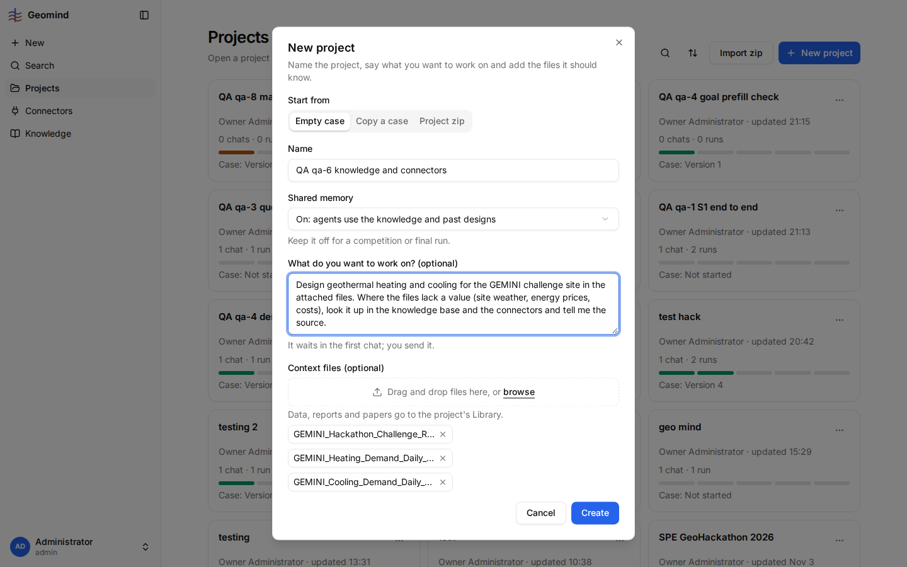
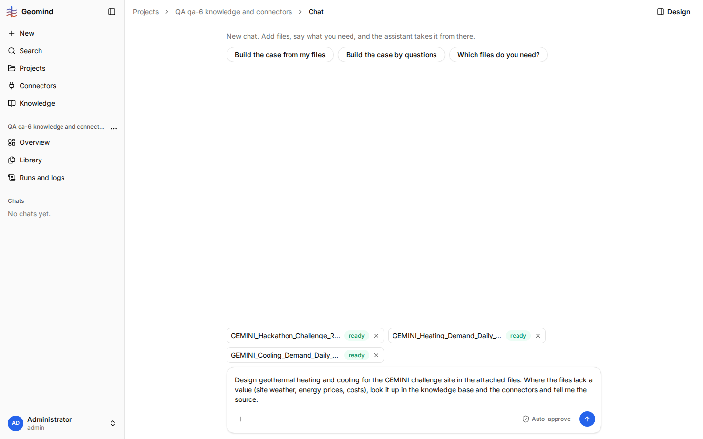
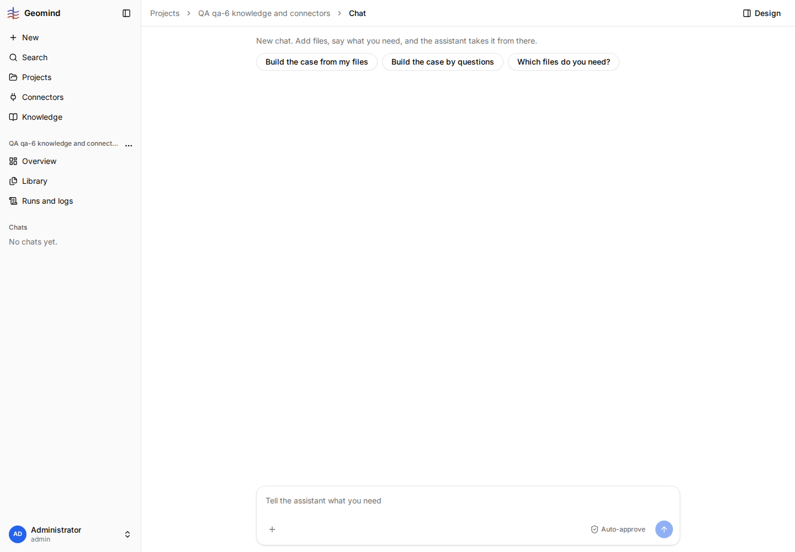

# QA-028: The first request typed in New project is lost when the user leaves the chat before sending it

| Field | Value |
|---|---|
| Status | fixed |
| Severity | minor |
| Area | frontend |
| Reporter | qa-6 |
| Found | 2026-11-04 20:24 UTC |
| Versions | frontend bundle index-DnxCbfcj.js (1.1.33), backend 1.1.22 |
| Where | https://geomind.team/projects/bc1d5450-590a-4dce-afe0-0d5ea13932bd/assistant/chat; project QA qa-6 knowledge and connectors; no chat yet; no run |
| Fixer | hotfix-front |

## Steps

1. Projects, New project: Empty case, a name, Shared memory On, a request in "What do you want to work on?"
   and the three challenge files (screenshot 0-dialog). Create.
2. The chat opens with the request in the composer and the three files as `ready` chips (screenshot 1).
3. Before sending, open the project's Settings (to turn on a connector: the New project dialog has no
   connector choice, so this is the natural next step), tick open-meteo, then go back to Chat.

## Expected

The request and the file chips still wait in the composer ("It waits in the first chat; you send it").

## Actual

The composer is empty and the chips are gone (screenshot 2); the project has no chat. The three files
are in the Library (`searchable: ready`), so only the request text and the attachment to the first
message are lost; the user has to type the request again and re-attach the files.

## Evidence

- 
- 
- 

## Cause

Guess: the draft is kept only in the page state of the first chat view, not in storage or on the server.

## Fix

(Hotfix session: cause, commit, version, deployed at.)
- 2026-11-04 20:26 UTC: fixed in frontend 1.1.41 (a73946a), waiting for deploy. The draft was in sessionStorage (per tab), cleared only on send; now localStorage and edits are kept. Not reproduced before the fix: if the retest still loses it in the same tab, the cause is elsewhere.
- 2026-11-04 21:05 UTC: frontend 1.1.41, commit a73946a, deployed (1.1.46, bundle index-DAOiLoAA.js, 20:30 UTC)
- 2026-11-04 21:12 UTC: code live in 1.1.50 (checked in the served chunks); behaviour not rechecked live: needs an active run, a 429, a provider retry, a bad CSV or an upload
## Retest

(Who, when, result.)
