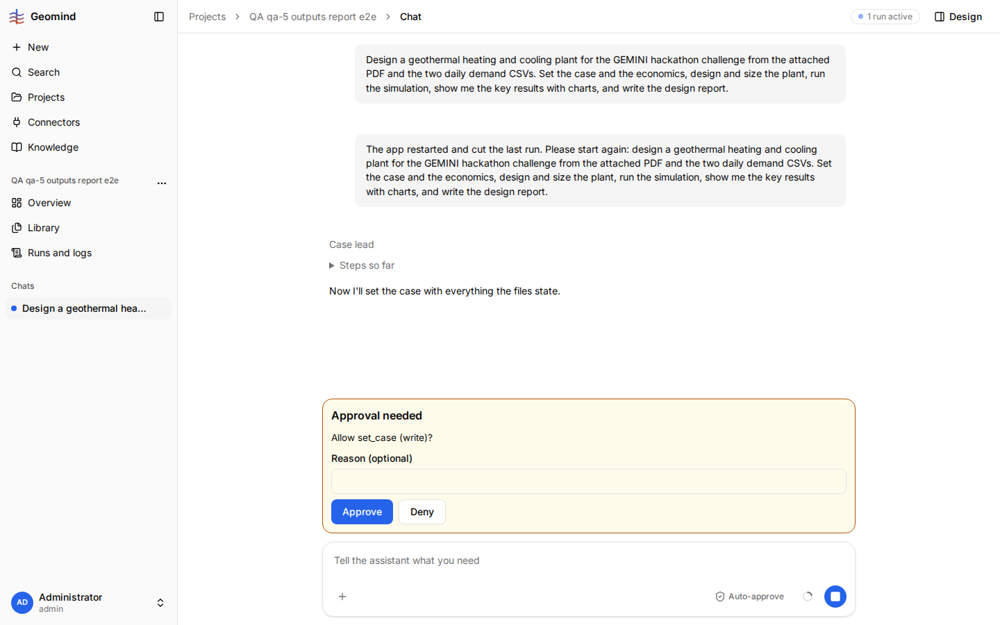

# QA-031: Auto-approve works only while the chat tab is open; with the tab closed the run waits for an approval

| Field | Value |
|---|---|
| Status | fixed |
| Severity | minor |
| Area | frontend |
| Reporter | qa-5 |
| Found | 2026-11-04 20:25 UTC |
| Versions | frontend 1.1.33 (deployed), backend 1.1.22 (geomind 0.4.29) |
| Where | https://geomind.team/projects/4d8fb808-9af1-493e-94e4-4d6d50916e5f/assistant/chat/f0388b3b-8f3a-4f97-8167-c7939e9bca9d; project QA qa-5 outputs report e2e; run 9a33db47-648f-435a-a3e1-a6ad0665b16b; case lead's set_case approval (request-179) |
| Fixer | hotfix-back |

## Steps

1. In a project chat, turn on Auto-approve (the button says "Auto-approve is on: tool calls run without asking").
2. Send a long request (case, economics, design, simulation, report), 20:21 UTC.
3. Close the tab (or open the chat in another browser) while the run goes on.

## Expected

With Auto-approve on, the run's tool calls run without asking, whether or not the tab stays open;
a long pipeline run can be left alone.

## Actual

- At 20:24:56 UTC the run went to `waiting` with request `{"kind": "approval", "agent": "case_lead",
  "message": "Allow set_case (write)?"}` and stayed there until a tab with Auto-approve on was opened again.
- Opened in another browser (fresh profile), the chat shows Auto-approve off and the approval card.

## Evidence

- 

## Cause

Fact (frontend source, `src/domains/assistant/chat/auto-approve.tsx`): Auto-approve is a browser
setting in localStorage per project; `useApproveByItself` sends the approval from the open tab. The
backend does not know about it, so with no tab open nobody approves. The button's title promises more
than it does. A fix: send the setting with the message (or store it on the chat) and let the
backend approve, or at least say "while this tab is open" on the button.

## Fix

(Hotfix session: cause, commit, version, deployed at.)
- 2026-11-04 20:28 UTC: frontend part in 1.1.44 (b54b785), waiting for deploy: the button now says it approves only while the chat is open in this browser. The expected behaviour (approve with no tab open) needs the backend: the API has no auto-approve setting on a chat or message; once it has one, the frontend sends it. Needs a decision (backend change).
- 2026-11-04 21:06 UTC: frontend 1.1.44, commit b54b785, deployed (1.1.46, bundle index-DAOiLoAA.js, 20:30 UTC)
- 2026-11-04 23:20 UTC: backend 1.1.50 (ddaddc1), deployed: GET/PUT /api/v1/assistant/chat/{chat_id}/auto-approve with {"auto_approve": bool}; while on, runs started or resumed afterwards run in geomind permission mode auto (no approvals, nested agents included), with no tab open. For hotfix-front: the Auto-approve button should read this on load and PUT it on toggle (instead of localStorage); a run already running picks up a change at its next resume.
## Retest

(Who, when, result.)
- 2026-11-04 21:11 UTC: geomind.team 1.1.50, Playwright 21:15 UTC: button title says Auto-approve works only while the chat is open in this browser (server-side approval still needs a backend setting)
