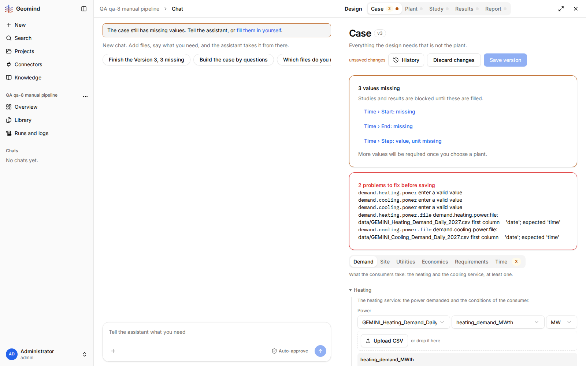
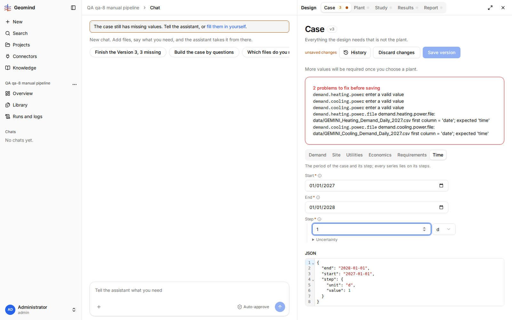

# QA-032: Case page: the challenge demand CSVs are refused by hand (first column 'date', expected 'time'); no way to map the column

| Field | Value |
|---|---|
| Status | open |
| Severity | major |
| Area | gemini |
| Reporter | qa-8 |
| Found | 2026-11-04 20:26 UTC |
| Versions | frontend bundle index-DnxCbfcj.js, backend 1.1.22 |
| Where | https://geomind.team/projects/55612f74-441f-4a37-9859-a7ea43ab6600/design/case; project QA qa-8 manual pipeline (case v3); no chat, no run; S8 step: Case by hand, Demand tab |
| Fixer | |

## Steps

1. New project, Case page, Start the case (empty).
2. Demand > Heating > Power: click "series", Upload CSV `gemini/examples/hackathon_2026/GEMINI_Heating_Demand_Daily_2027.csv`
   (the competition's file: header `date,heating_demand_MWth`, rows `2027-01-01,24.313`). The same for
   Cooling with `GEMINI_Cooling_Demand_Daily_2027.csv`.
3. Choose the file, the column (`heating_demand_MWth`, `cooling_demand_MWcool`) and the unit MW for each.
4. Time: 2027-01-01 to 2028-01-01, step 1 d.

## Expected

The challenge's own demand files work as given, or the page offers to choose which column is the
time (or converts `date` to `time`).

## Actual

"Save version" stays disabled; the problems box says
`demand.heating.power.file: data/GEMINI_Heating_Demand_Daily_2027.csv first column = 'date'; expected 'time'`
(and the same for cooling). The page gives no way to tell it that `date` is the time column. A user
working by hand must edit the CSV outside the app. The example case in gemini
(`examples/hackathon_2026/data/demand.csv`) uses `time` with ISO timestamps, so it differs from the
files the competition hands out.

## Evidence

- 
- 

## Cause

Fact: the message comes from the case check (the series reader wants the first column named
`time`). Guess: accept a first column named `date`/`datetime` (or any parseable first column) in
gemini's series reader, or let the backend's file upload rename it. The agents may convert the file
themselves, which would explain why the chat path works and the hand path does not.

## Fix

(Hotfix session: cause, commit, version, deployed at.)

## Retest

(Who, when, result.)
