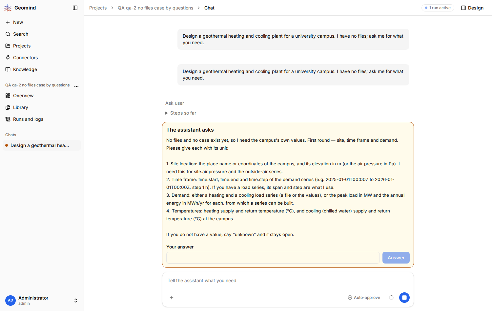
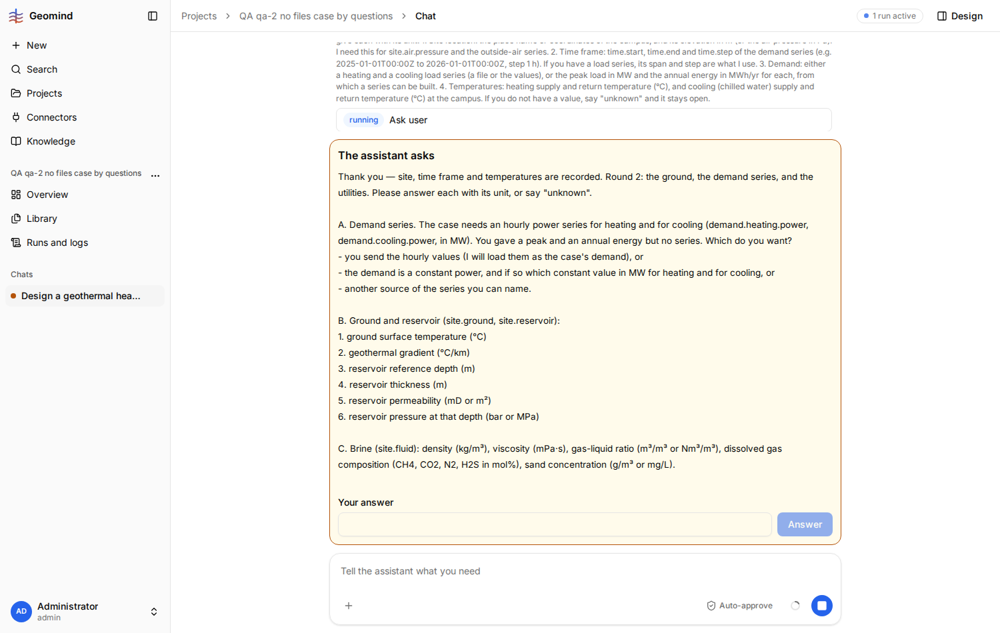

# QA-034: Case lead offers to build the demand series from a peak and an annual energy, then says it cannot and falls back to a constant

| Field | Value |
|---|---|
| Status | open |
| Severity | minor |
| Area | geomind |
| Reporter | qa-2 |
| Found | 2026-11-04 20:30 UTC |
| Versions | frontend bundle index-DnxCbfcj.js, backend 1.1.24 when the run started (1.1.27 at report time) |
| Where | https://geomind.team/projects/c8482f7a-9ff9-4888-82ac-4c8402b29a46/assistant/chat/abfff893-d638-4b04-927c-e0c154aa2490; project QA qa-2 no files case by questions; run 592f3730-4743-490e-91f0-63d9330aa7f2; case_lead questions request-71, request-83, request-115 |
| Fixer | |

## Steps

1. New project, Empty case, Shared memory Off, no files. In chat: "Design a geothermal heating and
   cooling plant for a university campus. I have no files; ask me for what you need."
2. Round 1 (case_lead, request-71), item 3 says: "Demand: either a heating and a cooling load series
   (a file or the values), or the peak load in MW and the annual energy in MWh/yr for each, from which
   a series can be built." Answer with peaks and annual energies (heating 6 MW, 18000 MWh/yr; cooling
   3 MW, 4000 MWh/yr), no series.
3. Round 2 (request-83), item A: "You gave a peak and an annual energy but no series. Which do you
   want?" and offers only: send hourly values, a constant power, or another source. Answer: build it
   from the peak and annual energy as offered in round 1; only if you cannot, a constant 2.05 MW
   heating and 0.46 MW cooling.
4. Round 3 (request-115) ends: "I cannot compute a series from a peak and an annual energy, so I will
   use the constant fallback you gave".

## Expected

The agent offers only ways in it can carry out. Either it builds a demand series from a peak and an
annual energy (with a stated shape and source the user approves), or round 1 does not offer that
way in and asks for a series or a constant directly.

## Actual

Round 1 offers "peak and annual energy, from which a series can be built"; the user answers that way;
two rounds later the agent says it cannot and uses a constant demand. The user spent one round on
values the case cannot use, and the design runs on a flat demand (a constant 2.05 MW heating) that
has no peak at all, so the 6 MW peak the user gave is lost from the case.

## Evidence

- 
- 
- Run JSON (log at request-115): `../evidence/QA-034/run-592f3730.json`

## Cause

Guess: the case-lead prompt lists "peak and annual energy" as an accepted demand input, but no tool
turns a peak and an annual energy into a series (no profile builder), so the agent cannot keep the
promise.

## Fix

(Hotfix session: cause, commit, version, deployed at.)

## Retest

(Who, when, result.)
