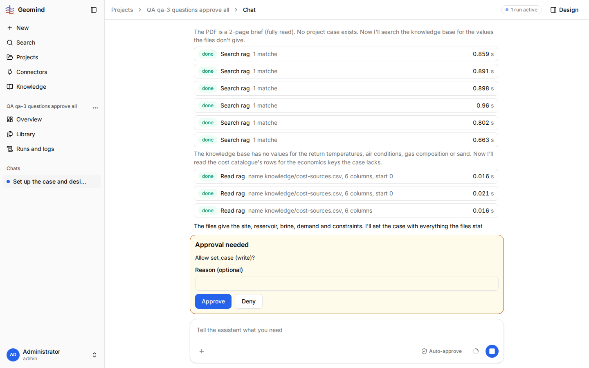

# QA-036: Chat steps: search_rag reads '1 matche' and list_files reads '2 files' when it listed 3

| Field | Value |
|---|---|
| Status | fixing |
| Severity | cosmetic |
| Area | frontend |
| Reporter | qa-3 |
| Found | 2026-11-04 20:27 UTC |
| Versions | frontend bundle index-DnxCbfcj.js (STATUS.md: 1.1.33 deployed), backend 1.1.22 to 1.1.27 |
| Where | https://geomind.team/projects/00f5dd96-3a12-4cd5-9ac1-4aff6a546b80/assistant/chat/ea82a233-2acc-4390-b107-15c7099b7d74 (project "QA qa-3 questions approve all 2"), run 0b704308-0338-45a2-982d-ad3c72ee322c; the same in project "QA qa-3 questions approve all", run e1da748d |
| Fixer | hotfix-front |

## Steps

1. New project with the challenge PDF and the two demand CSVs; send "Set up the case and design a
   geothermal heating and cooling plant for the attached hackathon challenge. Ask me about any value
   the files do not give."
2. Open "Steps so far" under the Case lead.

## Expected

- A `search_rag` step with one match reads "1 match".
- The `list_files` step reads "3 files": the run JSON shows its output lists three files
  (the two CSVs and the PDF).

## Actual

- Every `search_rag` step reads "1 matche".
- "Listed the project documents: 2 files" (case lead step 1 and geoscientist step 1), while the
  tool's output in the run JSON has three entries in `files`.

## Evidence

- 
- Run JSON: [`../evidence/QA-036/run-0b704308.json.gz`](../evidence/QA-036/run-0b704308.json.gz)
  (gzip): `steps[3].tool_calls[0]` is the `list_files` call with three files.

## Cause

Fact: `frontend/src/shared/sse/pretty.ts` `toCount` makes a singular by cutting the last letter of
a key ending in "s", so "matches" becomes "matche".
Guess for "2 files": the step summary the chat receives is a shortened text of the output, and
`fromText` reads only the entries that are whole in it, so the last file is lost from the count.

## Fix

- 2026-11-04 20:44 UTC: fixed in frontend 1.1.48 (598272c), waiting for deploy: singular fixed; counts from a cut summary show 'N+'. The exact count needs the full output or a count in the event (backend/geomind) if wanted.
## Retest
