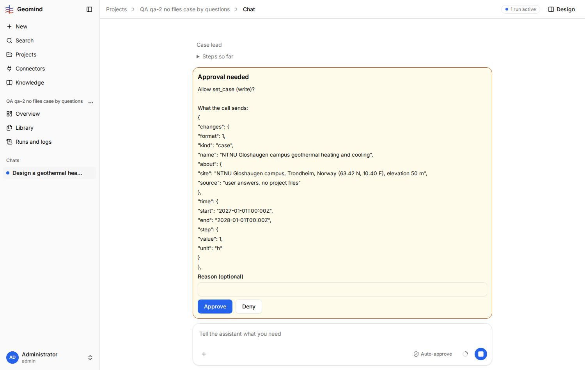
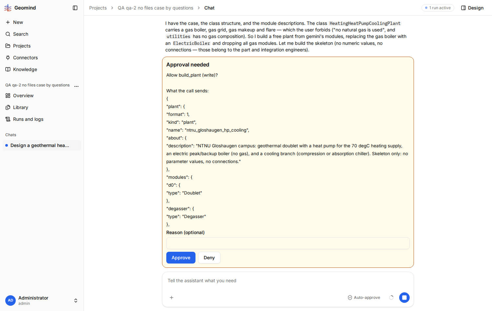

# QA-037: set_case asks for approval before the values are checked; gemini refuses mg/L and bare fractions, and the user must approve again

| Field | Value |
|---|---|
| Status | fixed |
| Severity | minor |
| Area | geomind |
| Reporter | qa-2 |
| Found | 2026-11-04 20:34 UTC |
| Versions | frontend bundle index-DnxCbfcj.js, backend 1.1.27 |
| Where | https://geomind.team/projects/c8482f7a-9ff9-4888-82ac-4c8402b29a46/assistant/chat/abfff893-d638-4b04-927c-e0c154aa2490; project QA qa-2 no files case by questions; run 592f3730-4743-490e-91f0-63d9330aa7f2; case_lead step 7 (set_case call-78c9be36) |
| Fixer | hotfix-python |

## Steps

1. A project with no files; the case lead builds the case by questions (three ask_user rounds).
2. In round 2 the case lead itself asks for "sand concentration (g/m³ or mg/L)"; the user answers
   "sand 5 mg/L"; in round 3 it asks for relative humidity "a fraction 0-1, e.g. 0.8".
3. The case lead calls set_case; the chat shows "Approval needed: Allow set_case (write)?" with the
   JSON (screenshot 1). Approve.

## Expected

The values are checked before the user is asked, so the user approves a call that gemini accepts,
once. Units the agent itself offers ("mg/L") are accepted.

## Actual

After the approval, set_case fails (run JSON, case_lead step 7):
`invalid_unit` at 3 paths: `site.fluid.sand_concentration.unit = 'mg/L'; expected ... g/m3, kg/m3, mg/l`;
`site.air.relative_humidity = 0.8; expected an object {'value': ...}`;
`demand.cooling.indoor_relative_humidity = 0.5; expected an object {'value': ...}`.
The agent fixes them and a second "Allow set_case (write)?" card appears with the whole case again;
the user must read and approve it a second time. Nothing tells the user the first approval was refused.

### The same for build_plant (qa-2, 21:00 UTC)

In the same run the process engineer's first build_plant (a skeleton: "no parameter values, no
connections") was shown as "Allow build_plant (write)?" (screenshot 2); after Approve it failed
`unconnected_port` (d0.supply_out, degasser.liquid_out, ... ; run JSON `run-592f3730-design.json`,
process_engineer step 5), and a second build_plant approval followed. A call that a dry check would
refuse should not reach the user for approval.

## Evidence

- 
- Run JSON: `../evidence/QA-037/run-592f3730.json` (step 7, set_case output)
- 
- Run JSON with the design steps: `../evidence/QA-037/run-592f3730-design.json`

## Cause

Facts: gemini's unit names are case-sensitive here ('mg/L' refused, 'mg/l' accepted); a bare number
is refused for a dimensionless value. Guess: set_case has no dry-run check before the approval, as
ask_economics had before QA-004 was fixed; the same fix (check first, then ask) would apply.

## Fix

(Hotfix session: cause, commit, version, deployed at.)
- 2026-11-04 20:41 UTC: fixed in geomind 0.4.40 (commit 52777ef): a dry run of set_case before its approval; a refused call returns its error without asking. Backend 1.1.37, waiting for deploy.
- 2026-11-04 21:06 UTC: shipped in backend 1.1.40 with geomind 0.4.42 (deployed 21:02 UTC); the fix is in the prod worker (checked: code/prompt present, QA-023 gives 'Design a plant' for a ready case). Live retest by the bug's steps still to do.
- 2026-11-04 21:08 UTC: hotfix-python 21:10 UTC: precheck code present in the prod worker (geomind 0.4.42). A live set_case approval test is not done: running a check run in the prod container was refused by this session's permission check. Needs a QA session or a person: in a chat with Auto-approve off, give a value gemini refuses (sand 5 mg/L) and see that no approval card shows for the refused set_case.
## Retest

(Who, when, result.)
