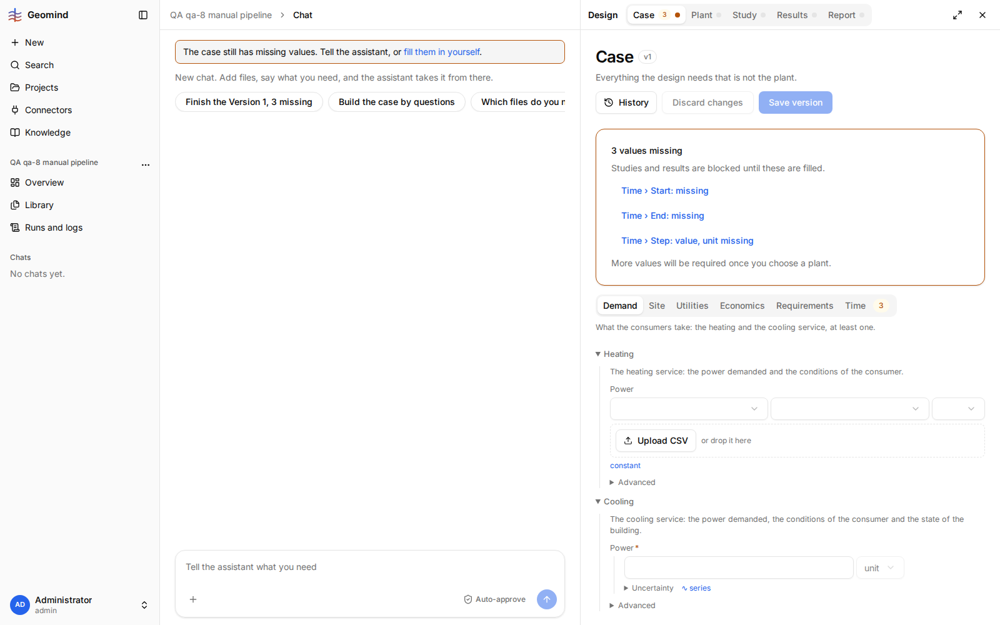
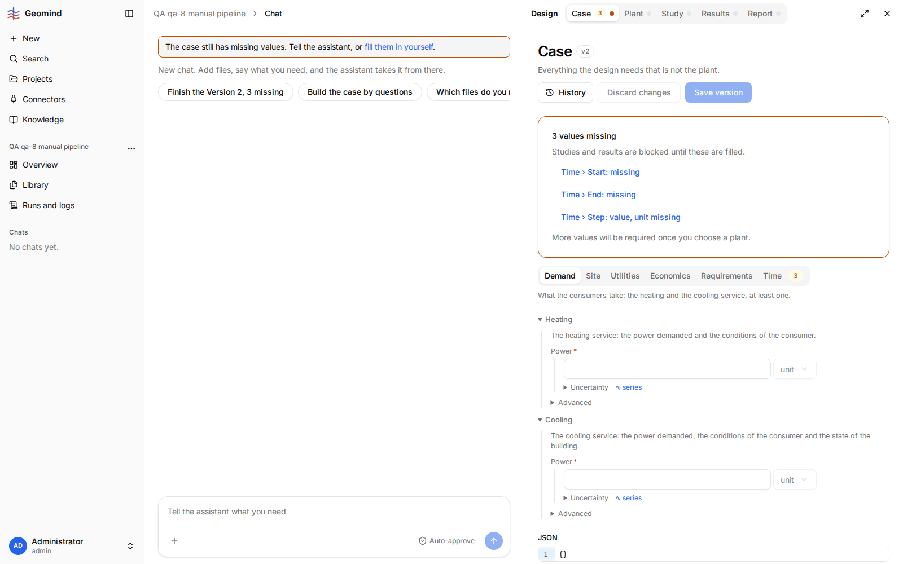
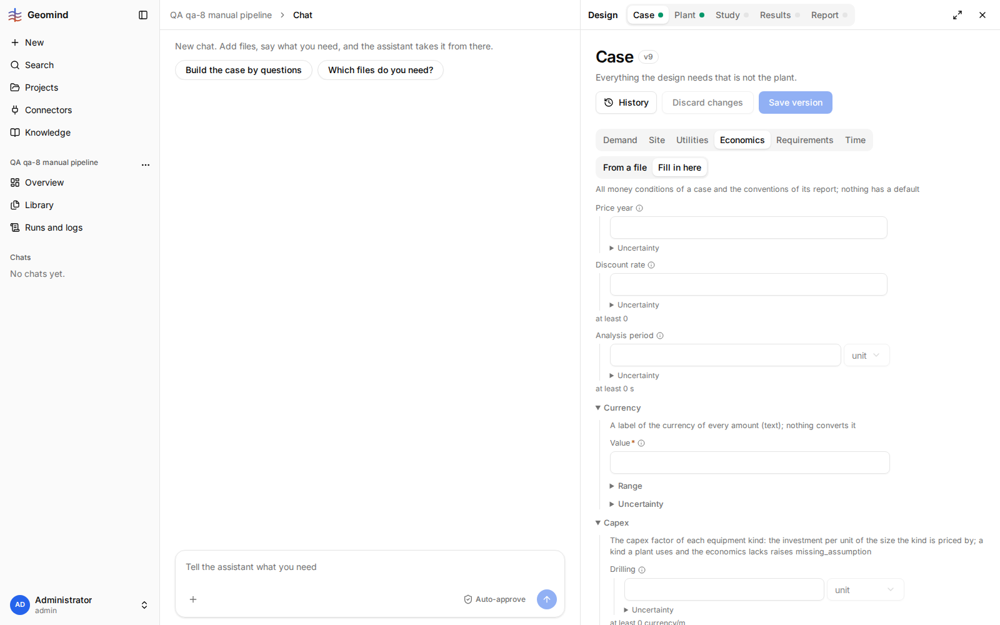
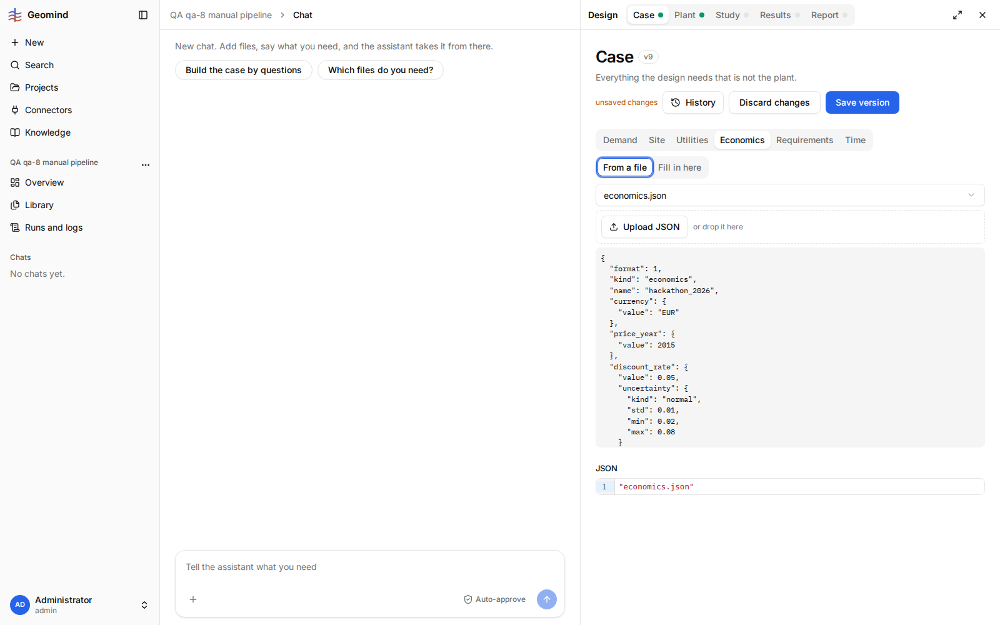

# QA-038: Case page: Upload CSV/JSON saves a version with the file only; the field falls back to empty and the file must be chosen again

| Field | Value |
|---|---|
| Status | fixed |
| Severity | minor |
| Area | frontend |
| Reporter | qa-8 |
| Found | 2026-11-04 20:37 UTC |
| Versions | frontend bundles index-DnxCbfcj.js and index-DAOiLoAA.js, backend 1.1.21 to 1.1.27 |
| Where | https://geomind.team/projects/55612f74-441f-4a37-9859-a7ea43ab6600/design/case; project QA qa-8 manual pipeline; case v2 (CSV) and v9 (economics.json); no chat, no run |
| Fixer | hotfix-front |

## Steps

1. Case page, Demand > Heating > Power: click "series", then Upload CSV and pick a demand CSV.
2. Economics: click "From a file", then Upload JSON and pick `gemini/examples/hackathon_2026/economics.json`.

## Expected

After the upload the field uses the uploaded file (series: that file and its column chosen;
economics: `"economics": "economics.json"`), and one Save version stores it.

## Actual

Each upload saves a new case version at once (v2 note "File data/GEMINI_Heating_Demand_Daily_2027.csv";
v9) that holds only the file. The field is not set: heating power falls back to the constant input
with an empty value (screenshot 2), the Economics tab falls back to "Fill in here" with empty fields
(screenshot 3), and the JSON stays `{}`. It looks as if the upload failed. The way on: click
"series" / "From a file" again and choose the uploaded file in the select (screenshot 4), then save
another version. Every upload adds an extra version to History.

## Evidence

- 
- 
- 
- 

## Cause

Guess: the upload posts to `/design/case/files`, which saves a version; the editor then reloads the case and loses its local mode and selection.

## Fix

(Hotfix session: cause, commit, version, deployed at.)
- 2026-11-04 20:43 UTC: fixed in frontend 1.1.47 (fe1ae7a), waiting for deploy: the upload sets the field in the draft (series .file / the file field). The upload itself still saves a version (backend /design/case/files); the choice needs one more Save.
- 2026-11-04 21:09 UTC: frontend 1.1.47, commit fe1ae7a, deployed (1.1.50, 21:10 UTC)
- 2026-11-04 21:12 UTC: code live in 1.1.50 (checked in the served chunks); behaviour not rechecked live: needs an active run, a 429, a provider retry, a bad CSV or an upload
## Retest

(Who, when, result.)
