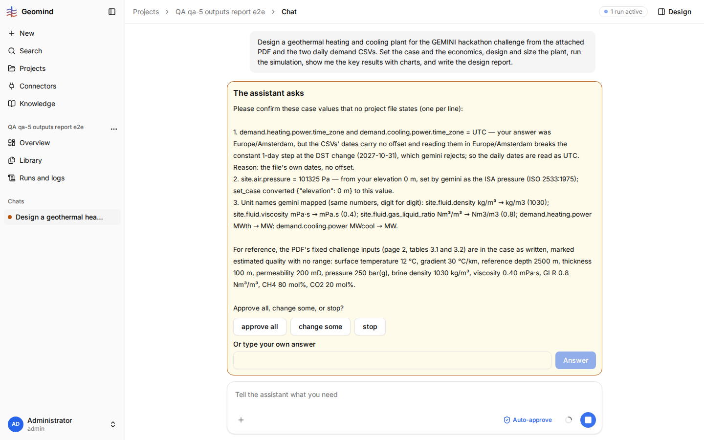

# QA-039: A daily demand series in a time zone with DST (Europe/Amsterdam) is refused; the agent falls back to UTC against the user's answer

| Field | Value |
|---|---|
| Status | fixing |
| Severity | minor |
| Area | gemini |
| Reporter | qa-5 |
| Found | 2026-11-04 20:38 UTC |
| Versions | frontend 1.1.33 (deployed bundle), backend 1.1.27 (geomind 0.4.29, gemini 0.6.4 per STATUS.md) |
| Where | https://geomind.team/projects/4d8fb808-9af1-493e-94e4-4d6d50916e5f/assistant/chat/f0388b3b-8f3a-4f97-8167-c7939e9bca9d; project QA qa-5 outputs report e2e; run started 20:30 UTC; case lead's set_case and confirmation question (20:38 UTC) |
| Fixer | hotfix-python |

## Steps

1. New project with the challenge PDF and the two daily demand CSVs (`gemini/examples/hackathon_2026/`).
2. Ask for the full design; when the case lead asks for the time zone of the series, answer `Europe/Amsterdam`.

## Expected

A daily series (365 dates, no offset) read in a local zone with DST is valid: each row is one calendar
day. gemini takes it in the user's zone (days of 23 or 25 hours at the DST change), or says
clearly how daily data in a DST zone must be given.

## Actual

The case lead's confirmation question (screenshot): "demand.heating.power.time_zone and
demand.cooling.power.time_zone = UTC: your answer was Europe/Amsterdam, but ... reading them in
Europe/Amsterdam breaks the constant 1-day step at the DST change (2027-10-31), which gemini rejects;
so the daily dates are read as UTC." The user's value is replaced; the series is shifted by one or two
hours against local time. The agent says so openly, so the user can see it.

## Evidence

- 

## Cause

Fact (the agent's words): gemini refuses a series whose step is not constant in UTC. Guess: gemini
checks the step on UTC instants, not on local calendar dates, for daily (and coarser) series.

## Fix

(Hotfix session: cause, commit, version, deployed at.)

## Retest

(Who, when, result.)
