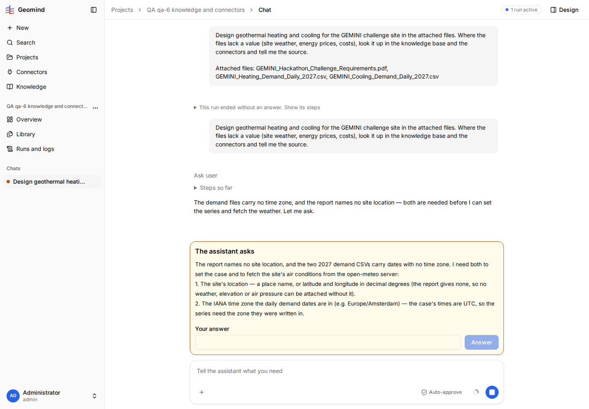
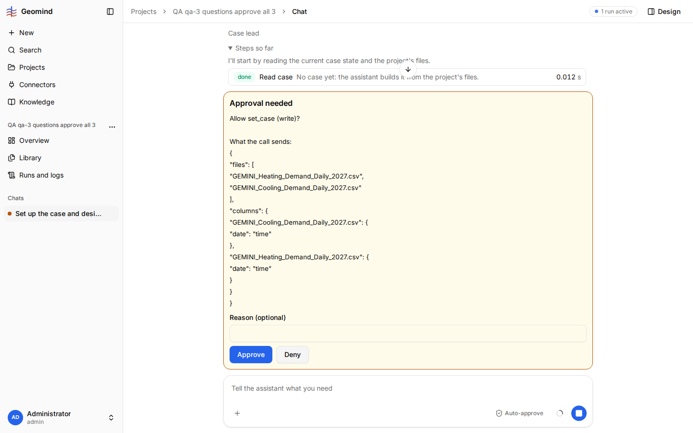

# QA-039: A daily demand series in a time zone with DST (Europe/Amsterdam) is refused; the agent falls back to UTC against the user's answer

| Field | Value |
|---|---|
| Status | blocked |
| Severity | minor |
| Area | gemini |
| Reporter | qa-5 |
| Found | 2026-11-04 20:38 UTC |
| Versions | frontend 1.1.33 (deployed bundle), backend 1.1.27 (geomind 0.4.29, gemini 0.6.4 per STATUS.md) |
| Where | https://geomind.team/projects/4d8fb808-9af1-493e-94e4-4d6d50916e5f/assistant/chat/f0388b3b-8f3a-4f97-8167-c7939e9bca9d; project QA qa-5 outputs report e2e; run started 20:30 UTC; case lead's set_case and confirmation question (20:38 UTC) |
| Fixer | hotfix-python |

## Steps

1. New project with the challenge PDF and the two daily demand CSVs (`gemini/examples/hackathon_2026/`).
2. Ask for the full design; when the case lead asks for the time zone of the series, answer `Europe/Amsterdam`.

## Expected

A daily series (365 dates, no offset) read in a local zone with DST is valid: each row is one calendar
day. gemini takes it in the user's zone (days of 23 or 25 hours at the DST change), or says
clearly how daily data in a DST zone must be given.

## Actual

The case lead's confirmation question (screenshot): "demand.heating.power.time_zone and
demand.cooling.power.time_zone = UTC: your answer was Europe/Amsterdam, but ... reading them in
Europe/Amsterdam breaks the constant 1-day step at the DST change (2027-10-31), which gemini rejects;
so the daily dates are read as UTC." The user's value is replaced; the series is shifted by one or two
hours against local time. The agent says so openly, so the user can see it.

## Evidence

- 

### qa-6: the same with weather from the open-meteo connector (2026-11-04 20:38-21:04 UTC, backend 1.1.27)

Project QA qa-6 knowledge and connectors, run a2dd83e3-f695-48a9-aaa4-e84b13003ed3 (run JSON in
`../evidence/QA-043/run-a2dd83e3.json.gz`). The user answered "Delft, Netherlands; Europe/Amsterdam"
(screenshot qa-6-1). The case lead then needed four set_case rounds and two climate fetches:
1. `openmeteo_get_climate` with `timezone: Europe/Amsterdam`; `save_mcp_table` stored the 365 days as
   2026-12-31T23:00Z to 2027-12-30T23:00Z; set_case refused it: "covers 2026-12-31T23:00 to
   2027-12-31T23:00; requested 2027-01-01T00:00 to 2028-01-01T00:00" (step 15).
2. With `time.start: 2027-01-01T00:00:00+01:00`: "no sample in the step starting 2027-10-30T23:00Z"
   for the weather and both demand files (DST, step 17).
3. A second fetch with `timezone: UTC` (steps 18-19), and the demand files read as `time_zone: UTC`,
   against the user's answer, with no word to the user in that run.
Also: `read_rag` cannot open the saved file `data/open-meteo_delft_2027_climate.csv` ("expected one of"
the three uploaded files, step 16), so the agent cannot check what it saved.

- 

## Cause

Fact (the agent's words): gemini refuses a series whose step is not constant in UTC. Guess: gemini
checks the step on UTC instants, not on local calendar dates, for daily (and coarser) series.

## Fix

(Hotfix session: cause, commit, version, deployed at.)
- 2026-11-04 20:43 UTC: hotfix-python: the fix is in gemini (check a daily or coarser series' step on local calendar dates, not UTC instants). gemini is frozen and its changes need Sahand's OK (rule of 2026-11-04 16:27: no bugs to gemini for now), so no change. For Sahand's list of gemini needs. Meanwhile the agent reads the dates as UTC and says so in its question.
- 2026-11-04 20:45 UTC: listed as gemini request 37 in geomind .claude/docs/plan.md (commit ea16df4), for Sahand to approve
## Retest

(Who, when, result.)

## Also seen (qa-3, 2026-11-04 20:46 UTC)

project "QA qa-3 questions approve all 3" (647b432b-b53c-4a5f-a854-38963af7180d), run b0ab49d0-6498-4bb0-a3a7-905a1c7afb7d, backend 1.1.27; run JSON in ../evidence/QA-042/run-b0ab49d0.json.gz. I answered "Europe/Amsterdam" for the demand dates; gemini refused the case ("no sample in the
step starting 2027-10-30T23:00:00+00:00", the DST change). The case lead then asked how to read the
dates, with the options Etc/GMT-1, UTC or a corrected file; I chose UTC.

