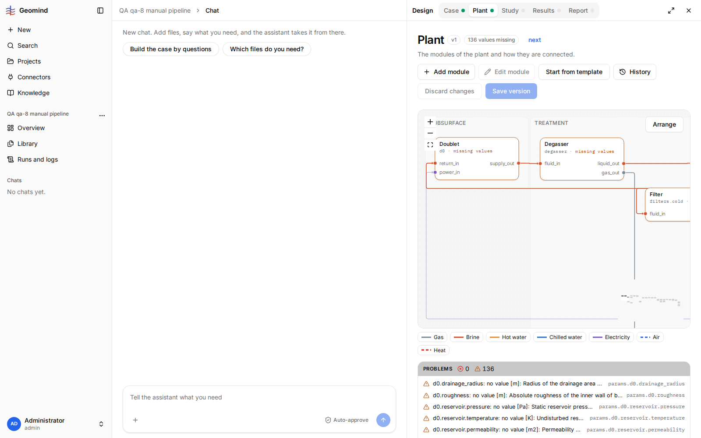
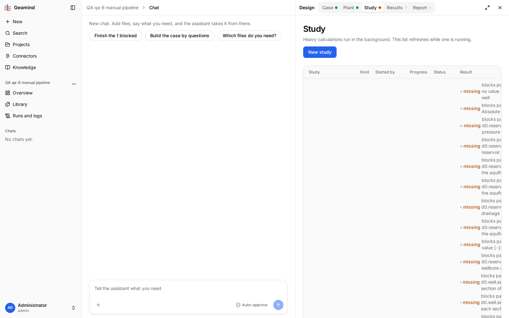
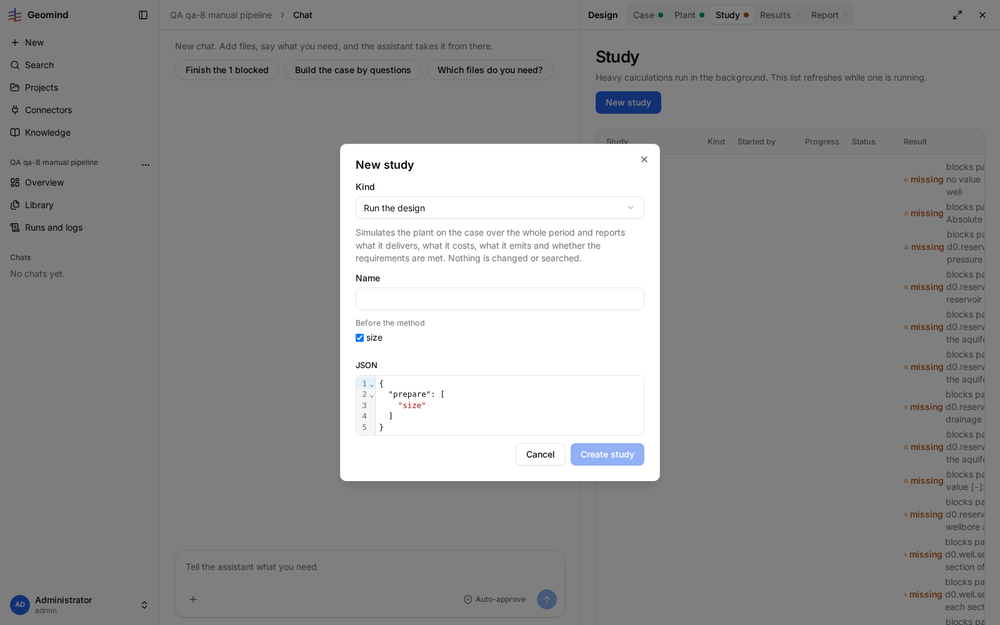

# QA-040: Study by hand: a run with size fails 'params.backup is missing'; the Plant page neither lists nor offers backup

| Field | Value |
|---|---|
| Status | fixing |
| Severity | blocker |
| Area | backend |
| Reporter | qa-8 |
| Found | 2026-11-04 20:40 UTC |
| Versions | frontend bundle index-DAOiLoAA.js, backend 1.1.27 |
| Where | https://geomind.team/projects/55612f74-441f-4a37-9859-a7ea43ab6600/design/study; project QA qa-8 manual pipeline; case v10, plant v1 (template HeatingCoolingPlant); studies 'QA qa-8 run by hand', 'QA qa-8 run with size'; no chat |
| Fixer | hotfix-back |

## Steps

1. By hand: a complete case (v10: demand series, time, site, utilities, economics; no values missing).
2. Plant page: Start from template > Heating Cooling Plant (`HeatingCoolingPlant`). The page shows
   "136 values missing", all module parameters (`params.d0.drainage_radius`, `params.d0.reservoir.pressure`, ...).
3. Study page: New study > Run the design, name "QA qa-8 run by hand", Create: status `blocked`
   with the same 136 missing values (screenshot 2).
4. New study > Run the design, tick "Before the method: size" (JSON `{"prepare": ["size"]}`),
   Create (screenshot 3).

## Expected

Either the run sizes the plant from the case and runs, or the Plant page tells, before the
study, every value the user must give, with a field to give it.

## Actual

The study fails at once: `study_failed: params.backup is missing; expected one of ('none', 'peak') (it has no default)`
(screenshot 4). The Plant page never lists `backup` among its problems (all 136 are module
parameters), and neither the Plant page nor the parameter panel has a field for it
(`/plant/parameters/plant` has no `backup`; the frontend has no field for it). A user working by hand
cannot run any study. Also: without size, the study is `blocked` on 136 values that size would
derive (reservoir pressure, permeability, ... are in the case); the dialog does not hint that size
is needed.

## Evidence

- 
- 
- 
- 

## Cause

Fact: gemini's brief plant (`examples/hackathon_2026/plants_brief/HeatingCoolingPlant.json`)
has a plant-level option `"backup": {"value": "peak"}`; the web template plant has none and the
web has no way to set it. Guess: the Plant page should show the brief's plant-level options
(backup, dispatch, ...) as fields and list them as missing; or the backend/gemini template should
carry them. Area may be backend (templates/parameters API) as much as frontend.

## Fix

(Hotfix session: cause, commit, version, deployed at.)
- 2026-11-04 20:41 UTC: belongs in backend (hotfix-front checked live, 20:45 UTC): GET /plant/parameters/plant?project=55612f74... returns search keys size.doublets, depth, d1.* ... but no 'backup' (nor other plant-level options of the brief plant), and the plant 'missing' list never names params.backup, while the study requires it. The Plant page renders exactly the fields and missing values the API gives, so it cannot offer a field the API does not list. Fix: the backend's plant template / parameters API should carry backup (and list it as missing, or set it from the brief). Once the API lists it, the page shows it with no frontend change, unless it is a choice type the form does not handle: then hotfix-front adds that.
## Retest

(Who, when, result.)
