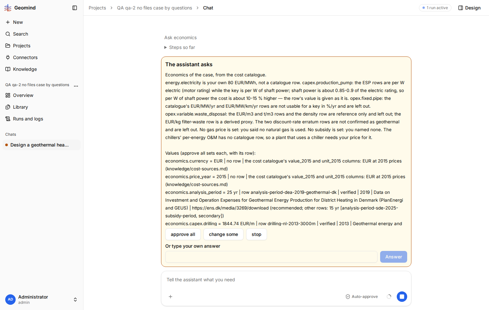

# QA-041: Economics question for a Norwegian campus recommends the Dutch heat price cap and the COVRA radioactive-waste drum tariff, and puts the user's 2026 electricity price into 2015 EUR

| Field | Value |
|---|---|
| Status | open |
| Severity | major |
| Area | geomind |
| Reporter | qa-2 |
| Found | 2026-11-04 20:41 UTC |
| Versions | frontend bundle index-DnxCbfcj.js, backend 1.1.27 |
| Where | https://geomind.team/projects/c8482f7a-9ff9-4888-82ac-4c8402b29a46/assistant/chat/abfff893-d638-4b04-927c-e0c154aa2490; project QA qa-2 no files case by questions; run 592f3730-4743-490e-91f0-63d9330aa7f2; case_lead ask_economics question (call-d9e67516) |
| Fixer | |

## Steps

1. A project with no files; the case is built by questions for the NTNU Gloshaugen campus,
   Trondheim, Norway (site in the case: "Trondheim, Norway (63.42 N, 10.40 E)").
2. In round 2 the user gives "electricity 80 EUR/MWh" (a price of today; no year asked).
3. After the case is approved, the case lead's economics question appears (screenshot 1; full text in
   `economics-question.txt`).

## Expected

The recommended rows suit the site and the use: a Norwegian or Nordic heat price where one exists,
a waste-disposal rate for bulk geothermal scale, not a radioactive-waste upper bound; a user price is
asked for its year (or converted) before it is set at `price_year = 2015`.

## Actual

- `economics.revenue.heat = 114.555 EUR/MWh`, row `heat-price-nl-cap-2026` (the Dutch ACM maximum
  heat tariff) is "recommended"; the Swedish row 81.1069 EUR/MWh is only an alternative. For cold the
  same question does pick the Norwegian row (`cold-price-no-2017`).
- `economics.opex.variable.waste_disposal = 45.93 EUR/kg`, row `waste-disposal-norm-proxy-covra-2026`
  (COVRA drum tariff for solid radioactive waste) is "recommended". The catalogue itself notes this
  row is "an upper bound for NORM scale ... likely far cheaper" (`geomind/data/knowledge/cost-sources.csv`);
  the alternatives are 0.0497 and 3.87 EUR/kg (900 to 1000 times lower for the first).
- `economics.energy.electricity = 80 EUR/MWh | no row | user` is set while `economics.price_year = 2015`:
  a 2026 price is taken as 2015 EUR with no question and no conversion, while every catalogue row was
  converted to 2015 (HICP).
- `economics.discount_rate` is left open ("no usable row"), so the economics cannot be complete
  without a typed answer; the question does not suggest a value.

## Evidence

- 
- Full question text: `../evidence/QA-041/economics-question.txt`
- Run JSON: `../evidence/QA-041/run-592f3730.json`

## Cause

Guess: the economics step picks the "recommended" row per key from the catalogue without the site's
country, and treats any user price as already in the catalogue's price year.

## Fix

(Hotfix session: cause, commit, version, deployed at.)

## Retest

(Who, when, result.)
