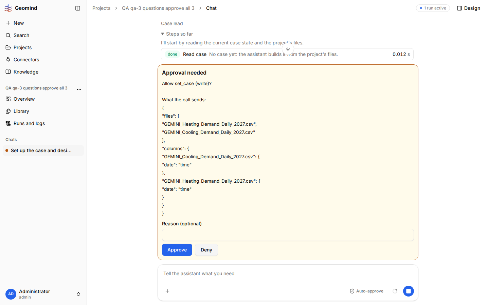

# QA-042: Case lead sends set_case with only files and columns again and again, also after the user denies it with a reason; the case is never set

| Field | Value |
|---|---|
| Status | fixed |
| Severity | major |
| Area | geomind |
| Reporter | qa-3 |
| Found | 2026-11-04 20:47 UTC |
| Versions | backend 1.1.27 (geomind 0.4.32 local wheel), models deepseek/deepseek-v4.1-flash-1017; frontend bundle index-DnxCbfcj.js |
| Where | https://geomind.team/projects/647b432b-b53c-4a5f-a854-38963af7180d (project "QA qa-3 questions approve all 3"), chat of its first message, run b0ab49d0-6498-4bb0-a3a7-905a1c7afb7d; also run e1da748d (project "QA qa-3 questions approve all") |
| Fixer | hotfix-python |

## Steps

1. New project with the challenge PDF and the two demand CSVs, shared memory on; auto-approve off.
2. Send "Set up the case and design a geothermal heating and cooling plant for the attached
   hackathon challenge. Ask me about any value the files do not give."
3. Approve every set_case; answer the grouped question (typed); choose "UTC" for the demand dates.
4. The next set_case card shows only `{"files": [...], "columns": {...}}`. Deny it with the reason
   "Denied: this call sends only the file names and sets no case. Send the whole case with the
   demand dates read as UTC."
5. Deny the next one (the same call) with no reason; approve the one after.

## Expected

After a refusal, the case lead sends the whole case (`changes` with every value it has, the
requirements and `columns`), as its own text says.

## Actual

- The case lead writes "The user denied that call because it sent only file names. Sending the
  whole case now, with the demand dates read as UTC." and sends the same `files` + `columns` call
  again, four times in a row (`steps[20]`, `[21]`, `[22]`; the reason reached it as the tool output
  of `steps[20]`).
- gemini refuses it every time: "files = [...] and nothing else; expected changes that name each
  file as the `file` of its series".
- The case team's loop stops on the repeated error; the project lead tries `set_case`
  `{"source": "project"}` (`steps[24]`, refused: the project has no case.json), then re-briefs a new
  case lead, which re-reads all files and the catalogue and sends the same files-only call again
  (`steps[39]`). The case is still not set after 25 minutes and 10 set_case calls.
- The same files-only first call is in run e1da748d (case lead step 5).
- Also seen: the second call (`steps[13]`) carried the 8 challenge `requirements`; gemini refused
  one (pump efficiency, QA-002), and every later call drops the whole `requirements` section.

All set_case calls of run b0ab49d0 (0-based `steps[i]`):

| steps[i] | input keys | output tokens | result |
|---|---|---|---|
| 12 | files, columns | 8527 | refused: files and nothing else |
| 13 | changes, requirements | 3634 | refused: column `date`, pump efficiency |
| 14 | changes, columns | 663 | refused: dates without offset |
| 17 | files, changes, columns | 1965 | refused: span shifted by the zone |
| 18 | changes, columns | 1292 | refused: DST step (QA-039) |
| 20 | files, columns | 1506 | denied by me, with a reason |
| 21 | files, columns | 1179 | denied by me |
| 22 | files, columns | 1031 | refused: files and nothing else |
| 24 | source (project lead) | 234 | refused: no case.json |
| 39 | files, columns (new case lead) | 4418 | refused: files and nothing else |

## Evidence

- 
- 
- Run JSON: [`../evidence/QA-042/run-b0ab49d0.json.gz`](../evidence/QA-042/run-b0ab49d0.json.gz) (gzip, exported while the run was still running)
- Run JSON: [`../evidence/QA-042/run-e1da748d.json.gz`](../evidence/QA-042/run-e1da748d.json.gz) (gzip)

## Cause

Guess: the files-only call is what the case lead's prompt or the set_case schema shows as the way
to load files, so the model reaches for it first. The output tokens of `steps[20]` to `[22]`
(1000-1500) are far more than a files-only call needs, so the `changes` may be written and then
lost (dropped while the call is parsed, or put in the text). That is not checked.

## Fix

- 2026-11-04 20:56 UTC: cause (runs b0ab49d0, e1da748d): after the time-zone answer the case lead sent set_case(files, columns) alone; under geomind 0.4.32 each such call asked an approval the user had to deny. Fixed: 0.4.40 (QA-037) refuses it before any approval; geomind 0.4.42 (commit 3334d64) names the run's last full set_case step and asks to send it again whole. Backend 1.1.40, waiting for deploy.
- 2026-11-04 21:06 UTC: shipped in backend 1.1.40 with geomind 0.4.42 (deployed 21:02 UTC); the fix is in the prod worker (checked: code/prompt present, QA-023 gives 'Design a plant' for a ready case). Live retest by the bug's steps still to do.
## Retest
