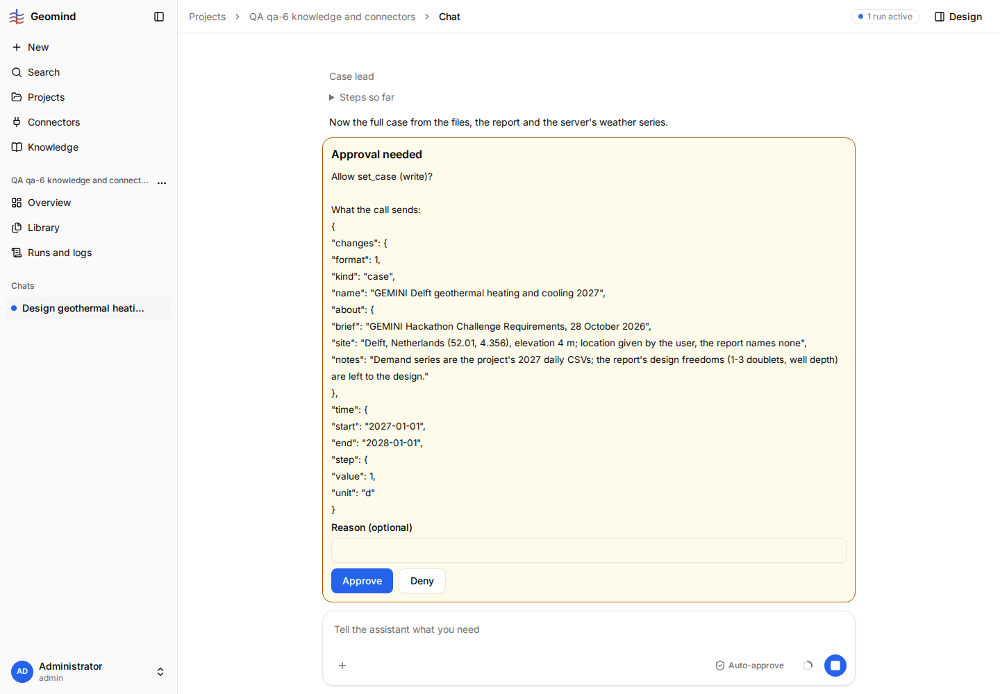
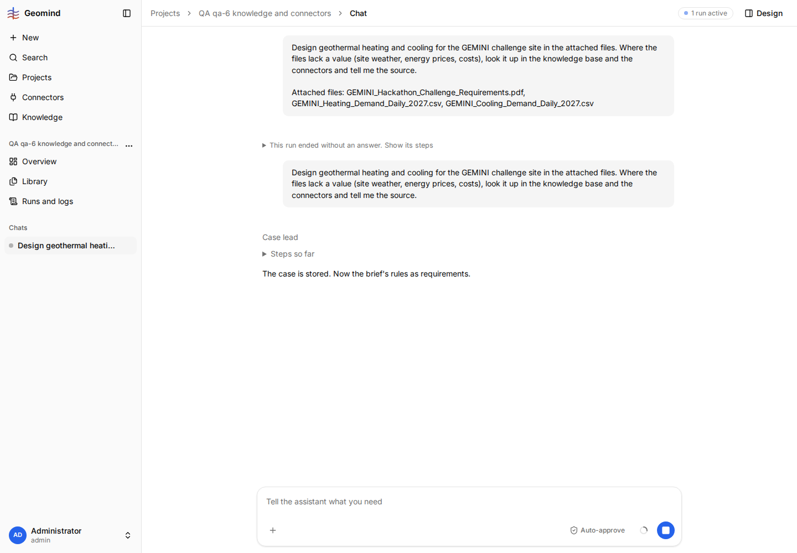

# QA-043: Relative humidity from the open-meteo connector (in %) cannot enter the case; the agent drops it without telling the user

| Field | Value |
|---|---|
| Status | open |
| Severity | major |
| Area | geomind |
| Reporter | qa-6 |
| Found | 2026-11-04 21:05 UTC |
| Versions | frontend bundle index-DnxCbfcj.js, backend 1.1.27 (geomind 0.4.29) |
| Where | https://geomind.team/projects/bc1d5450-590a-4dce-afe0-0d5ea13932bd/assistant/chat/1b669d3e-ea13-43ce-b2aa-9f3d8ab258da; project QA qa-6 knowledge and connectors (memory on, connector open-meteo on); run a2dd83e3-f695-48a9-aaa4-e84b13003ed3; case_lead steps 9-22 |
| Fixer | |

## Steps

1. New project, shared memory On, the challenge PDF and the two demand CSVs; in Settings tick the
   open-meteo connector.
2. Chat: "Design geothermal heating and cooling for the GEMINI challenge site in the attached files.
   Where the files lack a value (site weather, energy prices, costs), look it up in the knowledge base
   and the connectors and tell me the source."
3. The case lead asks for the site and the time zone; answer "1. Delft, Netherlands. 2. Europe/Amsterdam."
4. Approve each card (save_mcp_table, set_case).

## Expected

The daily relative humidity open-meteo gives (`relative_humidity_2m_mean`, unit `%`) becomes
`site.air.relative_humidity` (a fraction 0-1), as the temperature becomes `site.air.temperature`:
the unit `%` is converted (80 to 0.80), on save or in the case. If it cannot be used, the user is told so.

## Actual

- `openmeteo_get_climate` returns `relative_humidity_2m_mean` in `%`; `save_mcp_table` saves it to
  `data/open-meteo_delft_2027_climate_utc.csv` with `units: {"relative_humidity_2m_mean": "%"}`.
- set_case with `{file, column: relative_humidity_2m_mean, unit: "%"}`: `invalid_unit`
  "site.air.relative_humidity.unit = '%'; this value has no dimension, expected no unit" (step 20).
- set_case with no unit: `out_of_bounds` "step 0 = 80.0 (SI); expected within the bounds {min 0, max 1}" (step 21).
- Step 22: the agent sends the case without `site.air.relative_humidity` (screenshot 1 is the card
  that still had it). It was accepted. Nothing in the chat says that the humidity was dropped,
  and the user approved three set_case cards for it.
- The same `%` refusal came at step 15 with the first saved file.

## Evidence

- 
- 
- Run JSON (gzip): `../evidence/QA-043/run-a2dd83e3.json.gz`, case_lead steps 15, 19-22.

## Cause

Fact: gemini's site.air.relative_humidity takes a bare fraction and refuses %. Guess: save_mcp_table (geomind) could convert a % column to a fraction (or the case could accept % on a dimensionless key, a gemini request); the case lead should tell the user when a fetched value is left out.

## Fix

(Hotfix session: cause, commit, version, deployed at.)

## Retest

(Who, when, result.)
