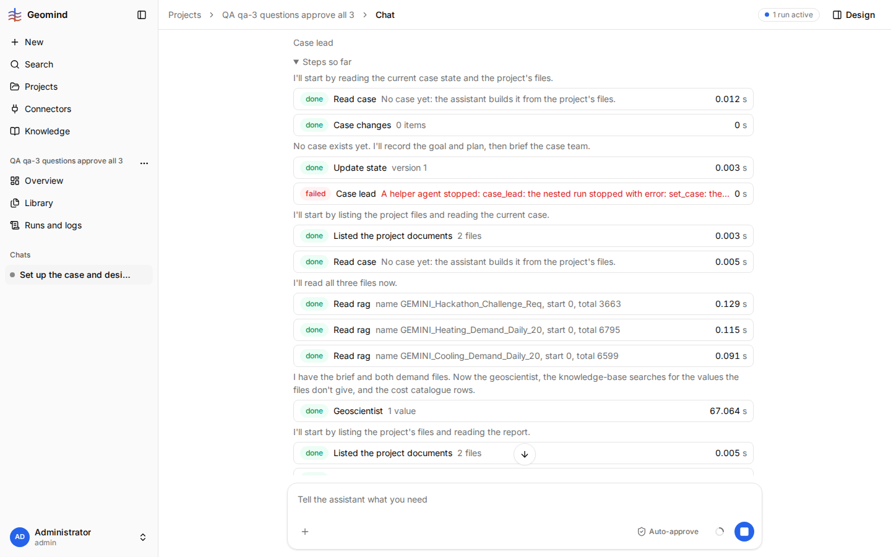

# QA-044: Chat: the live stream stops with validation_failed during a long run (Last-Event-ID refused); the chat says reload the page

| Field | Value |
|---|---|
| Status | fixing |
| Severity | minor |
| Area | frontend,backend |
| Reporter | qa-5 |
| Found | 2026-11-04 21:11 UTC |
| Versions | frontend 1.1.33 bundle index-DnxCbfcj.js, backend 1.1.40 |
| Where | https://geomind.team/projects/4d8fb808-9af1-493e-94e4-4d6d50916e5f/assistant/chat/f0388b3b-8f3a-4f97-8167-c7939e9bca9d; project QA qa-5 outputs report e2e; run 6c5b17e1-6ce7-4025-af28-fbb763938aaf; fill_parts step, about 21:07 UTC |
| Fixer | hotfix-back |

## Steps

1. Keep the chat of a long run open (case, economics, design) for 35 minutes, across a backend deploy (21:00 UTC).
2. Watch the chat when the run reaches fill_parts.

## Expected

The live stream reconnects by itself and the chat goes on showing the run.

## Actual

The chat shows in red "The live stream stopped (validation_failed). Reload the page to continue." The run itself goes on (`running`).
Probe: `GET /api/v1/assistant/runs/<id>/events` with `Last-Event-ID: ''` or `abc` returns 422 `Last-Event-ID must be an integer`; with `5` it streams.

## Evidence

- 

## Cause

Guess: after the WebSocket gave up (it got 404 while the backend restarted), the SSE fallback (`shared/sse/stream.ts`) sent a Last-Event-ID that is not an integer (empty or a non-numeric id), which `src/core/sse/follow.py:last_event_id` refuses; 422 is not retryable, so the chat stops. A fix: the backend treats an empty/invalid id as a new stream, and/or the frontend sends only numeric ids.

## Fix

(Hotfix session: cause, commit, version, deployed at.)

## Retest

(Who, when, result.)

## Also seen (qa-3, 2026-11-04 21:10 UTC)

project "QA qa-3 questions approve all 3" (647b432b-b53c-4a5f-a854-38963af7180d), run b0ab49d0-6498-4bb0-a3a7-905a1c7afb7d, backend 1.1.27; run JSON in ../evidence/QA-042/run-b0ab49d0.json.gz. Right after I approved the economics set_case (about 38 minutes into the run), the chat said
"The live stream stopped (validation_failed). Reload the page to continue." A reload showed the run
going on (the case lead's next question). 
