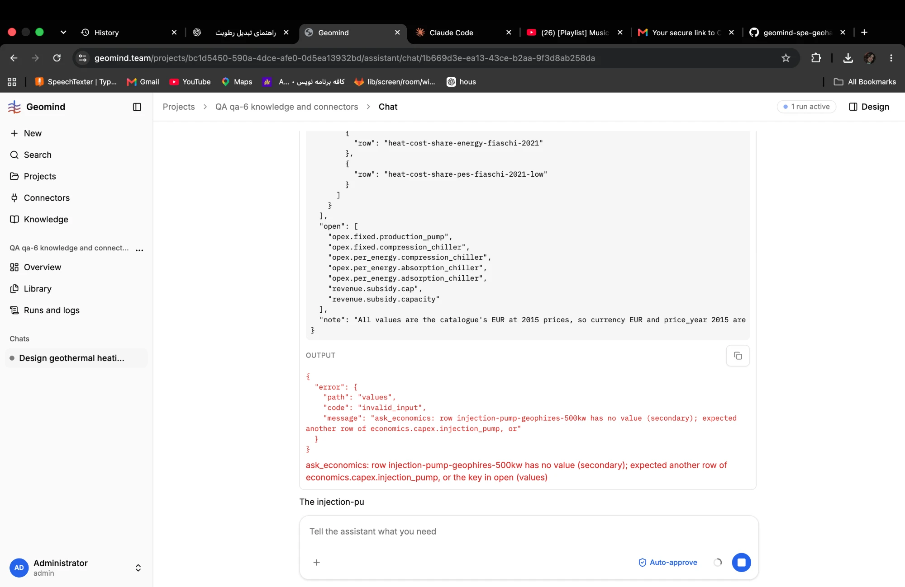

# QA-045: ask_economics refuses the whole question on a catalogue row with no 2015 value; the knowledge base offers such rows

| Field | Value |
|---|---|
| Status | open |
| Severity | major |
| Area | data,geomind |
| Reporter | Fatemeh (screenshot), Claude (write-up) |
| Found | 2026-11-04 21:18 UTC |
| Versions | frontend 1.1.33; API health at write-up: {"status":"ok","assistant":"model","version":"1.1.40"} |
| Where | https://geomind.team/projects/bc1d5450-590a-4dce-afe0-0d5ea13932bd/assistant/chat/1b669d3e-ea13-43ce-b2aa-9f3d8ab258da (project QA qa-6 knowledge and connectors); the case lead's ask_economics |
| Fixer | |

## Steps

1. In a design chat, the case lead reads the cost catalogue and calls ask_economics.
2. For `capex.injection_pump` it lists the row `injection-pump-geophires-500kw` (as the value or in `others`).

## Expected

The knowledge base never offers a row ask_economics cannot use; or ask_economics leaves that row
out with a note and asks the rest (as it now does for a non-economics key, QA-007).

## Actual

ask_economics refuses the whole question: "ask_economics: row injection-pump-geophires-500kw has no
value (secondary); expected another row of economics.capex.injection_pump, or the key in open
(values)". The agent has to write the long call again (QA-013).

## Evidence

- 
- `geomind/data/knowledge/cost-sources.csv` (and `gemini/docs/cost-sources/sources.csv`): three
  economics rows have a `value` but no `value_2015` / `unit_2015` (and no `price_year`):
  - `esp-geophires-500kw`: 0.593 USD/W, economics.capex.production_pump
  - `injection-pump-geophires-500kw`: 0.733 USD/W, economics.capex.injection_pump
  - `corrosion-inhibitor-ouzounian-1989-dogger`: 60000 FRF/yr, economics.opex.variable.chemical

## Cause

Fact: the economics take `value_2015` (EUR, 2015 prices); these rows were never converted (no
price year, USD or FRF), so the tool sees "no value". Guess: read_rag / search_rag hand them to the
agent like any other row. Two fixes: convert the rows (data), and let ask_economics drop an unusable
row with a note instead of refusing the question (geomind).

## Fix

## Retest
