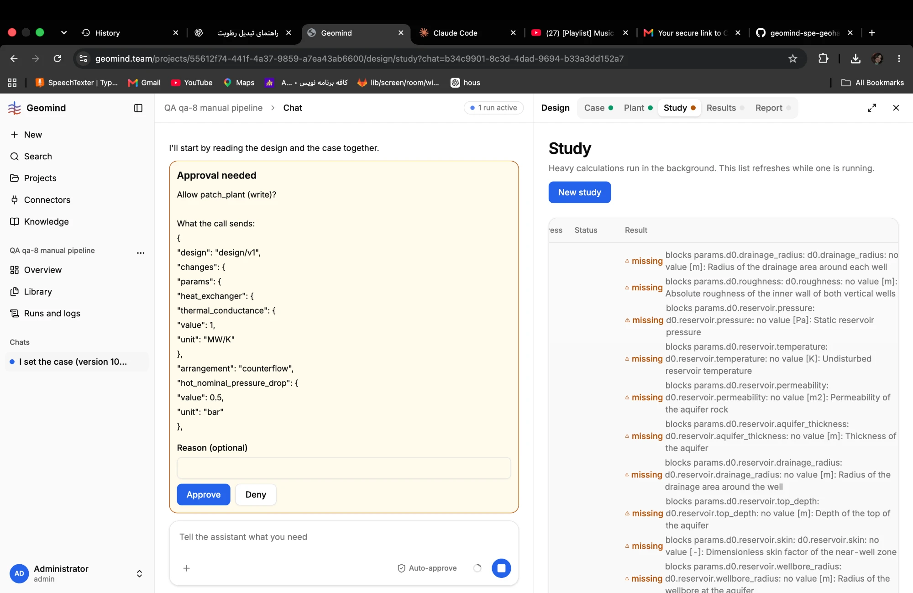

# QA-048: Study tab: the missing-parameter list overflows; the table is cut on the left (Progress reads 'ess')

| Field | Value |
|---|---|
| Status | fixing |
| Severity | cosmetic |
| Area | frontend |
| Reporter | Fatemeh (screenshot), Claude (write-up) |
| Found | 2026-11-04 21:25 UTC |
| Versions | frontend 1.1.33; backend 1.1.40 (API health at write-up) |
| Where | https://geomind.team/projects/55612f74-441f-4a37-9859-a7ea43ab6600/design/study?chat=b34c9901-8c3d-4dad-9694-b33a3dd152a7 (project QA qa-8 manual pipeline) |
| Fixer | hotfix-front |

## Steps

1. In a project whose plant still lacks parameters (the design team has not filled them; a patch_plant approval is waiting), open Design > Study.

## Expected

The Study tab says in one short line that studies wait for the plant's parameters and links to the Plant tab; the table fits the panel.

## Actual

The table is wider than the panel: its first column is cut (the header reads "ess" for Progress). The Result column holds one row per missing parameter, each a long gemini message ("blocks params.d0.drainage_radius: d0.drainage_radius: no value [m]: Radius of the drainage area around each well", and about ten more), so the tab reads as a long red-orange list.

## Evidence

- 

## Cause

Guess: the Study table puts the plant's whole missing list in a result cell and has no min-width / horizontal handling for the side panel.

## Fix

## Retest
