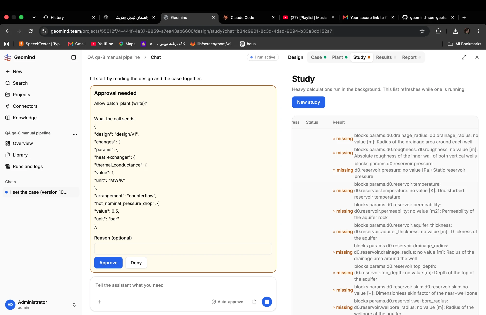

# QA-049: The plant asks again for reservoir pressure, permeability and thickness that the case already has

| Field | Value |
|---|---|
| Status | fixing |
| Severity | minor |
| Area | gemini,geomind |
| Reporter | Fatemeh (screenshot), Claude (write-up) |
| Found | 2026-11-04 21:25 UTC |
| Versions | frontend 1.1.33; backend 1.1.40 (API health at write-up) |
| Where | https://geomind.team/projects/55612f74-441f-4a37-9859-a7ea43ab6600/design/study?chat=b34c9901-8c3d-4dad-9694-b33a3dd152a7 (project QA qa-8 manual pipeline) |
| Fixer | hotfix-python |

## Steps

1. The case of project QA qa-8 (case version 10) has site.reservoir.pressure 250 barg, thickness 100 m, permeability 200 mD, reference_depth 2500 m.
2. Open Design > Study: the plant's missing list.

## Expected

Plant parameters that describe the same reservoir come from the case (or the agent is told they are the same values); the plant does not ask for them again.

## Actual

The plant lists as missing: params.d0.reservoir.pressure, d0.reservoir.permeability, d0.reservoir.aquifer_thickness, d0.reservoir.temperature, d0.reservoir.top_depth (plus drainage radius, skin, wellbore radius, roughness). The first ones are in the case already, so the reservoir engineer must copy them, with a chance of a different value or unit.

## Evidence

- 
- Postgres read-only: case_versions of project 55612f74, number 10, site.reservoir.

## Cause

Guess: gemini's Doublet takes its reservoir as plant parameters, separate from the case's site. A request to gemini needs Sahand's approval: list it in the gemini requests, do not ask gemini directly.

## Fix

## Retest
