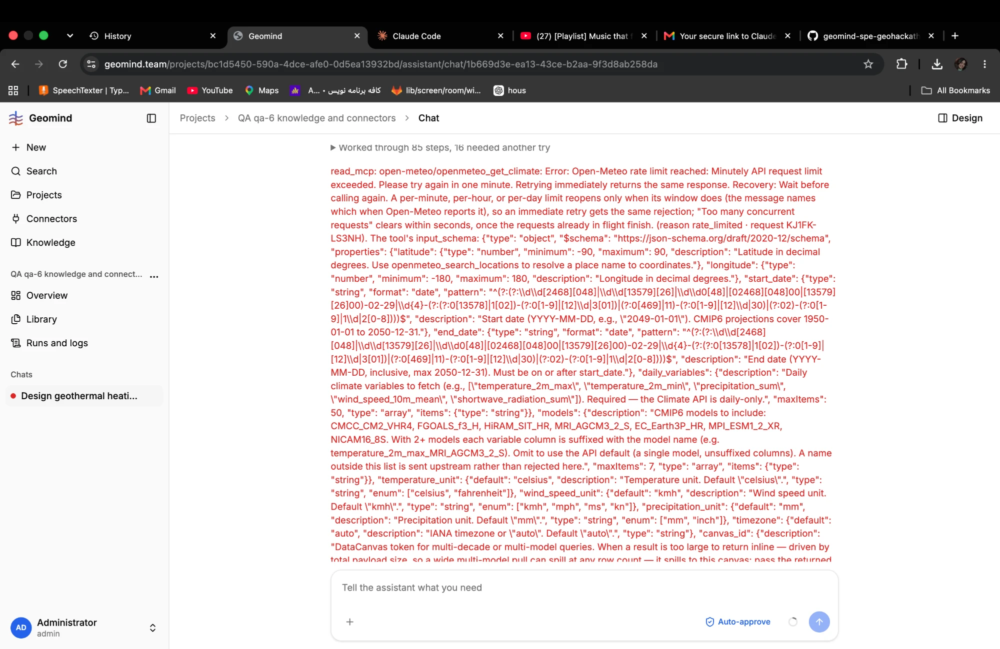

# QA-050: A connector rate limit (Open-Meteo, per minute) stops the whole run after 3 tries; nothing waits for the window

| Field | Value |
|---|---|
| Status | open |
| Severity | major |
| Area | geomind |
| Reporter | Fatemeh (screenshot), Claude (write-up) |
| Found | 2026-11-04 21:26 UTC |
| Versions | frontend 1.1.33; backend 1.1.40 (API health at write-up) |
| Where | https://geomind.team/projects/bc1d5450-590a-4dce-afe0-0d5ea13932bd/assistant/chat/1b669d3e-ea13-43ce-b2aa-9f3d8ab258da (project QA qa-6); run a2dd83e3-f695-48a9-aaa4-e84b13003ed3 |
| Fixer | |

## Steps

1. A design chat that asks the agents to find the site weather in the connectors (open-meteo).
2. The case lead calls the open-meteo climate tool several times (the run shows "Worked through 85 steps, 16 needed another try").

## Expected

On a rate limit the agent (or the MCP client) waits for the window the message names (here one minute) and calls again; the run goes on.

## Actual

Open-Meteo answers "Minutely API request limit exceeded. Please try again in one minute". The same call is retried at once, fails three times with the same error, and the run stops: `{"code": "error", "message": "read_mcp: the same call failed 3 times in a row with the same error; the run stops instead of spending more"}` (ended 2026-11-04 21:24:05 UTC, after 54 minutes). The tool's own message says "Retrying immediately returns the same response. Recovery: Wait before calling again".

## Evidence

- 
- Postgres read-only: runs row a2dd83e3, error above.

## Cause

Fact: the loop's "same call failed 3 times" guard counts a rate-limit refusal like any error. Guess: nothing in read_mcp waits on rate_limited; the case lead also calls the climate tool more often than it needs (one call per variable or per retry).

## Fix

## Retest
