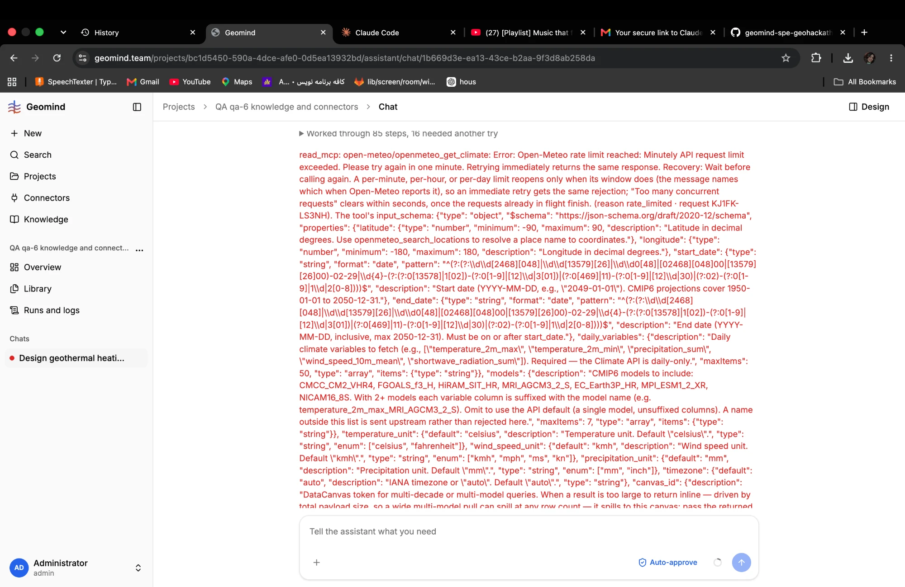

# QA-051: The run's error in the chat dumps the whole MCP tool input schema as a wall of red text

| Field | Value |
|---|---|
| Status | fixed |
| Severity | minor |
| Area | geomind,frontend |
| Reporter | Fatemeh (screenshot), Claude (write-up) |
| Found | 2026-11-04 21:26 UTC |
| Versions | frontend 1.1.33; backend 1.1.40 (API health at write-up) |
| Where | https://geomind.team/projects/bc1d5450-590a-4dce-afe0-0d5ea13932bd/assistant/chat/1b669d3e-ea13-43ce-b2aa-9f3d8ab258da (project QA qa-6); run a2dd83e3-f695-48a9-aaa4-e84b13003ed3 |
| Fixer | hotfix-front |

## Steps

1. As QA-050: the run stops on the Open-Meteo rate limit.

## Expected

The chat shows one short line: what stopped the run, and what to do ("Open-Meteo's per-minute limit; send again in a minute").

## Actual

The chat shows the whole error in red, and with it the tool's full `input_schema` (latitude, longitude, the date regex patterns, daily_variables, models, units, canvas_id ...): about forty lines, unreadable.

## Evidence

- 

## Cause

Guess: the read_mcp error message appends the tool's input_schema (meant for the agent, so it can fix its call) and the run's final error shows that same text to the user.

## Fix

- 2026-11-04 23:18 UTC: frontend part 1.1.52 (af07031), pushed, build checked; deploy with the batch
- 2026-11-04 23:31 UTC: frontend 1.1.52, commit af07031, deployed (1.1.54)
## Retest
