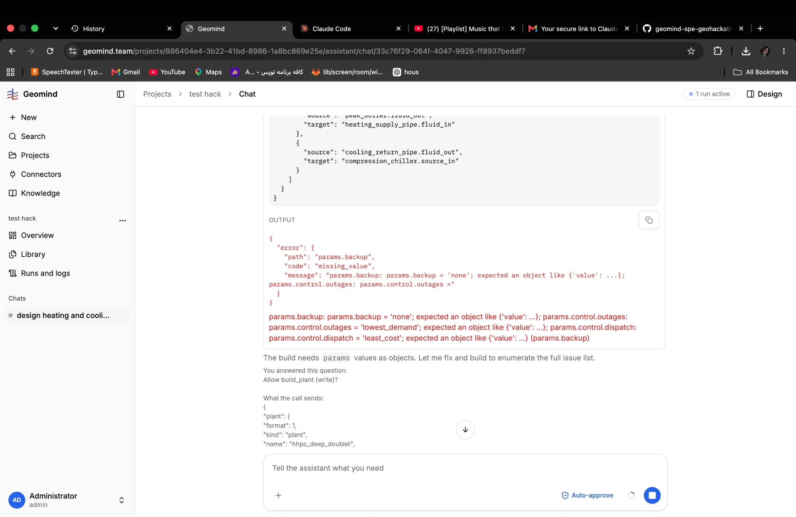

# QA-052: build_plant: params.backup, control.outages and control.dispatch sent as bare strings are refused, after the user's approval

| Field | Value |
|---|---|
| Status | fixing |
| Severity | minor |
| Area | geomind |
| Reporter | Fatemeh (screenshot), Claude (write-up) |
| Found | 2026-11-04 21:27 UTC |
| Versions | frontend 1.1.33; backend 1.1.40 |
| Where | https://geomind.team/projects/886404e4-3b22-41bd-8986-1a8bc869e25e/assistant/chat/33c76f29-064f-4047-9926-ff8937beddf7 (project test hack); run f78c671a-82b9-45e1-832e-0c2466de6d77 (after "continue", QA-047) |
| Fixer | hotfix-python |

## Steps

1. The design lead rebuilds the plant hhpc_deep_doublet with build_plant (Auto-approve on, so the
   chat answers "Allow build_plant (write)?" by itself).

## Expected

The agent writes every parameter in gemini's form (`{"value": ...}`), and a write the user
approves is one gemini accepts (checked before the approval, as set_case now does, QA-037).

## Actual

build_plant is refused with `missing_value` on three paths at once:
`params.backup = 'none'; expected an object like {'value': ...}`,
`params.control.outages = 'lowest_demand'; expected an object like {'value': ...}`,
`params.control.dispatch = 'least_cost'; expected an object like {'value': ...}`.
The agent says "The build needs params values as objects. Let me fix and build" and calls again,
with a new approval.

## Evidence

- 

## Cause

Guess: `params.backup` is new (QA-040) and the prompts or the skill do not show that a choice
parameter is written as `{"value": "none"}`; build_plant asks for approval before gemini checks the
plant. Same family as QA-002 (a value in the wrong form) and QA-037 (approval before the check).

## Fix

## Retest
