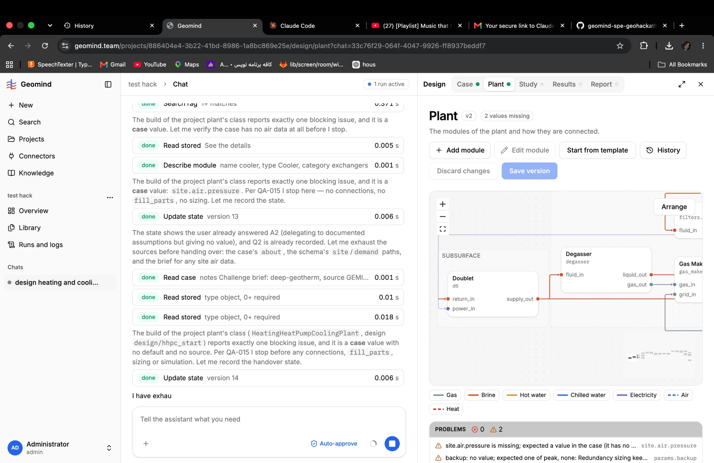
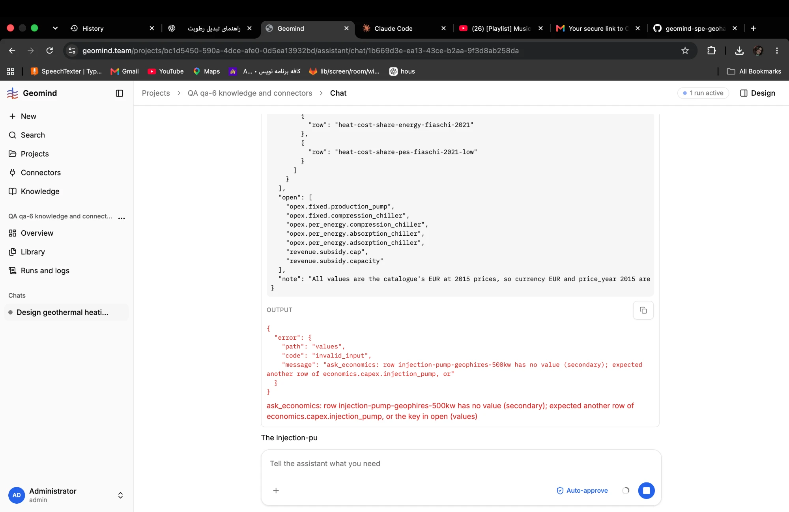

# QA-053: Chat: an agent's streamed text stops mid-word ("I have exhau"); the full text never replaces it

| Field | Value |
|---|---|
| Status | fixed |
| Severity | minor |
| Area | frontend |
| Reporter | Fatemeh (screenshot), Claude (write-up) |
| Found | 2026-11-04 21:31 UTC |
| Versions | frontend 1.1.33; backend 1.1.40 |
| Where | https://geomind.team/projects/886404e4-3b22-41bd-8986-1a8bc869e25e/assistant/chat/33c76f29-064f-4047-9926-ff8937beddf7 (project test hack); run f78c671a-82b9-45e1-832e-0c2466de6d77 |
| Fixer | hotfix-front |

## Steps

1. Watch an active run in the chat while an agent's step ends with a tool call (here the design lead's handover, 21:30:36 UTC).

## Expected

The agent's text in the chat ends as the agent wrote it.

## Actual

The chat shows "I have exhau" and nothing after, while the run goes on (the next agent starts). The run's events hold the full text: step.finished (sequence 340, design_lead, public) `"text": "I have exhausted the sources and the build is blocked on a case value. Handing over."`. Seen before in another chat: "The injection-pu" (QA-045's screenshot).

## Evidence

- 
- 
- Postgres read-only: run_events of f78c671a, sequence 335 and 340.

## Cause

Guess: the chat renders the text from the stream's deltas and does not replace it with the step's final text when step.finished arrives; the last deltas are lost when the step ends on a tool call.

## Fix

- 2026-11-04 23:16 UTC: frontend 1.1.51 (87de23b), pushed, build checked; deploy with the batch. Events of f78c671a: step.finished 340 holds the full text; the live block now shows a finished step's text whole (no pacing)
- 2026-11-04 23:31 UTC: frontend 1.1.51, commit 87de23b, deployed (1.1.54)
## Retest
