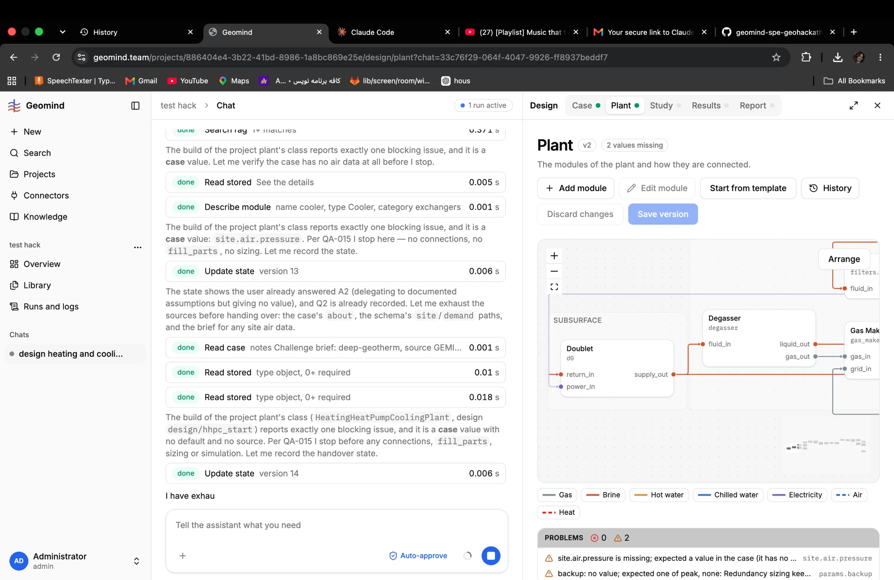

# QA-054: Agent prompts name QA bug ids; agents quote them to the user ("Per QA-015 I stop here")

| Field | Value |
|---|---|
| Status | open |
| Severity | minor |
| Area | geomind |
| Reporter | Fatemeh (screenshot), Claude (write-up) |
| Found | 2026-11-04 21:31 UTC |
| Versions | frontend 1.1.33; backend 1.1.40 |
| Where | https://geomind.team/projects/886404e4-3b22-41bd-8986-1a8bc869e25e/assistant/chat/33c76f29-064f-4047-9926-ff8937beddf7 (project test hack); run f78c671a-82b9-45e1-832e-0c2466de6d77 |
| Fixer | |

## Steps

1. As QA-047 (A): the design lead finds site.air.pressure missing after build_plant.

## Expected

The agent explains the stop in the user's terms ("the plant needs the site's air pressure; I stop before sizing").

## Actual

The chat says: "Per QA-015 I stop here — no connections, no fill_parts, no sizing" and "reports exactly one blocking issue ... Per QA-015 I stop before any connections". QA-015 is an internal bug id; the user cannot know it. The prompts that name QA ids (12 places): geomind/prompts/design/well.md geomind/prompts/design/process.md geomind/prompts/design/energy.md geomind/prompts/design/reservoir.md geomind/prompts/case/lead.md geomind/prompts/project/lead.md geomind/prompts/design/lead.md .

## Evidence

- 

## Cause

Fact: the hotfixes wrote the bug id into the prompts' rules (for example `prompts/design/well.md` "(QA-020)"). The model repeats it. Fix: keep bug ids in commits and code comments, not in prompt text.

## Fix

## Retest
