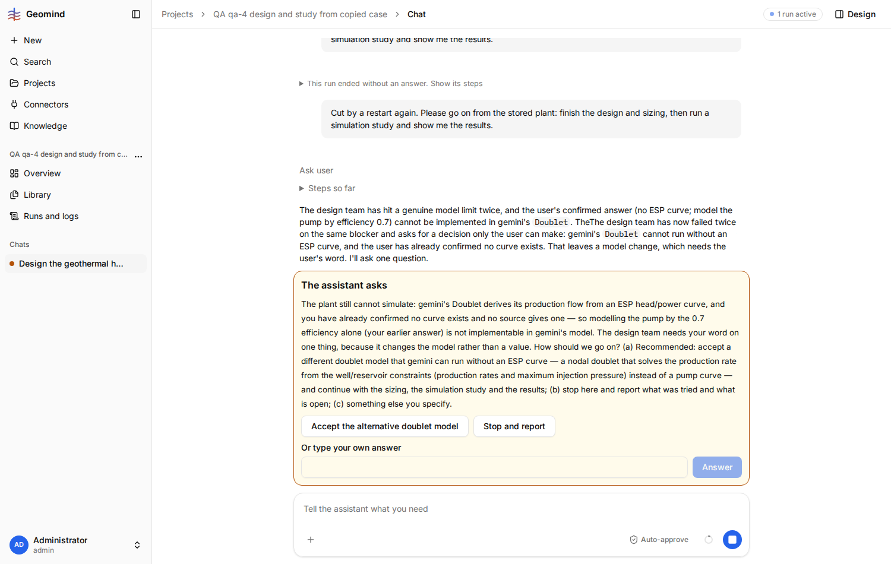
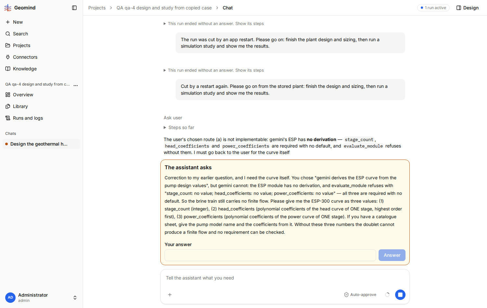

# QA-055: Design lead asks the user for an ESP pump curve no source has, offers an option (gemini derives it) gemini cannot do, and blocks the design

| Field | Value |
|---|---|
| Status | fixed |
| Severity | major |
| Area | geomind |
| Reporter | qa-4 |
| Found | 2026-11-04 22:21 UTC |
| Versions | backend 1.1.43 (deployed 21:30 UTC); run started on 1.1.27 |
| Where | https://geomind.team/projects/d113b998-4b59-452e-a69c-128faca2a595/assistant/chat/a543367b-0304-4314-adbc-0bcc5192b015; project "QA qa-4 design and study from copied case"; run 641c7f5a-a0af-4747-b93c-c2bafb67fe8a; design lead, ask_user |
| Fixer | hotfix-python |

## Steps

1. Project with the case copied from "SPE GeoHackathon 2026" (case requirement `pump_efficiency`
   0.7 on the doublet; no pump curve anywhere).
2. Chat: "Design the geothermal heating and cooling plant for this case, size it, then run a
   simulation study and show me the results." Approve every write.
3. The design lead sets `d0.esp.pump_type` "ESP-300" and asks: "How should the ESP curve be set?
   (a) Let gemini derive it from the pump design values ... or (b) you give the ESP-300 stage
   count, head coefficients and power coefficients."
4. Answer (a).
5. The design lead answers: "Correction ... gemini cannot: the ESP module has no derivation,
   and evaluate_module refuses with stage_count: no value; head_coefficients: no value;
   power_coefficients: no value ... Please give me the ESP-300 curve as three values".

## Expected

The design works with what the case gives (pump efficiency 0.7), as the reference plant
`gemini/examples/hackathon_2026/plants/HackathonPlant.json` does (`d0.esp.pump_type`
"unspecified", no stage curve). A question offers only options the tools can carry out.

## Actual

The design lead picks an ESP model that needs a stage curve no file, knowledge entry or gemini
value gives, offers an option gemini cannot do, then asks the user for polynomial head and power
coefficients of one pump stage, which a user of the challenge does not have. The design stops
there ("the brine train carries no finite flow"). Detour tried: a typed answer telling it to use
the efficiency 0.7 as the reference plant does (21:39 UTC); result in Retest/notes below.

After the typed detour (use efficiency 0.7, no curve), the project lead asks a third question
(21:45 UTC): "gemini's Doublet derives its production flow from an ESP head/power curve ...
modelling the pump by the 0.7 efficiency alone ... is not implementable", offering (a) a
different "nodal doublet" model, (b) stop and report. The project "SPE GeoHackathon 2026" (the
source of this case) has 4 finished studies with this challenge, so a doublet without a pump
curve did simulate before. qa-4 chose (a) to go on. 

## Evidence

- 
- Run JSON: `../evidence/QA-055/run-641c7f5a.json` (added when the run ends)

## Cause

Guess: the design lead or well engineer does not know that the ESP can run without a curve (or
how the reference plant does it), and the ask_user options are not checked against the tools.

## Fix

(Hotfix session: cause, commit, version, deployed at.)
- 2026-11-04 23:19 UTC: geomind 0.4.49 (commit ddeb5be: well engineer and design lead prompts: an ESP with no curve is pump_type unspecified and the doublet derives its curves from its design values and the case's pump efficiency; no curve question), backend 1.1.49 (2af2257) deployed by hotfix-python. Live retest by the bug's steps still to do.
## Retest

(Who, when, result.)
