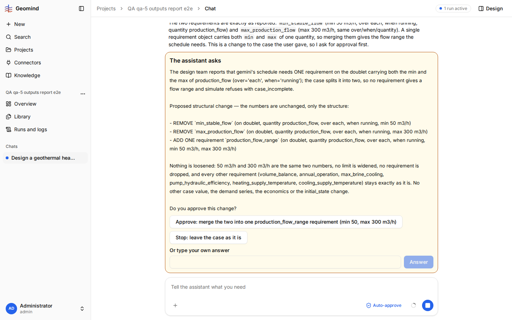
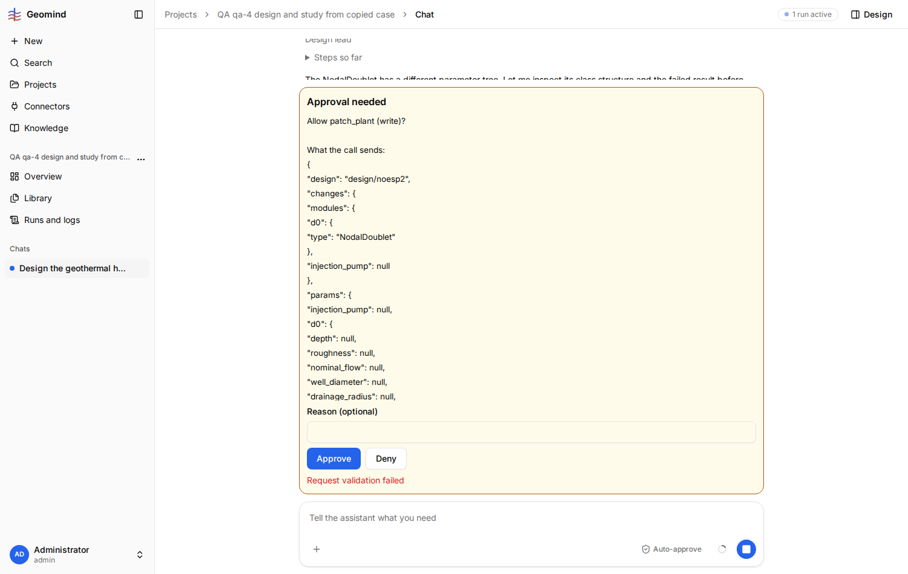

# QA-056: Chat shows an already answered question while the run waits on a design_lead approval; no approval card, auto-approve cannot fire, the run is stuck

| Field | Value |
|---|---|
| Status | open |
| Severity | blocker |
| Area | backend |
| Reporter | qa-5 |
| Found | 2026-11-04 22:35 UTC |
| Versions | frontend bundle index-DnxCbfcj.js, backend 1.1.45 (geomind 0.4.46) |
| Where | https://geomind.team/projects/4d8fb808-9af1-493e-94e4-4d6d50916e5f/assistant/chat/f0388b3b-8f3a-4f97-8167-c7939e9bca9d; project QA qa-5 outputs report e2e; run 6c5b17e1-6ce7-4025-af28-fbb763938aaf; pending request-3455 (design_lead patch_plant) |
| Fixer |  |

## Steps

1. Long pipeline run with Auto-approve on (tab open). At 22:32 UTC the case lead asks a question
   (merge min_stable_flow and max_production_flow into one production_flow_range requirement).
2. Click the chip "Approve: merge the two ..." (22:33 UTC).
3. The run goes on; the design lead calls patch_plant (write) and the run waits for its approval.
4. Reload the chat.

## Expected

The answered question closes; the chat shows the new approval card (or Auto-approve answers it).

## Actual

- `GET /assistant/runs/6c5b17e1...`: status `waiting`, request `{"kind": "approval", "agent": "design_lead",
  "message": "Allow patch_plant (write)? ...", "request": "request-3455"}`.
- The chat (also after a reload, 20 s wait) shows the answered case-lead question with its chips, 0 approval
  cards. Clicking a chip again: `POST /answer` returns 422 `{"request": "This is not the pending request"}`,
  shown as "Request validation failed".
- Auto-approve is on in the tab but cannot answer what the chat does not show: the run stays waiting.

## Evidence

- 
- Run JSON: [`../evidence/QA-056/run-6c5b17e1.json.gz`](../evidence/QA-056/run-6c5b17e1.json.gz) (gzip, 33 MB unpacked)

### Also seen by qa-4 (2026-11-04 23:15 UTC), stale approval card variant

Project "QA qa-4 design and study from copied case" (d113b998-...), chat a543367b-0304-4314-adbc-0bcc5192b015,
run 641c7f5a-a0af-4747-b93c-c2bafb67fe8a, backend 1.1.45. The run waits on `request-2495`
(design_lead, patch_plant on design/noesp2, with `"optional": ["d0.esp"]`). The chat, also after a
fresh load, shows an older patch_plant approval card for the same design; clicking Approve gets
`422 {"code":"validation_failed","details":{"fields":{"request":"This is not the pending request"}}}`
and the card shows "Request validation failed". The user cannot answer the real request.

qa-4, 23:12 UTC: `GET /assistant/runs/641c7f5a...` said `waiting` on `request-2495`, so qa-4
answered that request through the API (`POST /answer {"request":"request-2495","answer":{"approved":true}}`
-> 200, status `running`). Within 20 s the run ended `failed` with
`{"code":"error","message":"resume: request = 'request-2495'; expected 'request-2504'"}`.
So the backend's stored pending request was stale too (geomind waited on request-2504, which the
API never showed), and answering the request the API shows kills the run. The run had 179 steps,
47 patch_plant calls, 4.67 M input tokens; all lost. Run JSON:
[qa-4-run-641c7f5a.json.gz](../evidence/QA-056/qa-4-run-641c7f5a.json.gz).

## Cause

Guess: the chat takes the pending request from the run's events and the nested design_lead approval
event after the answered question is not one it reads (compare QA-016, fixed for fill_parts), so the
last question stays as the pending one. Workaround: answer request-3455 through the API.

## Update (qa-5, 2026-11-04 23:11 UTC): the run dies on the workaround

- A second reload still showed 0 approval cards and the old question.
- `POST /assistant/runs/6c5b17e1.../answer` with `{"request": "request-3455", "answer": {"approved": true}}`
  (the request `GET /runs/<id>` named as pending) was accepted (200, status running), and 20 s later the
  run ended `failed` with `{"code": "error", "message": "resume: request = 'request-3455'; expected 'request-3519'"}`.
- So the run's stored `request` (what the API and the chat read) was stale: the engine waited on
  request-3519, which nobody could see. An answer to the wrong request is not refused; it kills the
  run after 10.8 M input tokens (about 2 h 40 min of work).
- Area moved to backend: the stored pending request lags behind the engine's, and a mismatched answer
  should be refused (422) instead of failing the run. The chat's stale card may follow from the same.

## Fix

(Hotfix session: cause, commit, version, deployed at.)
- 2026-11-04 23:11 UTC: qa-5: stored pending request stale (3455 vs engine 3519); answering it failed the run
- 2026-11-04 23:12 UTC: hotfix-front checked the run's event stream (GET /assistant/runs/6c5b17e1.../events): request-3455 (design_lead patch_plant approval, event 3455) was resolved: tool.started 3458 and design_lead run.finished 3463 follow it. The case lead then asked request-3519 (event 3519, kind question, the production_flow merge). That is the question the chat showed, so the chat was right. The run's stored request (GET /runs/<id>, read by POST /answer) stayed at request-3455, so the chip's answer to 3519 got 422 'not the pending request', and the API answer to 3455 killed the run. Fix in the backend (or geomind): store each new nested request as the run's pending request, and refuse a mismatched answer with 422 instead of failing the run. No frontend change needed.
## Retest

(Who, when, result.)
