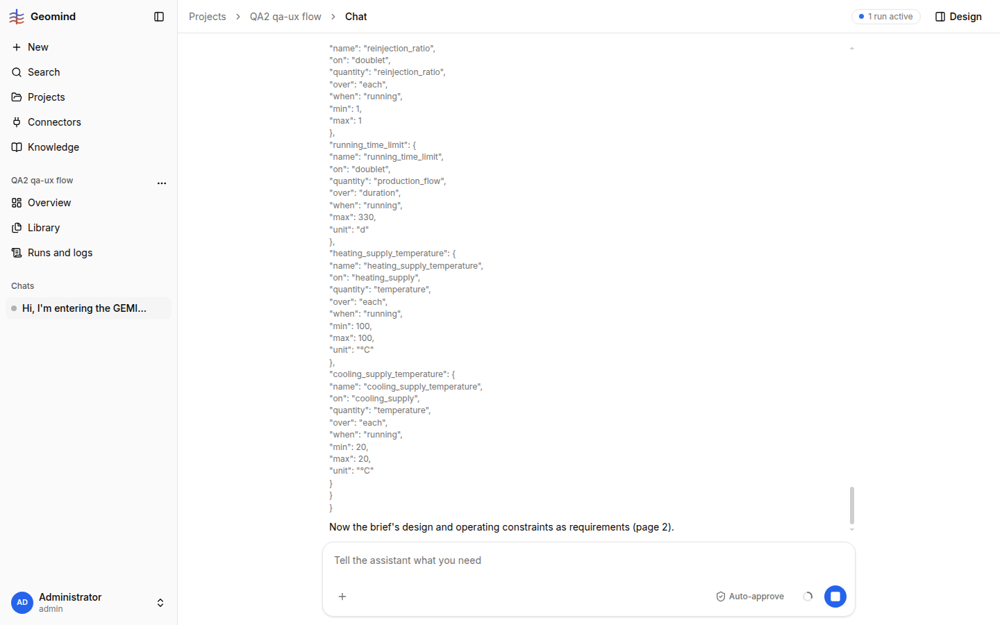

# QA-058: Chat: an Approve or Deny (with its reason) leaves no trace in the transcript; the card just vanishes

| Field | Value |
|---|---|
| Status | fixing |
| Severity | minor |
| Area | frontend |
| Reporter | qa-ux |
| Found | 2026-11-04 23:53 UTC |
| Versions | frontend 1.1.50 (per STATUS.md), backend 1.1.53 (health), geomind 0.4.54 |
| Where | https://geomind.team/projects/4cfeab2d-73e3-4299-a1f8-afec3d7e4bae/assistant/chat; project QA2 qa-ux flow; first chat; two set_case approvals |
| Fixer | hotfix-front |

## Steps

1. Run a chat until an Approval needed card appears (set_case).
2. Click Approve on the first card; on the second type a Reason (optional) and click Deny.
3. Read the chat afterwards (and `get text` of the page).

## Expected

A line in the transcript for each decision, for example "You approved set_case" or "You denied set_case: <reason>", so the user (and anyone reading the chat later) sees what was decided.

## Actual

The card disappears at once. No line shows approved or denied, and the reason text I typed appears nowhere in the chat. Page text has no "approved"/"denied" entry. (The agent did act on the reason: it replied with a table.) Compare QA-005, where the economics answer was labelled "You answered".

## Evidence

- 
- Run JSON: `../evidence/QA-058/run-<id>.json`

## Cause

(Facts, or a guess marked as one.)

## Fix

(Hotfix session: cause, commit, version, deployed at.)

## Retest

(Who, when, result.)
