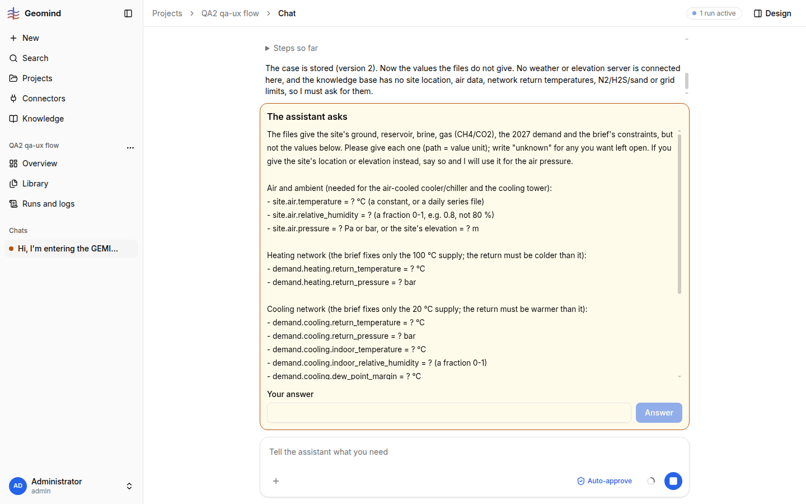

# QA-059: Question card: a 15-value questionnaire gets a one-line text input; no per-value fields, no multiline

| Field | Value |
|---|---|
| Status | open |
| Severity | minor |
| Area | frontend |
| Reporter | qa-ux |
| Found | 2026-11-05 00:03 UTC |
| Versions | frontend 1.1.50 (per STATUS.md), backend 1.1.53 (health), geomind 0.4.54 |
| Where | https://geomind.team/projects/4cfeab2d-73e3-4299-a1f8-afec3d7e4bae/assistant/chat; project QA2 qa-ux flow; first chat; case lead's ask_user after the set_case approvals |
| Fixer | |

## Steps

1. New project, attach the PDF and the two CSVs, ask the assistant to set up the case; approve the set_case cards.
2. Wait for the card "The assistant asks".
3. Look at the answer field (DOM: `INPUT`, height 36 px).

## Expected

For a question that lists about 15 `path = ? unit` values, a multiline field (textarea) that can hold a list, or one field per value with its unit and an 'unknown' option, and the question text kept in view while answering.

## Actual

The card lists 16 values (site.air.*, demand.heating/cooling.*, site.fluid.*, utilities.electricity.*) and offers one single-line `<input>` ("Your answer") with an Answer button. The user must type all values on one line (Enter cannot make a new line), while the question scrolls inside a box of fixed height. Related: QA-005 (wall of text), verified for the economics question only.
Also seen once on this card: a red "Request validation failed" under the empty answer box before I typed anything (screenshot 2); it was gone after a reload. Possibly the same family as QA-044; not reproduced yet.

## Evidence

- 
- Run JSON: `../evidence/QA-059/run-<id>.json`

## Cause

(Facts, or a guess marked as one.)

## Fix

(Hotfix session: cause, commit, version, deployed at.)

## Retest

(Who, when, result.)
