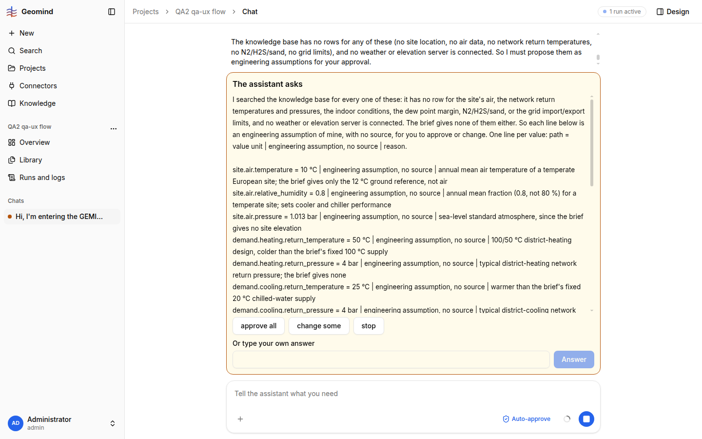

# QA-061: Question card shows an internal note: 'Already answered in this run, not asked again: ... (request-530)'

| Field | Value |
|---|---|
| Status | fixed |
| Severity | minor |
| Area | geomind |
| Reporter | qa-ux |
| Found | 2026-11-05 00:05 UTC |
| Versions | frontend 1.1.5x, backend 1.1.55 (health 00:04 UTC), geomind 0.4.54 |
| Where | https://geomind.team/projects/4cfeab2d-73e3-4299-a1f8-afec3d7e4bae/assistant/chat/159de1e5-d65d-4031-946d-86046aefcaaa; project QA2 qa-ux flow; second ask_user card of the first run |
| Fixer | hotfix-python |

## Steps

1. In a new chat, send the PDF and CSVs and ask for the case; approve the cards.
2. Answer the first long question with "I don't know these ... propose them with sources".
3. Read the text of the next 'The assistant asks' card to its end.

## Expected

The card holds only what the user must decide.

## Actual

After 'Approve all, change some, or stop?' the card text ends with: `Already answered in this run, not asked again: site.air.relative_humidity (request-530): "I don't know these; ...".` That is a note meant for the agent (a request id, a repeat guard), shown to the user and quoting their own answer back. (Found in the page text of the card; I did not scroll to it on screen.)
Also seen: this agent asked for 15 values as "engineering assumption, no source" although I asked for sourced values; for qa-func-1 to judge.

## Evidence

- 
- Run JSON: `../evidence/QA-061/run-<id>.json`

## Cause

Guess: the ask_user tool appends the 'already answered' guard text to the question and the frontend prints the whole question.

## Fix

(Hotfix session: cause, commit, version, deployed at.)
- 2026-11-05 00:23 UTC: geomind 0.4.60 (c9fdb22, no internal already-answered note in the question; only-path questions get one plain line), backend 1.1.61 (3d2aa31), deployed
## Retest

(Who, when, result.)
