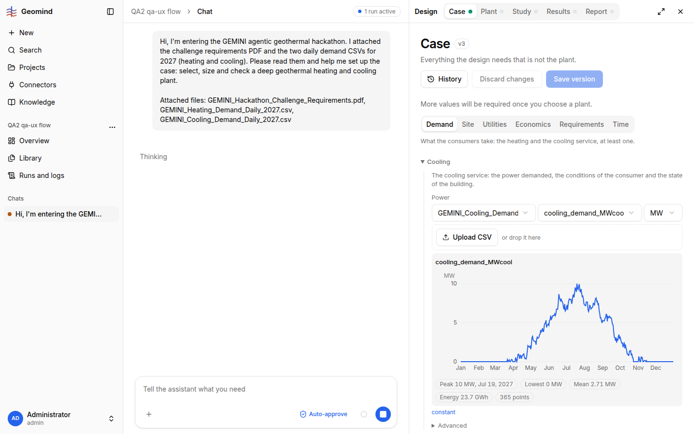

# QA-062: Chat opened (or reloaded) during a run shows the top of the transcript and 'Thinking'; the pending question card is not in view

| Field | Value |
|---|---|
| Status | fixing |
| Severity | minor |
| Area | frontend |
| Reporter | qa-ux |
| Found | 2026-11-05 00:08 UTC |
| Versions | frontend 1.1.5x, backend 1.1.55 (health), geomind 0.4.54 |
| Where | https://geomind.team/projects/4cfeab2d-73e3-4299-a1f8-afec3d7e4bae/design/case?chat=159de1e5-d65d-4031-946d-86046aefcaaa; project QA2 qa-ux flow; first chat, run waiting for an economics answer |
| Fixer | hotfix-front |

## Steps

1. Start a run that reaches a question card (ask_user) and leave the chat (open Library, then the Design link).
2. Open the chat again (or reload while the run waits).

## Expected

The chat scrolls to the newest content: the pending question or approval card is visible, as it is when the card arrives live.

## Actual

The chat shows the first user message and the word 'Thinking' (screenshot 1). The card the run waits for is far below and needs a scroll (screenshot 2 shows it after I scrolled it into view). The sidebar says 'needs your input', so a user who reads 'Thinking' may wait for nothing. Same in the full-width chat page after a reload.

## Evidence

- 
- Run JSON: `../evidence/QA-062/run-<id>.json`

## Cause

(Facts, or a guess marked as one.)

## Fix

(Hotfix session: cause, commit, version, deployed at.)

## Retest

(Who, when, result.)
