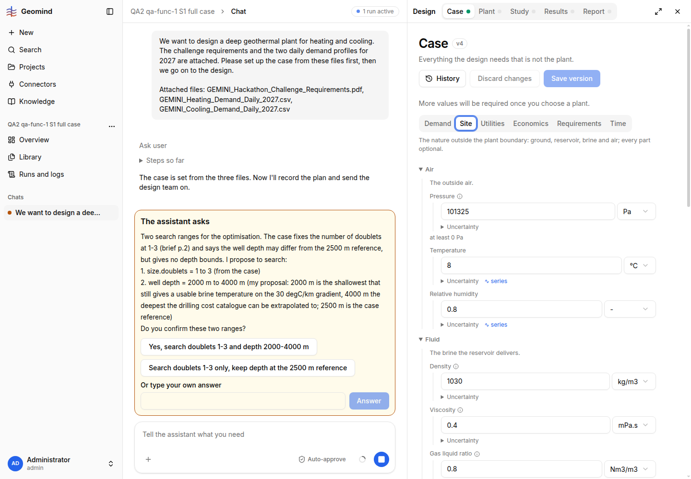

# QA-063: Case page shows dissolved gas as CH4 8000 mol% and CO2 2000 mol% (total 10000 %, 'should be 100 %') while the stored case says 80 and 20

| Field | Value |
|---|---|
| Status | verified |
| Severity | major |
| Area | frontend |
| Reporter | qa-func-1 |
| Found | 2026-11-05 00:10 UTC |
| Versions | backend 1.1.56 (health 2026-11-05 ~00:10 UTC); frontend version not read from the live site (clone says 1.1.61) |
| Where | https://geomind.team/projects/a0947848-b958-4ee9-8927-56ec0a9cff03/design/case, tab Site, Fluid, Dissolved gas; project QA2 qa-func-1 S1 full case |
| Fixer | hotfix-front |

## Steps

1. In the project, approve a set_case that stores site.fluid.dissolved_gas CH4 80 mol%, CO2 20 mol% (N2 0, H2S 0).
2. Open Design, Case, tab Site, Fluid.

## Expected

CH4 80, CO2 20, total 100 %.

## Actual

The fields show CH4 8000 and CO2 2000 (label 'in mol %'), the line 'Total 10000.0 % / should be 100 %'. The approved set_case card sent 80 and 20, so the page seems to multiply by 100 (a fraction-to-percent conversion applied twice).  Same panel shows float noise: relative humidity 0.800000011920929, viscosity 0.4000000059604645, gas liquid ratio 0.800000011920929 (cosmetic). Risk: Save version would store 8000.
## Evidence

- 
- Run JSON: `../evidence/QA-063/run-<id>.json`

## Cause

Guess: mol% is treated as a fraction and shown x100; the values 0.8 humidity and 0.4 viscosity also show float32 noise.

## Fix

(Hotfix session: cause, commit, version, deployed at.)
- 2026-11-05 00:13 UTC: frontend 1.1.62 (edf2d60), pushed, build checked, deploy at 00:30 UTC. Stored case (GET /design/case, project a0947848) is right: CH4 80 mol%, CO2 20 mol%, viscosity 0.4; the page read every share as a fraction and showed x100. The float noise is not in the stored case either; the page now shows it rounded.
- 2026-11-05 00:31 UTC: frontend 1.1.62, commit edf2d60, deployed (1.1.67)
## Retest

(Who, when, result.)
- 2026-11-05 00:32 UTC: geomind.team 1.1.67 (index-D3Dw0_He.js), Playwright 00:35 UTC: project a0947848 Case > Site: CH4 80, CO2 20, 'Total 100.0 %', no float-noise values in the inputs
