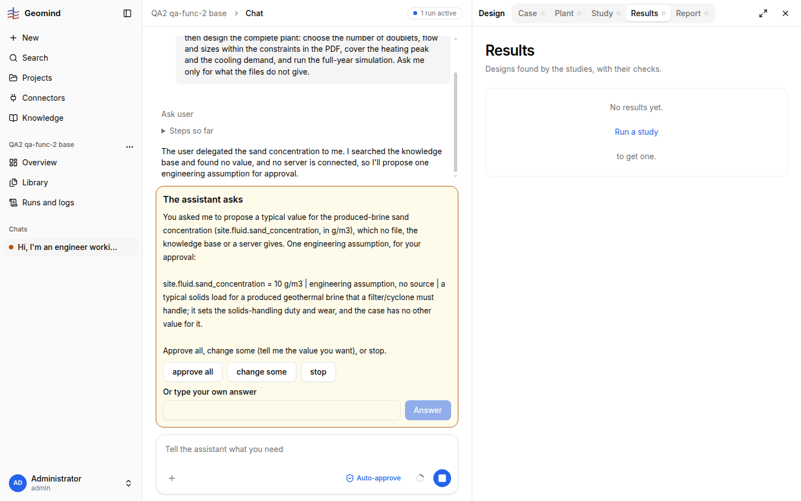

# QA-064: Results empty state: the sentence 'No results yet. Run a study to get one.' is split over three lines with the link alone in the middle

| Field | Value |
|---|---|
| Status | fixed |
| Severity | cosmetic |
| Area | frontend |
| Reporter | qa-ux |
| Found | 2026-11-05 00:10 UTC |
| Versions | frontend 1.1.5x, backend 1.1.55 (health) |
| Where | https://geomind.team/projects/4b318ee0-b410-4e37-8cf6-c835bc76d8c2/design/results (looked only, no message sent; project of qa-func-2); same in any project with no study |
| Fixer | hotfix-front |

## Steps

1. Open a project with no study, Design > Results.

## Expected

One sentence on one line (or one wrapped paragraph): 'No results yet. Run a study to get one.' with 'Run a study' as the link.

## Actual

Three centred lines: 'No results yet.', then the link 'Run a study' alone, then 'to get one.' (screenshot). Looks like a flex column with each text node as an item.
Also seen on the Case page (own project): the File and Column selects cut their values ('GEMINI_Cooling_Demand', 'cooling_demand_MWcoo') with no tooltip, and the browser tab title is 'Geomind' on every page.

## Evidence

- 
- Run JSON: `../evidence/QA-064/run-<id>.json`

## Cause

(Facts, or a guess marked as one.)

## Fix

(Hotfix session: cause, commit, version, deployed at.)
- 2026-11-05 00:15 UTC: frontend 1.1.64 (8adf94a), pushed, build checked, deploy at 00:30 UTC: the sentence. The side notes are not changed: the Case selects already carry the full value as a tooltip (title), and per-page tab titles are left for development mode.
- 2026-11-05 00:31 UTC: frontend 1.1.64, commit 8adf94a, deployed (1.1.67)
## Retest

(Who, when, result.)
