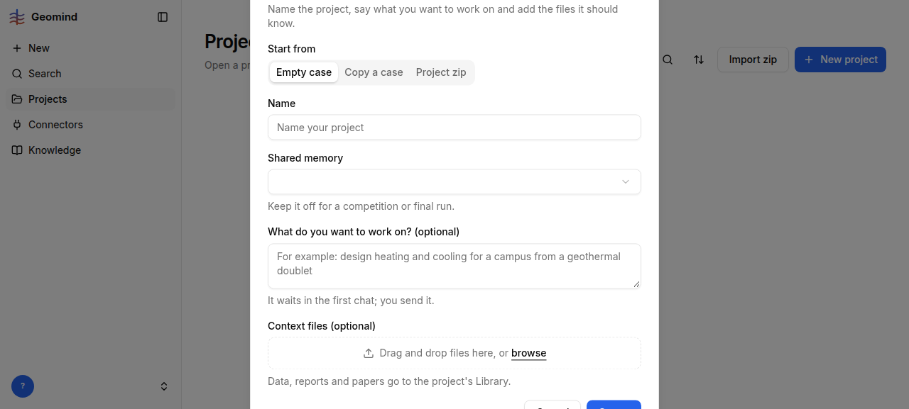

# QA-066: New project dialog is taller than a 577 px window and cannot scroll: title and Create/Cancel buttons are cut off

| Field | Value |
|---|---|
| Status | open |
| Severity | minor |
| Area | frontend |
| Reporter | qa-ux |
| Found | 2026-11-05 00:11 UTC |
| Versions | frontend 1.1.5x, backend 1.1.55 (health) |
| Where | https://geomind.team/projects, button New project |
| Fixer | |

## Steps

1. Sign in; set the window to 1280x577 (a laptop with a toolbar, or browser zoom 125-150 %).
2. Projects > New project.

## Expected

The dialog fits the window or scrolls inside it; title and the Create/Cancel buttons are always reachable. (At 1440x900 and 390x844 it fits.)

## Actual

Measured with the dialog open: height 671 px, top -48 px, bottom 625 px in a 577 px window; `overflow-y: visible`, so no scrollbar and the page does not scroll. The title 'New project' is above the screen and the Create/Cancel buttons are half cut at the bottom (screenshot). My first click on Create at this size closed the dialog without creating the project.

## Evidence

- 
- Run JSON: `../evidence/QA-066/run-<id>.json`

## Cause

(Facts, or a guess marked as one.)

## Fix

(Hotfix session: cause, commit, version, deployed at.)

## Retest

(Who, when, result.)
