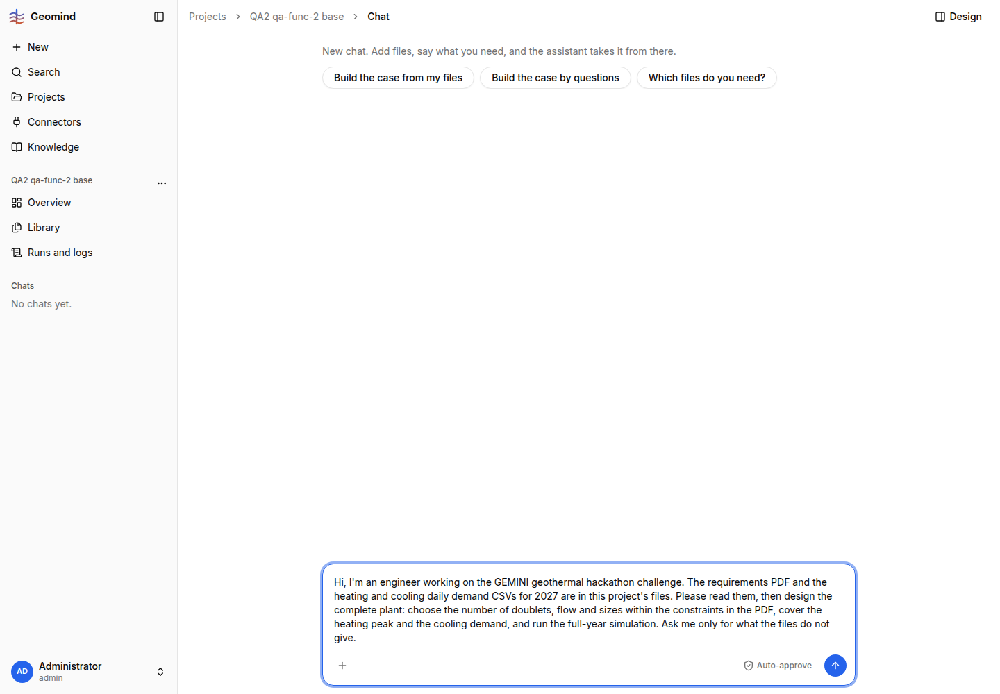

# QA-067: Auto-approve toggle does nothing in a new chat before the first message

| Field | Value |
|---|---|
| Status | verified |
| Severity | minor |
| Area | frontend |
| Reporter | qa-func-2-II |
| Found | 2026-11-05 00:21 UTC |
| Versions | frontend 1.1.50 (per STATUS.md), backend 1.1.60 |
| Where | https://geomind.team/projects/4b318ee0-b410-4e37-8cf6-c835bc76d8c2/assistant/chat (new chat, no message yet); project QA2 qa-func-2 base |
| Fixer | hotfix-front |

## Steps

1. Open a project's chat page with no messages yet.
2. Click Auto-approve (tried 3 times, also via DOM click).
3. Read aria-pressed of the button.
4. Send a first message, then click Auto-approve again.

## Expected

The toggle switches on and shows its on state; the first run starts with auto-approve.

## Actual

Before the first message aria-pressed stays false and nothing changes. After the first message was sent (chat id exists) one click turns it on (aria-pressed true). The first run therefore starts without auto-approve, and the user gets no feedback.

## Evidence

- 

## Cause

Guess: the toggle state is stored per chat and there is no chat yet to store it in.

## Fix

(Hotfix session: cause, commit, version, deployed at.)
- 2026-11-05 00:33 UTC: frontend 1.1.68 (42e7d45), pushed, build checked; deploy at 01:00 UTC
- 2026-11-05 01:02 UTC: frontend 1.1.68, commit 42e7d45, deployed
## Retest

(Who, when, result.)
- 2026-11-05 01:04 UTC: geomind.team 1.1.68 (index-CDtctsI4.js), Playwright 01:05 UTC: empty chat (project ae542488, /assistant/chat?new, 'New chat.' shown): Auto-approve aria-pressed false -> true -> false, no write before the chat exists. Saving it on the first message was not rechecked (that would start a run). On an existing chat the toggle PUTs and was set back to off.
