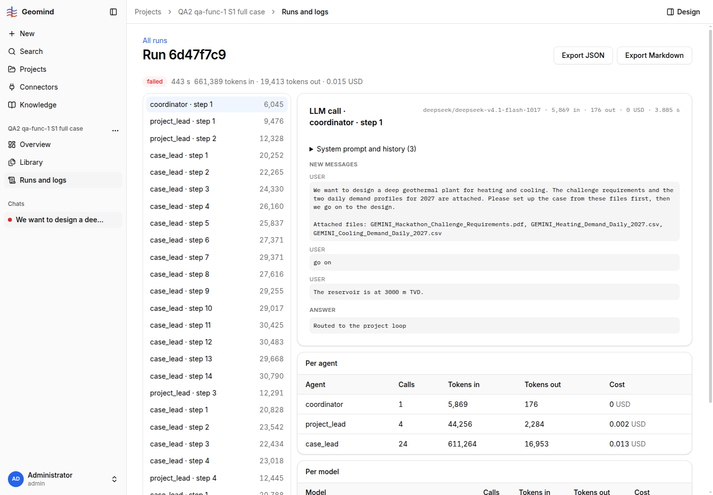

# QA-068: OpenRouter API key limit reached (403 'Key limit exceeded', 10 USD of 10 USD used): every agent run fails; the chat shows only 'internal error in geomind'

| Field | Value |
|---|---|
| Status | open |
| Severity | blocker |
| Area | infra |
| Reporter | qa-func-1 |
| Found | 2026-11-05 00:24 UTC |
| Versions | backend 1.1.61 (health 2026-11-05 00:30 UTC), frontend 1.1.61 clone |
| Where | https://geomind.team/projects/a0947848-b958-4ee9-8927-56ec0a9cff03/assistant/runs/6d47f7c9-db08-42da-aa66-f9c212991e41; project QA2 qa-func-1 S1 full case; chat 235c60c5-da86-4f21-9257-e21a6e400697; run 6d47f7c9 |
| Fixer | |

## Steps

1. Answer a question card in the chat (after the 00:22 UTC restart).
2. The run fails after the next LLM call.

## Expected

Runs go on; if the provider key is exhausted, the chat says so (key limit reached) and the operator is warned.

## Actual

Run log: 'OpenRouter: status = 403; Key limit exceeded (total limit) ... $10.00 of $10.00 used; does not reset' (limit_source openrouter_key_limit, limit_usd 10, spend 10.0014). The chat shows 'The assistant stopped with an internal error in geomind'. All sessions' new runs will fail until the key limit is raised. Run JSON in evidence. Also seen in the same run: set_case tried site.reservoir.pressure.hydrostatic, refused with unknown_name (no such key) - the agent invented a key for 'hydrostatic rule'.
## Evidence

- 
- Run JSON: `../evidence/QA-068/run-<id>.json`

## Cause

Fact: the OpenRouter key has a total cap of 10 USD that does not reset. Chat text is the generic internal error, not the provider message.

## Fix

(Hotfix session: cause, commit, version, deployed at.)

## Retest

(Who, when, result.)
